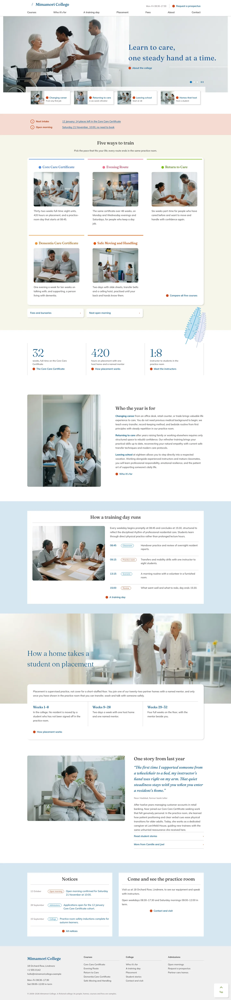

# Mimamori College

A WordPress block theme for a caregiver training college that teaches career-changers, returners and school leavers. Calm white ground, Fraunces headings and Mulish text, with a documentary photograph that cross-fades between three practice-room scenes.

## Signature techniques
1. **Gateway strip biting an inset photo**: a 1400:473 photograph (three slides, 1 s cross-fade, dots and a pause button, 6% parallax) with a translucent strip of four audience tiles overlapping its lower edge.
2. **One white sheet of five courses**: each cell has its own 3 px coloured rule and round dot; the sixth slot is left open for a link.
3. **A feather across a seam**: a hand-drawn two-quill SVG straddles the cream/white seam above a three-column figures row split by hairline rules (counted-up numbers).

## Pages
Home, Courses, Who it’s for, A training day, Placement, Fees, About, Contact, Student stories. The demo importer creates them and the main menu (`demo-content.json`).

## Notes
- Photographs are AI-generated, one shared style; all fictional people and places (Lindmere, Larchfield House, ...).
- Motion uses the bundled sp-scroll helpers; everything is static under `prefers-reduced-motion` and `?sp-static`.
- Fonts are bundled (OFL, see `assets/fonts`). The hero pause button reads its labels from `data-pause` / `data-play` so they can be translated.
- Languages: English only so far; further languages follow in later releases.

<!-- screenshots:start -->
## Screenshots

<table>
<tr>
<td valign="top"></td>
<td valign="top"></td>
</tr>
</table>

- About: [desktop](screenshots/about-desktop.webp) · [mobile](screenshots/about-mobile.webp)
- News: [desktop](screenshots/news-desktop.webp) · [mobile](screenshots/news-mobile.webp)
- Article: [desktop](screenshots/article-desktop.webp) · [mobile](screenshots/article-mobile.webp)
- Category: [desktop](screenshots/category-desktop.webp) · [mobile](screenshots/category-mobile.webp)
- Tag: [desktop](screenshots/tag-desktop.webp) · [mobile](screenshots/tag-mobile.webp)
- Newsletter: [desktop](screenshots/newsletter-desktop.webp) · [mobile](screenshots/newsletter-mobile.webp)
- Contact: [desktop](screenshots/contact-desktop.webp) · [mobile](screenshots/contact-mobile.webp)
- Other languages (home page): [zh-TW](screenshots/zh-TW/home-desktop.webp) · [ja](screenshots/ja/home-desktop.webp) · [fr](screenshots/fr/home-desktop.webp) · [de](screenshots/de/home-desktop.webp)
<!-- screenshots:end -->
