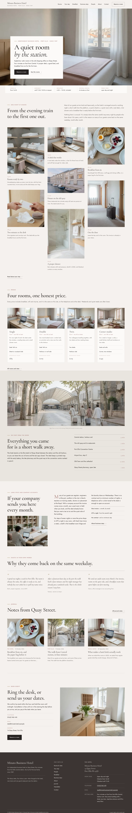

# Minato Business Hotel

A calm, photograph-led block theme for an **independent business hotel** near a railway station: rooms for people who travel for work, breakfast from six, company accounts and long stays.

The demo hotel is fictional: opened in 1987 by Arthur Penrose, a former ship's engineer, in the old shipping-line office at 14 Quay Street, Port Ellis, four minutes from Central station, and run today by his daughter Helen Penrose with Daniel Okafor (night desk), Marta Kowalska (breakfast) and Sofia Lind (housekeeping). The whole brand (people, place, tone, a day at the hotel) is written down in [`brand.md`](brand.md); every page's copy comes from it. Type: hospitality. Sample content in English, Traditional Chinese (zh-TW), Japanese, French and German. Built to the quality gate in ROADMAP §4 (rule 0) and `rules.quality_gate` in design-plan.json (row b6-5).

## Concept: a quiet room by the station

- **Palette.** Linen white `#F5F2EE` ground, stone `#EAE5DF` panels, paper `#FBFAF8` fields, ink `#262120` text, quiet ink `#655D5A` secondary text, warm charcoal `#3B3533` for the one dark band and the footer, and a single suo rose `#9E6B68` for labels, links and prices. Oak `#A8916F` appears only as short rules. The photographs carry the colour; the first screen stays well below 15 % saturated pixels.
- **Type.** Cormorant (display, roman and italic) up to 4.75 rem over Jost (text). Both OFL-1.1 without a Reserved Font Name, subset to Latin WOFF2.
- **Photographs.** 17 high-key photographs generated with one shared style string (28 mm, bright soft daylight, white linen, pale oak, warm stone greys, a faint dusty rose). Rooms, lobby, breakfast, the street to the station, the harbour at dusk, hands at the desk and three calm portraits. No cut-outs, no illustrations.

## Front page (1.1.0)

1. **The room at first light**: a full-height photograph of a quiet double room; the headline "A quiet room *by the station.*", a short paragraph and two links on a paper card over its lower left corner. No booking search on the first screen.
2. **Arrival strip**: check-in, checkout, breakfast hours, minutes from the station and the front desk in one ruled line (information, not a form).
3. **One night at Minato**: two narrative paragraphs, then seven photographs of different heights in a masonry, each with a time (14.00 to 06.40), a title and a line.
4. **Four rooms, one honest price**: four room cards side by side with a photograph, who the room suits, size, desk, view and the price from.
5. **On foot from the door**: a wide photograph of the street from the station, a paragraph on the neighbourhood and walking minutes to six places.
6. **Long stays and company accounts**: an essay in two columns with three plain terms, beside a small photograph of the lounge.
7. **Guests in their own words**: three quotations in ruled columns.
8. **Journal** (latest three) and **Book direct**: the lobby photograph with telephone, email and address.

## Languages

The sample content and every word the theme itself shows come in **en, zh-TW, ja, fr and de**, using the mechanism of Hokuto Driving School 1.1.0: the shared importer picks the language (`shippress_demo_lang`, else the site language) and imports `demo-content.<lang>.json`; patterns print their words through `minato_business_hotel_t( 'key' )` from `inc/i18n/<lang>.php` (English fallback, `inc/i18n.php`), and the synced hotel card starts from `inc/info/<lang>/office.html`.

The copy is localised, not translated: the hotel and people keep the brand (Helen, Daniel, Marta, Sofia, Quay Street, Port Ellis), while the wording of rooms, breakfast, invoices and travel follows each country (a Taiwanese business hotel, a Japanese business hotel, a French hôtel d'affaires, a German Businesshotel).

- **Type.** zh-TW headings use a bundled subset of Noto Serif TC (Regular), ja headings a bundled subset of Noto Serif JP (Regular), built with fontTools from exactly the characters of that language's sample text; Latin letters and figures stay in Cormorant. CJK headings run at about three quarters of the English sizes, body line height 1.85, no italics.
- **German and French** paragraphs hyphenate (`hyphens: auto`).

## One source for shared details

The hotel details (address, front desk, telephone, email, getting here) are one synced pattern created on activation from `inc/info/<lang>/office.html`; the footer, Rooms & rates and Contact only reference it.

## Pages and templates

Home, Rooms & rates, Your stay, People, Breakfast, Business stays, About, Journal, Newsletter, Contact; six posts in three categories (The hotel, Port Ellis, Travel notes). Templates: front page, page, wide page, single, archive, category, tag, home (posts), search, 404.

## Licence

GPL-2.0-or-later. Fonts OFL-1.1 (see `assets/fonts/`). Photographs AI-generated for this theme, released under GPL-2.0-or-later / CC0. All names, the city, the address, telephone numbers and prices are fictional.

<!-- screenshots:start -->
## Screenshots

<table>
<tr>
<td valign="top"></td>
<td valign="top"></td>
</tr>
</table>

- Rooms: [desktop](screenshots/rooms-desktop.webp) · [mobile](screenshots/rooms-mobile.webp)
- Your stay: [desktop](screenshots/your-stay-desktop.webp) · [mobile](screenshots/your-stay-mobile.webp)
- People: [desktop](screenshots/people-desktop.webp) · [mobile](screenshots/people-mobile.webp)
- Breakfast: [desktop](screenshots/breakfast-desktop.webp) · [mobile](screenshots/breakfast-mobile.webp)
- Business: [desktop](screenshots/business-desktop.webp) · [mobile](screenshots/business-mobile.webp)
- About: [desktop](screenshots/about-desktop.webp) · [mobile](screenshots/about-mobile.webp)
- News: [desktop](screenshots/news-desktop.webp) · [mobile](screenshots/news-mobile.webp)
- Article: [desktop](screenshots/article-desktop.webp) · [mobile](screenshots/article-mobile.webp)
- Category: [desktop](screenshots/category-desktop.webp) · [mobile](screenshots/category-mobile.webp)
- Tag: [desktop](screenshots/tag-desktop.webp) · [mobile](screenshots/tag-mobile.webp)
- Newsletter: [desktop](screenshots/newsletter-desktop.webp) · [mobile](screenshots/newsletter-mobile.webp)
- Contact: [desktop](screenshots/contact-desktop.webp) · [mobile](screenshots/contact-mobile.webp)
- Search: [desktop](screenshots/search-desktop.webp) · [mobile](screenshots/search-mobile.webp)
- Other languages (home page): [zh-TW](screenshots/zh-TW/home-desktop.webp) · [ja](screenshots/ja/home-desktop.webp) · [fr](screenshots/fr/home-desktop.webp) · [de](screenshots/de/home-desktop.webp)
<!-- screenshots:end -->
