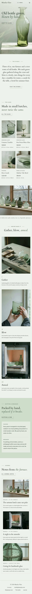

# Mizuha Glass

A serene, sculptural block theme for a **small glass studio** and its online shop. A ShipPress **store** theme: WooCommerce templates styled to match, eight sample products in four categories, and a shop that still works without WooCommerce.

The demo studio is fictional: three makers (Noe Kanemura, Teo Arashiro, Rin Okabe) in an old net-mending shed in Usuzawa, a quiet river-mouth town, blowing and kiln-forming tableware from the town's old green bottles.

## Concept: light through bottle green

- **Palette.** Mist `#EEF2EC` pages, sage glass `#CFDCCB` panels, deep ink `#233026` text (12.2:1 on mist) and a bottle-green accent `#6E8B6A`, plus pale mist `#F6F8F4` cards and a glass-edge hairline `#B4C5AF`. Bottle green (3.3:1) is kept to large marks and rules; links and small labels use deep bottle green `#46604A` (6.1:1 on mist, 4.9:1 on sage), secondary text quiet green-grey `#4F5D53` (6.1:1 on mist, 4.9:1 on sage). Buttons are ink with mist text.
- **Type.** Cardo (display, its italic for soft accents; prices in lining figures) and Source Sans 3 (text, labels in spaced capitals).
- **Refraction highlights.** Product cells, photo frames and journal pictures carry a soft diagonal light streak and a faint caustic glow, layered CSS linear and radial gradients on a pseudo-element (pointer-events none, soft-light blend). The streak drifts a little on hover; still for `prefers-reduced-motion`. Cards and frames have a thin glass edge: a 1px sage hairline with a lighter inner line.
- **Size line on every product**, read from the product's `Size` attribute (one source, edited in the product editor).

## Header, footer, layout (ROADMAP codes)

- **H8 transparent header.** On the home page the header (Cardo wordmark, core navigation, account and mini cart when WooCommerce is active) lies transparent over the full-bleed photograph with a faint mist scrim at the top, and turns solid mist with a hairline as the page scrolls (CSS scroll timeline; `assets/js/header.js` for other browsers; solid at once for reduced motion). Inner pages start solid. Phones: wordmark, a quiet "Menu" and the cart on one line.
- **F3 one-line footer.** One centred line on mist: copyright, the town and email (read from the synced studio card), Shipping & care, The studio, Journal. On phones it stacks into centred lines.
- **L1 full-bleed photograph + long pauses.** The backlit vessel under the header with a short headline and one quiet link; then, with very generous space between: the studio idea in one paragraph, a shelf of four pieces, a second full-bleed photograph with a one-line caption, how we make it (gather, blow, anneal), the shipping promise and the latest journal.

## One source for shared details

| What | Source | Shown on |
| --- | --- | --- |
| Studio address, showroom hours, telephone, email | `inc/info/studio.html` (synced pattern) | Footer line (town + email), The studio, Contact |
| Packing, breakage promise, delivery, returns | `inc/info/policy.html` (synced pattern) | Home (short form), Shipping & care (full), every product page (breakage + delivery) |
| Size line | each product's `Size` attribute | Product cards and product page |

## Pages and templates

Demo pages: Home, Shop, The studio (makers, the furnace, recycled glass, visit the showroom), Shipping & care (the synced policy, caring for handmade glass), Journal (posts page), Newsletter and Contact. Six sample posts in three categories (At the furnace, Glass at the table, Notes from Usuzawa) with six tags.

Templates: front page, page, wide page, single post, journal, archive, category, tag, search, 404, plus WooCommerce shop, product category and tag archives, product, cart, checkout, my account, order confirmation and product search.

## WooCommerce

Optional. With it active, `inc/woo-import.php` adds four product categories (Drinking glass, Pouring, Bowls & plates, Vases), six tags and eight products with photographs, prices and attributes (size, glass, care); run twice it creates nothing new. Without it the home shelf and the Shop page show a static shelf that links to Contact, and orders go by email.

## Licence

GPL-2.0-or-later. Fonts OFL-1.1 (see `assets/fonts/`): Cardo subset to Latin (no Reserved Font Name); Source Sans 3 shipped unmodified (Reserved Font Name "Source"). Photographs AI-generated for this theme, released under GPL-2.0-or-later / CC0.

<!-- screenshots:start -->
## Screenshots

<table>
<tr>
<td valign="top"></td>
<td valign="top"></td>
</tr>
</table>

- Shop: [desktop](screenshots/shop-desktop.webp) · [mobile](screenshots/shop-mobile.webp)
- Product: [desktop](screenshots/product-desktop.webp) · [mobile](screenshots/product-mobile.webp)
- About: [desktop](screenshots/about-desktop.webp) · [mobile](screenshots/about-mobile.webp)
- Shipping and care: [desktop](screenshots/shipping-and-care-desktop.webp) · [mobile](screenshots/shipping-and-care-mobile.webp)
- Contact: [desktop](screenshots/contact-desktop.webp) · [mobile](screenshots/contact-mobile.webp)
- News: [desktop](screenshots/news-desktop.webp) · [mobile](screenshots/news-mobile.webp)
- Article: [desktop](screenshots/article-desktop.webp) · [mobile](screenshots/article-mobile.webp)
- Category: [desktop](screenshots/category-desktop.webp) · [mobile](screenshots/category-mobile.webp)
- Tag: [desktop](screenshots/tag-desktop.webp) · [mobile](screenshots/tag-mobile.webp)
- Newsletter: [desktop](screenshots/newsletter-desktop.webp) · [mobile](screenshots/newsletter-mobile.webp)
- Search: [desktop](screenshots/search-desktop.webp) · [mobile](screenshots/search-mobile.webp)
<!-- screenshots:end -->
