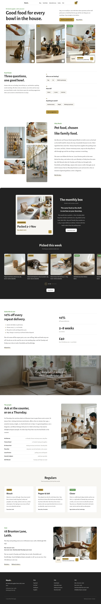

# Mochi Pet Supply

Mochi Pet Supply is a neighbourhood pet-food and supplies shop in Leith, Edinburgh, founded in 2017 and selling online across the UK in pounds. The site starts with three questions — species, age, and one thing to watch — then shows the food and a subscribe-and-save price at 10% off repeat deliveries. Shop, product, cart, checkout, account and order-received pages are set up for WooCommerce and still read as ordinary pages without it.

## Design
A white ground with ink and one muted mustard accent (#B8973F) on small areas only. Alegreya Sans for headings and prices, Alegreya for text (both OFL, bundled). Signature moves: a floating pill header with a mustard basket square and a "next dispatch" chip, a staggered two-column photo mosaic, and a rounded-top ink band with a scroll-snap strip of square product cards. Every photograph is generated from one style string; no cut-outs.

## Structure
- `patterns/front-*.php`: the nine home sections (hero, finder, concept, box, subscribe, interlude, desk, stories, visit); `patterns/head-cart.php`: the header cart square.
- `parts/`: floating pill header (collapses to a full-screen menu below 960px; the basket links to the WooCommerce cart, or to `/shop/` without it) and ink footer. `templates/`: front page, page, index, home, archive, search, tag, single, 404, plus WooCommerce archive-product and single-product.
- `assets/sp-scroll.css|js`: ShipPress scroll effects (fade-up, stagger, parallax). `assets/images/demo/`: AI-generated photographs (GPL-2.0-or-later / CC0).

Design notes: `brand.md`, `brand/design-spec.md`, `brand/reference.md`.

License: GPL-2.0-or-later.

<!-- screenshots:start -->
## Screenshots

<table>
<tr>
<td valign="top"></td>
<td valign="top"></td>
</tr>
</table>

- Shop: [desktop](screenshots/shop-desktop.webp) · [mobile](screenshots/shop-mobile.webp)
- Product: [desktop](screenshots/product-desktop.webp) · [mobile](screenshots/product-mobile.webp)
- Food finder: [desktop](screenshots/food-finder-desktop.webp) · [mobile](screenshots/food-finder-mobile.webp)
- Subscribe and save: [desktop](screenshots/subscribe-and-save-desktop.webp) · [mobile](screenshots/subscribe-and-save-mobile.webp)
- About: [desktop](screenshots/about-desktop.webp) · [mobile](screenshots/about-mobile.webp)
- Nutrition desk: [desktop](screenshots/nutrition-desk-desktop.webp) · [mobile](screenshots/nutrition-desk-mobile.webp)
- Feeding guides: [desktop](screenshots/feeding-guides-desktop.webp) · [mobile](screenshots/feeding-guides-mobile.webp)
- Delivery returns: [desktop](screenshots/delivery-returns-desktop.webp) · [mobile](screenshots/delivery-returns-mobile.webp)
- Stories: [desktop](screenshots/stories-desktop.webp) · [mobile](screenshots/stories-mobile.webp)
- Visit: [desktop](screenshots/visit-desktop.webp) · [mobile](screenshots/visit-mobile.webp)
- News: [desktop](screenshots/news-desktop.webp) · [mobile](screenshots/news-mobile.webp)
- Article: [desktop](screenshots/article-desktop.webp) · [mobile](screenshots/article-mobile.webp)
- Category: [desktop](screenshots/category-desktop.webp) · [mobile](screenshots/category-mobile.webp)
- Tag: [desktop](screenshots/tag-desktop.webp) · [mobile](screenshots/tag-mobile.webp)
- Newsletter: [desktop](screenshots/newsletter-desktop.webp) · [mobile](screenshots/newsletter-mobile.webp)
- Contact: [desktop](screenshots/contact-desktop.webp) · [mobile](screenshots/contact-mobile.webp)
- Other languages (home page): [zh-TW](screenshots/zh-TW/home-desktop.webp) · [ja](screenshots/ja/home-desktop.webp) · [fr](screenshots/fr/home-desktop.webp) · [de](screenshots/de/home-desktop.webp)
<!-- screenshots:end -->
