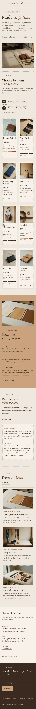

# Nameshi Leather

A quiet, handmade block theme for a **small leather atelier** and its online shop. A ShipPress **store** theme: WooCommerce templates styled to match, eight sample products in three categories, and a shop that still works without WooCommerce.

The demo atelier is fictional: two makers (Hana Arase and Teo Ishida) in a small workshop on Riverside Lane in Kawabe, a quiet riverside district, making vegetable-tanned wallets, bags and belts by hand and repairing them for life. *Nameshi* is the old word for leather before it is finished.

## Concept: stitched seams

- **Palette.** Parchment `#EFE7DD` pages, tan `#C9A27E` panels, ink brown `#3A2A1F` text (11.2:1 on parchment, 5.9:1 on tan) and a saddle accent `#7A5236` (5.6:1 on parchment, but 2.9:1 on tan, so on tan it is used only for rules and marks), plus deep saddle `#4E321F` for links and small text on tan (9.5:1 parchment, 5.0:1 tan), quiet brown `#5E4A3B` for secondary text on parchment (6.8:1) and pale parchment `#F7F2EA` cards. The footer band is ink brown with parchment (11.2:1) and tan links (5.9:1).
- **Type.** Libre Baskerville (display, italic accents, prices in tabular lining figures) and Epilogue (text, labels in spaced capitals).
- **Stitched seams.** Section dividers, the header underline, product cells, cards, care rows and pill outlines are dashed hairlines that read as saddle stitch (CSS repeating gradients and dashed borders); photographs carry a light stitch just inside the edge.
- **Patina strip on every product**: three swatches of the same leather (new · 1 yr · 5 yr) under the price, read from the product's `Patina` attribute, toned by its leather tag (natural, black, indigo).

## Header, footer, layout (ROADMAP codes)

- **H2 centred logo, split navigation.** The Libre Baskerville wordmark sits centred between two tiny dashed stitch marks; the core navigation splits three links left and three right (account and mini cart join the right cluster when WooCommerce is active), on a parchment bar with a stitched seam and a hairline beneath. Below 1180px a Menu button opens the overlay; phones keep Menu, wordmark and cart on one line.
- **F10 split two-tone footer.** Left, the parchment workshop card (the synced address, hours, telephone and email); right, an ink-brown band with the newsletter form and links (Patina guide, Repairs, Journal, Contact). Stacks on phones.
- **L14 filter-first directory.** A compact title block ("Made to patina") with the bench photograph, then straight into the directory: Item and Leather pills over stitched cells (photo, name, leather note, price, patina strip). Works without JavaScript (all pieces show). Then how leather ages (tan band), the synced repair and care promise and the latest journal.

## One source for shared details

| What | Source | Shown on |
| --- | --- | --- |
| Workshop address, hours, telephone, email | `inc/info/atelier.html` (synced pattern) | Footer, The atelier, Repairs, Contact |
| Conditioning, lifetime stitching, repair costs, turnaround | `inc/info/care.html` (synced pattern) | Home (short), Repairs (full), Patina guide (care note), every product page (short) |
| Leather note and patina strip | each product's `Leather` and `Patina` attributes | Product cells and product page |

## Pages and templates

Demo pages: Home, Shop, Patina guide (the patina strip, three leathers, a care note), Repairs (the synced policy, what we can restitch, how to send it), The atelier (makers, vegetable tanning, tools, visit), Journal (posts page), Newsletter and Contact. Six sample posts in three categories (At the bench, Leather & patina, Repairs & care) with six tags.

Templates: front page, page, wide page, single post, journal, archive, category, tag, search, 404, plus WooCommerce shop, product category and tag archives, product, cart, checkout, my account, order confirmation and product search.

## WooCommerce

Optional. With it active, `inc/woo-import.php` adds three product categories, five tags and eight products with photographs, prices and attributes (leather, patina, size); run twice it creates nothing new. Without it the home directory and the Shop page show static cells that link to Contact, and orders go by email.

## Licence

GPL-2.0-or-later. Fonts OFL-1.1 (see `assets/fonts/`): Libre Baskerville shipped unmodified (Reserved Font Name "Libre Baskerville"); Epilogue subset to Latin (no Reserved Font Name). Photographs AI-generated for this theme, released under GPL-2.0-or-later / CC0.

<!-- screenshots:start -->
## Screenshots

<table>
<tr>
<td valign="top"></td>
<td valign="top"></td>
</tr>
</table>

- Shop: [desktop](screenshots/shop-desktop.webp) · [mobile](screenshots/shop-mobile.webp)
- Product: [desktop](screenshots/product-desktop.webp) · [mobile](screenshots/product-mobile.webp)
- About: [desktop](screenshots/about-desktop.webp) · [mobile](screenshots/about-mobile.webp)
- Patina guide: [desktop](screenshots/patina-guide-desktop.webp) · [mobile](screenshots/patina-guide-mobile.webp)
- Repairs: [desktop](screenshots/repairs-desktop.webp) · [mobile](screenshots/repairs-mobile.webp)
- Contact: [desktop](screenshots/contact-desktop.webp) · [mobile](screenshots/contact-mobile.webp)
- News: [desktop](screenshots/news-desktop.webp) · [mobile](screenshots/news-mobile.webp)
- Article: [desktop](screenshots/article-desktop.webp) · [mobile](screenshots/article-mobile.webp)
- Category: [desktop](screenshots/category-desktop.webp) · [mobile](screenshots/category-mobile.webp)
- Tag: [desktop](screenshots/tag-desktop.webp) · [mobile](screenshots/tag-mobile.webp)
- Newsletter: [desktop](screenshots/newsletter-desktop.webp) · [mobile](screenshots/newsletter-mobile.webp)
- Search: [desktop](screenshots/search-desktop.webp) · [mobile](screenshots/search-mobile.webp)
<!-- screenshots:end -->
