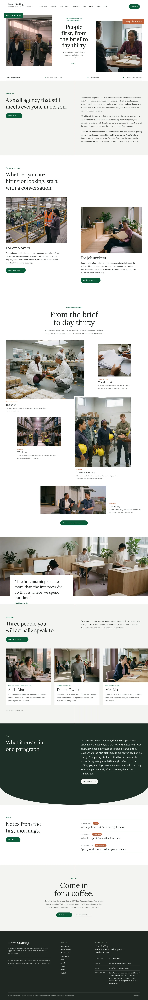

# Nami Staffing

A calm, photograph-led block theme for a **people-first recruitment and staffing agency** that places people in warehouses, clinics, offices and kitchens: two doors for employers and job seekers, the placement from the brief to the day-thirty visit in photographs, the consultants by name and the fees in one plain paragraph.

The demo agency is fictional: Nami Staffing, founded in 2012 by Sofia Marín at 14 Wharf Approach, Leeds, with Daniel Owusu (healthcare and clinics) and Mei Lin (offices and hospitality). See `brand.md`.

## Concept: the placement is finished on day thirty

- **Palette.** White and pale grey bands, ink text, deep field green (#0B5D3A) for one thin centre line, labels and pill buttons, one terracotta (#C0603A) corner label, taken from the Salad Bowl recruit site on S5-Style (see `brand/reference.md`). No match rates, guarantees or client names.
- **Type.** Lora (display) over Nunito Sans (text, labels, navigation).
- **Photographs.** 17 documentary workplace photographs in one 35 mm film-grain style: consultants with job seekers, first mornings, a site visit, an induction, a warehouse shift, a clinic desk, a kitchen and three portraits. Listed in `readme.txt`.
- **Techniques.** Two photographs either side of a narrow centre column with flat corner labels and one thin centre line running down the page with content either side (Salad Bowl recruit); scattered photographs of different sizes and a convex arc edge (Cominka recruit); consultants in a sliding row whose last card runs past the edge.

## Front page

Two photographs around the opening line with an info bar, the agency in three paragraphs, two doors (employers, job seekers), from the brief to day thirty in five scattered photographs, the office in one wide photograph with the founder's words, three consultants, fees in one paragraph, latest notes and a closing invitation.

## Languages

The sample content and every word the theme shows come in **en, zh-TW, ja, fr and de**, using the mechanism of Hokuto Driving School 1.1.0: the shared importer picks the language (`shippress_demo_lang`, else the site language) and imports `demo-content.<lang>.json`; patterns print their words through `nami_staffing_t( 'key' )` from `inc/i18n/<lang>.php` (English fallback), and the synced office card starts from `inc/info/<lang>/office.html`.

The copy is localised, not translated: the agency, its people and Wharf Approach keep the brand, while the service names (permanent recruitment and temporary staffing in each market's own words), sample registration lines and telephone formats follow each language. The fees (15% of first-year base salary for a permanent placement, the worker's pay rate plus a 26% margin for temporary staff) are the same in every language.

- **Type.** zh-TW headings use a bundled subset of Noto Serif TC, ja headings a bundled subset of Noto Serif JP (Regular), built with fontTools from exactly the characters of that language's sample text. CJK headings run at about three quarters of the English sizes, body line height 1.85; on wide screens the opening line in the centre column is set top to bottom (Latin text never is).
- **German and French** paragraphs hyphenate (`hyphens: auto`).

## Pages and templates

Home, For employers, For job seekers, How a placement works, Consultants, Fees, About, Journal, Notes, Contact; six posts in three categories. Templates: front page, page, wide page, single, archive, category, tag, home (posts), search, 404.

<!-- screenshots:start -->
## Screenshots

<table>
<tr>
<td valign="top"></td>
<td valign="top"></td>
</tr>
</table>

- Employers: [desktop](screenshots/employers-desktop.webp) · [mobile](screenshots/employers-mobile.webp)
- Job seekers: [desktop](screenshots/job-seekers-desktop.webp) · [mobile](screenshots/job-seekers-mobile.webp)
- Placement: [desktop](screenshots/placement-desktop.webp) · [mobile](screenshots/placement-mobile.webp)
- Consultants: [desktop](screenshots/consultants-desktop.webp) · [mobile](screenshots/consultants-mobile.webp)
- Fees: [desktop](screenshots/fees-desktop.webp) · [mobile](screenshots/fees-mobile.webp)
- About: [desktop](screenshots/about-desktop.webp) · [mobile](screenshots/about-mobile.webp)
- News: [desktop](screenshots/news-desktop.webp) · [mobile](screenshots/news-mobile.webp)
- Article: [desktop](screenshots/article-desktop.webp) · [mobile](screenshots/article-mobile.webp)
- Category: [desktop](screenshots/category-desktop.webp) · [mobile](screenshots/category-mobile.webp)
- Tag: [desktop](screenshots/tag-desktop.webp) · [mobile](screenshots/tag-mobile.webp)
- Newsletter: [desktop](screenshots/newsletter-desktop.webp) · [mobile](screenshots/newsletter-mobile.webp)
- Contact: [desktop](screenshots/contact-desktop.webp) · [mobile](screenshots/contact-mobile.webp)
- Search: [desktop](screenshots/search-desktop.webp) · [mobile](screenshots/search-mobile.webp)
- Other languages (home page): [zh-TW](screenshots/zh-TW/home-desktop.webp) · [ja](screenshots/ja/home-desktop.webp) · [fr](screenshots/fr/home-desktop.webp) · [de](screenshots/de/home-desktop.webp)
<!-- screenshots:end -->
