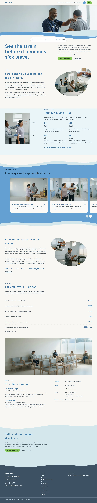
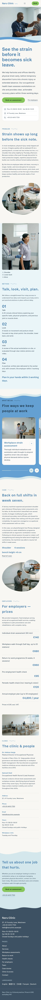

# Naru Clinic

A WordPress block theme for an occupational health clinic (home page plus ten inner pages and one article, English demo content).

- Techniques: three-layer wave band under a full-bleed photo; blob photo pairs with a wavy-line label; blue band with a snap-scroll card row.
- Type: Schibsted Grotesk (headings), Figtree (text); Noto Sans TC / JP fallbacks for CJK.
- Scroll effects: sp-scroll (reveal up, zoom reveal, stagger, parallax on the hero and clinic photos).
- Patterns: `naru-clinic/front-*`; the home page is built from them by `inc/demo-import.php` using `demo-content.json`.

## Pages
Home, About, Services, Workplace assessments, Return to work, Health checks, For employers, Team, Case stories, Clinic & access, Contact. The main menu links to the inner pages; each inner page is a pattern (`naru-clinic/page-*`) with a pale wave-cut header and blob photo pairs.

## Notes
- 12 photographs (`assets/images`), all distinct on the home page and under 300 KB.
- Colours: ground #F8F7F3, pale #D4E7ED, main #3A75A8, band #64A0D3, ink #3D5062, accent #86C55C.
- The services band heading uses dark navy for AA contrast on #64A0D3.
- zh-TW / ja / fr / de are not included yet.

<!-- screenshots:start -->
## Screenshots

<table>
<tr>
<td valign="top"></td>
<td valign="top"></td>
</tr>
</table>

- About: [desktop](screenshots/about-desktop.webp) · [mobile](screenshots/about-mobile.webp)
- Services: [desktop](screenshots/services-desktop.webp) · [mobile](screenshots/services-mobile.webp)
- Workplace assessments: [desktop](screenshots/workplace-assessments-desktop.webp) · [mobile](screenshots/workplace-assessments-mobile.webp)
- Return to work: [desktop](screenshots/return-to-work-desktop.webp) · [mobile](screenshots/return-to-work-mobile.webp)
- Health checks: [desktop](screenshots/health-checks-desktop.webp) · [mobile](screenshots/health-checks-mobile.webp)
- For employers: [desktop](screenshots/for-employers-desktop.webp) · [mobile](screenshots/for-employers-mobile.webp)
- Team: [desktop](screenshots/team-desktop.webp) · [mobile](screenshots/team-mobile.webp)
- Case stories: [desktop](screenshots/case-stories-desktop.webp) · [mobile](screenshots/case-stories-mobile.webp)
- Clinic access: [desktop](screenshots/clinic-access-desktop.webp) · [mobile](screenshots/clinic-access-mobile.webp)
- Contact: [desktop](screenshots/contact-desktop.webp) · [mobile](screenshots/contact-mobile.webp)
- News: [desktop](screenshots/news-desktop.webp) · [mobile](screenshots/news-mobile.webp)
- Article: [desktop](screenshots/article-desktop.webp) · [mobile](screenshots/article-mobile.webp)
- Category: [desktop](screenshots/category-desktop.webp) · [mobile](screenshots/category-mobile.webp)
- Tag: [desktop](screenshots/tag-desktop.webp) · [mobile](screenshots/tag-mobile.webp)
- Newsletter: [desktop](screenshots/newsletter-desktop.webp) · [mobile](screenshots/newsletter-mobile.webp)
- Other languages (home page): [zh-TW](screenshots/zh-TW/home-desktop.webp) · [ja](screenshots/ja/home-desktop.webp) · [fr](screenshots/fr/home-desktop.webp) · [de](screenshots/de/home-desktop.webp)
<!-- screenshots:end -->
