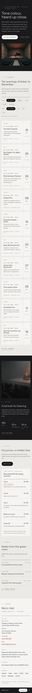

# Neiro Hall

An elegant, restrained, cinematic WordPress **block theme** for **Neiro Hall** (*neiro* means "tone colour"), a fictional 180-seat listening hall for chamber music, jazz and acoustic song in a quiet Tokyo neighbourhood. Smoke-stone ground (#ECEAE6), paper cards and stubs (#F5F4F1), charcoal type and dark "hall lights down" bands (#19191B), warm grey meta text (#67635E), one **muted rust** (#A5532F, #8A4426 for text links) kept to small marks, and soft brass (#B39A6E) on the dark bands. **Space Grotesk** in light weights for headings, **Inter** for text, **IBM Plex Mono** for dates, seat lines, labels and filters.

All copy is English and every name is fictional: the hall, the artists and ensembles, the staff, the address, telephone and prices.

## Who it is for

- **Industry:** music-venue: listening halls, chamber-music rooms, small jazz clubs, acoustic venues.
- **Site type:** events. No WooCommerce.

## Layout codes

- **Header H7 — bottom-docked bar:** a slim charcoal bar fixed to the bottom of the screen on desktop and phone (wordmark, menu, a paper "Tickets" pill with a rust dot), respecting the safe-area inset; it is sticky and ordered after the footer, so it never covers the footer and a full-page capture shows it at the end of the page. On phones the menu opens as a full-screen overlay set in large light type.
- **Footer F9 — colophon:** set like the colophon of a programme booklet: the hall (synced box office details), credits, typefaces and a small contents list, between hairlines on paper.
- **Home L14 — filter-first directory:** a dark hero band with the empty hall, then the programme straight away: ten concerts as ticket stubs, filtered by genre and month.

## Ticket-stub filters

Each concert is a paper ticket stub: the date and time in IBM Plex Mono, the genre, the title, a note and a seat line ("Reserved seating · Tiers A, B, C"); on the right a stub end with the day, month and stub number behind a dashed perforation, with two notches cut by a CSS mask. `assets/js/programme.js` (no build) reads the genre and month from the stubs and draws two groups of pill buttons (`aria-pressed`, a polite live count). Without JavaScript nothing is drawn and every concert shows.

## Pages

Home, Calendar (full programme and notes for the night), Artists (three portraits and a directory), Venue (hall, seating, foyer, access), Tickets (prices, box office, returns), About, Journal (6 posts, 3 categories, 6 tags) with article, category and tag archives, Newsletter, Contact, Search and 404.

## Edited in one place

- **Box office hours, address, telephone and email:** synced pattern, in the footer colophon and on Venue, Tickets and Contact.
- **Ticket prices** (tiers, the editable "Best listening" badge): synced pattern, on the home and Tickets pages. The stubs name tiers, never prices.
- **Programme (ticket stubs):** synced pattern, on the home and Calendar pages.

All three are created by `inc/hall-info.php` on activation (never twice). Demo import: shared `inc/demo-import.php` driven by `demo-content.json`; idempotent.

## Deviations from the roadmap

- Palette: the planned vivid orange #F15A24 gig-poster look was toned down to the restrained palette above; rust only for small marks. Colour tags neutral + dark + warm.
- Style tags elegant + audio + cinematic instead of gig-poster.
- Footer F9 colophon instead of the planned F5, so H7 + F5 (Menya Kaen v1) is not repeated.
- Inter added as a body font beside Space Grotesk and IBM Plex Mono.

## Credits

Fonts: Space Grotesk, Inter and IBM Plex Mono (SIL OFL 1.1). Photographs: AI-generated for this theme, GPL-2.0-or-later / CC0 (see readme.txt).

<!-- screenshots:start -->
## Screenshots

<table>
<tr>
<td valign="top"></td>
<td valign="top"></td>
</tr>
</table>

- Calendar: [desktop](screenshots/calendar-desktop.webp) · [mobile](screenshots/calendar-mobile.webp)
- Artists: [desktop](screenshots/artists-desktop.webp) · [mobile](screenshots/artists-mobile.webp)
- Venue: [desktop](screenshots/venue-desktop.webp) · [mobile](screenshots/venue-mobile.webp)
- Tickets: [desktop](screenshots/tickets-desktop.webp) · [mobile](screenshots/tickets-mobile.webp)
- About: [desktop](screenshots/about-desktop.webp) · [mobile](screenshots/about-mobile.webp)
- News: [desktop](screenshots/news-desktop.webp) · [mobile](screenshots/news-mobile.webp)
- Article: [desktop](screenshots/article-desktop.webp) · [mobile](screenshots/article-mobile.webp)
- Category: [desktop](screenshots/category-desktop.webp) · [mobile](screenshots/category-mobile.webp)
- Tag: [desktop](screenshots/tag-desktop.webp) · [mobile](screenshots/tag-mobile.webp)
- Newsletter: [desktop](screenshots/newsletter-desktop.webp) · [mobile](screenshots/newsletter-mobile.webp)
- Contact: [desktop](screenshots/contact-desktop.webp) · [mobile](screenshots/contact-mobile.webp)
- Search: [desktop](screenshots/search-desktop.webp) · [mobile](screenshots/search-mobile.webp)
<!-- screenshots:end -->
