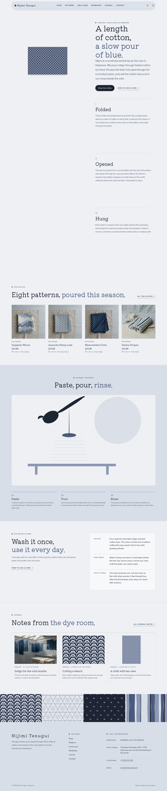
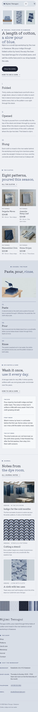

# Nijimi Tenugui

A handmade, organic block theme for a **small tenugui dye workshop** and its online shop. A ShipPress **store** theme: WooCommerce templates styled to match, eight sample cloths in three categories, and a shop that still works without WooCommerce.

The demo workshop is fictional: Sayo Kurata, Ren Ogino and Hana Ide, pour-dyeing cotton tenugui in a former rice store by the river in the town of Kawasoe since 1962.

## Concept: the unfolding cloth

- **Palette.** Pale indigo paper `#EEF0F4` pages, an indigo wash `#D9DEE8` for panels and the footer, deep indigo ink `#1F2433` text (13.6:1) and one muted dyer's blue `#4A5A7D` (6.0:1 on paper) for rules, numerals, emphasis and the label square; deep dyer's blue `#3A4867` for links and small labels (8.0:1), slate `#4F586C` for secondary text (6.3:1), cloth-white cards `#F7F8FA` and a hairline `#C3CAD8`. Buttons are deep indigo pills.
- **Type.** Kiwi Maru (display; headings, wordmark, prices; it has no italic, so emphasis is a change of blue) and Mona Sans (text, labels in spaced capitals).
- **Pictures.** The hero and the decorations are calm **2D flat raster illustrations** (WebP; solid shapes, no outlines, a repeat-pattern feel; the four pattern swatches are small geometric SVG tiles); the product pictures are photographs. Every picture was generated with Grok Build.
- **Cloth specs as product attributes.** Size, dye, cotton, method and ends are attributes of each product; size and dye print under every price ("90 × 34 cm · Two indigos"), from that one source.

## Header, footer, layout (ROADMAP codes)

- **H10 floating pill.** A pale indigo pill that never touches the page edges: a small folded-cloth mark and the Kiwi Maru wordmark, the menu, and (with WooCommerce) the account link and the cart as a paper-coloured pill at the end.
- **F8 pattern-strip footer.** The footer opens with four cloth patterns cropped square in one full-width row (seigaiha, asanoha, mameshibori, shima), each linking to Patterns; then the name and a line about the workshop, the menu, the synced workshop address and hours, and a fine print line, on the indigo wash.
- **L13 sticky media with scrolling text.** One flat illustration of the same tenugui stays pinned on the left while the chapters scroll on the right: folded, opened, hung. As each chapter reaches the middle of the screen the picture changes (`assets/js/unfold.js`; without it the folded cloth stays; on phones the three stages sit in a row above the text). Then a shelf of four cloths, the pour (paste, pour, rinse) as a wide illustration, the dye notes and care, and the journal.

## One source for shared details

| What | Source | Shown on |
| --- | --- | --- |
| Dyer, workshop address, shop hours, telephone, email | `inc/info/workshop.html` (synced pattern) | Footer (address, hours, telephone, email), The workshop, Contact |
| Dye notes and care (the dye, first wash, every wash, drying, the cut ends) | `inc/info/care.html` (synced pattern) | Home (short form), How to use & care (full), every product page |
| Size and dye line | each product's `Size` and `Dye` attributes | Product cards and product page |

## Pages and templates

Demo pages: Home, Shop, Patterns (the four stencil repeats with their meanings, seasonal stencils), How to use & care (the synced care card, four ways to use a cloth, sending), The workshop (people, the dye week, visiting), Journal (posts page), Newsletter and Contact. Six sample posts in three categories (In the dye room, Stencils & patterns, Living with cloth) with five tags.

Templates: front page, page, wide page, single post, journal, archive, category, tag, search, 404, plus WooCommerce shop, product category and tag archives, product, cart, checkout, my account, order confirmation and product search.

## WooCommerce

Optional. With it active, `inc/woo-import.php` adds three product categories (Patterned, Gradient & plain, Gift sets), four tags and eight products with photographs, prices and attributes; run twice it creates nothing new. Without it the home shelf and the Shop page show a static shelf that links to Contact, and orders go by email.

## Licence

GPL-2.0-or-later. Fonts OFL-1.1 (see `assets/fonts/`): Kiwi Maru subset to Latin (no Reserved Font Name); Mona Sans shipped unmodified as the upstream variable TTF (Reserved Font Name "Mona"). Illustrations and photographs AI-generated for this theme with Grok Build, released under GPL-2.0-or-later / CC0.

<!-- screenshots:start -->
## Screenshots

<table>
<tr>
<td valign="top"></td>
<td valign="top"></td>
</tr>
</table>

- Shop: [desktop](screenshots/shop-desktop.webp) · [mobile](screenshots/shop-mobile.webp)
- Product: [desktop](screenshots/product-desktop.webp) · [mobile](screenshots/product-mobile.webp)
- Patterns: [desktop](screenshots/patterns-desktop.webp) · [mobile](screenshots/patterns-mobile.webp)
- How to use and care: [desktop](screenshots/how-to-use-and-care-desktop.webp) · [mobile](screenshots/how-to-use-and-care-mobile.webp)
- About: [desktop](screenshots/about-desktop.webp) · [mobile](screenshots/about-mobile.webp)
- Contact: [desktop](screenshots/contact-desktop.webp) · [mobile](screenshots/contact-mobile.webp)
- News: [desktop](screenshots/news-desktop.webp) · [mobile](screenshots/news-mobile.webp)
- Article: [desktop](screenshots/article-desktop.webp) · [mobile](screenshots/article-mobile.webp)
- Category: [desktop](screenshots/category-desktop.webp) · [mobile](screenshots/category-mobile.webp)
- Tag: [desktop](screenshots/tag-desktop.webp) · [mobile](screenshots/tag-mobile.webp)
- Newsletter: [desktop](screenshots/newsletter-desktop.webp) · [mobile](screenshots/newsletter-mobile.webp)
- Search: [desktop](screenshots/search-desktop.webp) · [mobile](screenshots/search-mobile.webp)
<!-- screenshots:end -->
