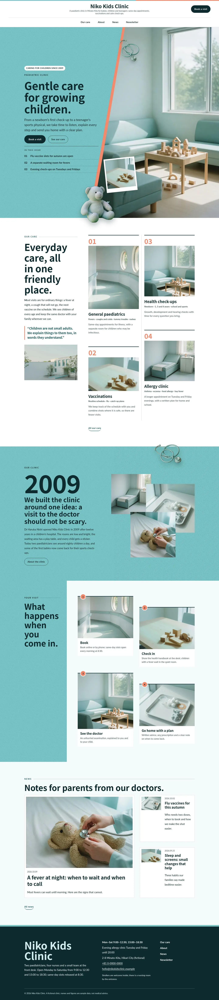
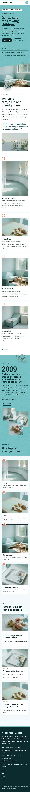

# Niko Kids Clinic

Niko Kids Clinic — a theme for a paediatric clinic (illness visits, vaccinations, check-ups and an allergy clinic), laid out as an editorial magazine under a formal white top header: the clinic name and tagline centred on top, a Book a visit button at the right and the menu as a centred row underneath (an aqua numbered overlay on phones). Byakugun pale aqua (#78C2C4) is the main colour, with a fine film-grain texture: the hero field, the story band, the visit-steps heading block and every page head are aqua fields in deep-teal type, with coral as a second risograph-style ink. The hero is a diagonal split: text on the aqua field, the waiting-room photograph cut on a diagonal with a coral misregistered edge, and a photo collage across the seam — a tilted print of toy blocks, a cut-out stethoscope and a cut-out teddy bear (transparent WebP) that breaks across the diagonal and past the hero bottom edge. Sections read like a magazine: running rules over every label, a numbered two-column care index with column rules, staggered visit steps and a lead story beside two side stories. Every picture is a realistic film-grain photograph (35mm look, 50mm f/2, natural side light). Noto Sans JP for display, Lato for reading, Noto Sans TC for Traditional Chinese headings. Sample content in English, Traditional Chinese, Japanese, French and German; vertical labels only in Chinese and Japanese. WCAG AA colours; no entrance animations.

- Design plan row b5-6: editorial-magazine, diagonal-split hero, centered nav, collage, illustration risograph converted to film-grain photographs, byakugun #78C2C4, Noto Sans JP + Lato.
- Sample content languages: en, zh-TW, ja, fr, de.
- Contrast: deep-teal ink #0E2A2D on byakugun #78C2C4 7.43:1 (all text on the hero field, story band, step heading block, page heads and overlay menu; white on the field is 2.04:1 so it is never used for text there); ink on coral #F08A6C 6.17:1 (step badges; coral otherwise decoration only); ink on paper #F5FBFB 14.5:1 and on white 15.1:1; deep teal #1B5C60 on paper 7.3:1 and on mist #E0F1F1 6.6:1 (links, pull quote); quiet #3D5557 on paper 7.6:1 and on mist 6.8:1 (facts, secondary text); pale #D3EDEE on ink 12.3:1 and white on ink 15.1:1 (footer, dark buttons).
- Break-frame: the cut-out teddy bear (transparent WebP) breaks across the hero diagonal seam and past the hero bottom edge; the cut-out stethoscope breaks over the diagonal, the story band and page heads.

<!-- screenshots:start -->
## Screenshots

<table>
<tr>
<td valign="top"></td>
<td valign="top"></td>
</tr>
</table>

- Services: [desktop](screenshots/services-desktop.webp) · [mobile](screenshots/services-mobile.webp)
- About: [desktop](screenshots/about-desktop.webp) · [mobile](screenshots/about-mobile.webp)
- News: [desktop](screenshots/news-desktop.webp) · [mobile](screenshots/news-mobile.webp)
- Article: [desktop](screenshots/article-desktop.webp) · [mobile](screenshots/article-mobile.webp)
- Category: [desktop](screenshots/category-desktop.webp) · [mobile](screenshots/category-mobile.webp)
- Tag: [desktop](screenshots/tag-desktop.webp) · [mobile](screenshots/tag-mobile.webp)
- Newsletter: [desktop](screenshots/newsletter-desktop.webp) · [mobile](screenshots/newsletter-mobile.webp)
- Contact: [desktop](screenshots/contact-desktop.webp) · [mobile](screenshots/contact-mobile.webp)
- Search: [desktop](screenshots/search-desktop.webp) · [mobile](screenshots/search-mobile.webp)
- Other languages (home page): [zh-TW](screenshots/zh-TW/home-desktop.webp) · [ja](screenshots/ja/home-desktop.webp) · [fr](screenshots/fr/home-desktop.webp) · [de](screenshots/de/home-desktop.webp)
<!-- screenshots:end -->
