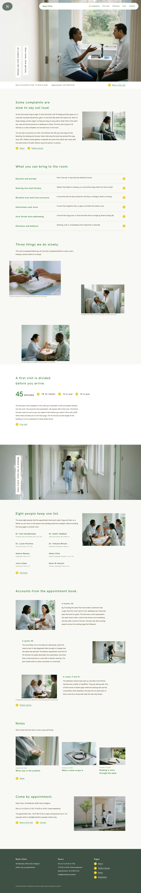

# Nodo Clinic

A quiet documentary block theme (type health) for an adult ear, nose and throat practice. Sample content in English; inner pages included, other languages follow.

## Signature
- Two white vertical paper strips on a full-bleed photograph, with a white information bar.
- An unframed photo walk: three photographs of different sizes stepping left, right, left.
- A round yellow chevron disc with an underlined text link as the only link style.

## Patterns
- `front-close`
- `front-complaints`
- `front-corridor`
- `front-hero`
- `front-notes`
- `front-opening`
- `front-pace`
- `front-roster`
- `front-stories`
- `front-walk`

## Fonts
Hanken Grotesk, Onest, Noto Sans TC, Noto Sans JP (all OFL-1.1, bundled).

<!-- screenshots:start -->
## Screenshots

<table>
<tr>
<td valign="top"></td>
<td valign="top"></td>
</tr>
</table>

- About: [desktop](screenshots/about-desktop.webp) · [mobile](screenshots/about-mobile.webp)
- News: [desktop](screenshots/news-desktop.webp) · [mobile](screenshots/news-mobile.webp)
- Article: [desktop](screenshots/article-desktop.webp) · [mobile](screenshots/article-mobile.webp)
- Category: [desktop](screenshots/category-desktop.webp) · [mobile](screenshots/category-mobile.webp)
- Tag: [desktop](screenshots/tag-desktop.webp) · [mobile](screenshots/tag-mobile.webp)
- Newsletter: [desktop](screenshots/newsletter-desktop.webp) · [mobile](screenshots/newsletter-mobile.webp)
- Contact: [desktop](screenshots/contact-desktop.webp) · [mobile](screenshots/contact-mobile.webp)
- Search: [desktop](screenshots/search-desktop.webp) · [mobile](screenshots/search-mobile.webp)
- Other languages (home page): [zh-TW](screenshots/zh-TW/home-desktop.webp) · [ja](screenshots/ja/home-desktop.webp) · [fr](screenshots/fr/home-desktop.webp) · [de](screenshots/de/home-desktop.webp)
<!-- screenshots:end -->
