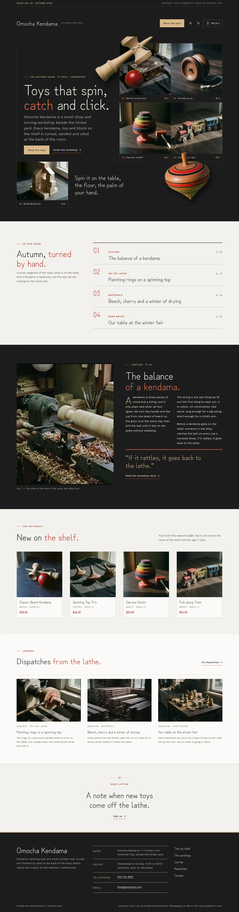
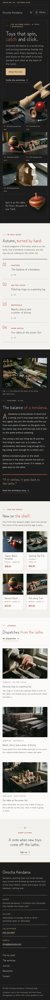

# Omocha Kendama

Omocha Kendama — a store theme for a small wooden toy shop and turning workshop, with WooCommerce templates styled to match. Sumi (#1C1C1C) is the main colour: the masthead, the hero, the feature spread, every page head and the footer are sumi fields with bone type and beech and kendama-red marks; Zen Kurenaido for display and Work Sans for reading. It is laid out like a small magazine: an issue strip in the header, a menu that opens as a full-screen overlay of numbered links, a product-grid hero of film photographs where a cut-out kendama swings out of the headline cell across the grid lines and a cut-out spinning top rises out of the last strip, then the contents of the issue, a two-column feature with a pull quote, the toy shelf and the journal. All photographs are generated in one 35mm film-grain direction graded toward sumi. The shop details and the wood-and-care notes each live in one synced pattern (WooCommerce optional: without it the toys show as static cells and orders go by email).

- Design plan row: b3-15 (editorial-magazine archetype, product-grid-hero, overlay nav, real-photography images, film-grain photo direction, sumi #1C1C1C, Zen Kurenaido + Work Sans).
- Header: a sumi masthead with an issue strip, the shop name and tag, Shop the toys, account and cart, and a Menu button; the primary menu always opens as a full-screen sumi overlay of large numbered links.
- Break-frame: the cut-out kendama swings out of the headline cell across the hairline grid into the photographs; the cut-out spinning top rises out of the last strip into the cell above.
- Magazine: an issue strip, a contents list with page numbers, a two-column feature with a drop cap and a pull quote, numbered chapters on The workshop.
- Synced: shop details (footer, Contact) and wood and care (product pages, Contact); wood and age per product from its attributes.
- Contrast: bone #EEEAE2 on sumi #1C1C1C 14.2:1 (all text on the sumi masthead, hero, feature, page heads, bands and footer); ash #B9B3A8 on sumi 8.2:1; beech #D8B88A on sumi 9.0:1 (labels, buttons, drop caps; sumi on beech buttons 9.0:1); light red #E86A4E on sumi 5.4:1 (numbers and emphasis); sumi on paper #F3F1EC 15.1:1; deep red links #9C2A1C on paper 6.7:1; stone #57534B on paper 6.8:1; kendama red #C0392B on paper 4.8:1 (large numbers and marks).

<!-- screenshots:start -->
## Screenshots

<table>
<tr>
<td valign="top"></td>
<td valign="top"></td>
</tr>
</table>

- Shop: [desktop](screenshots/shop-desktop.webp) · [mobile](screenshots/shop-mobile.webp)
- Product: [desktop](screenshots/product-desktop.webp) · [mobile](screenshots/product-mobile.webp)
- About: [desktop](screenshots/about-desktop.webp) · [mobile](screenshots/about-mobile.webp)
- Contact: [desktop](screenshots/contact-desktop.webp) · [mobile](screenshots/contact-mobile.webp)
- News: [desktop](screenshots/news-desktop.webp) · [mobile](screenshots/news-mobile.webp)
- Article: [desktop](screenshots/article-desktop.webp) · [mobile](screenshots/article-mobile.webp)
- Category: [desktop](screenshots/category-desktop.webp) · [mobile](screenshots/category-mobile.webp)
- Tag: [desktop](screenshots/tag-desktop.webp) · [mobile](screenshots/tag-mobile.webp)
- Newsletter: [desktop](screenshots/newsletter-desktop.webp) · [mobile](screenshots/newsletter-mobile.webp)
- Search: [desktop](screenshots/search-desktop.webp) · [mobile](screenshots/search-mobile.webp)
<!-- screenshots:end -->
