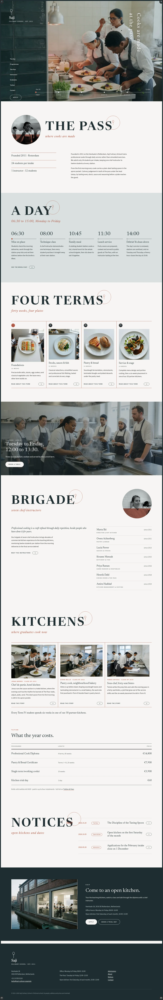

# Saji Culinary School

Saji Culinary School is an editorial magazine WordPress block theme designed for professional culinary academies and vocational cooking institutes. Inspired by structured Japanese editorial design, it features fixed ink viewport framing, daily schedule timelines, and candid kitchen documentary photography. It provides complete Full Site Editing templates for culinary programmes, faculty brigades, student-run restaurant services, and tuition schedules.

The theme ships the home page plus nine inner pages (The Training Day, Programmes & Terms, The Pass, Instructors, Graduates & Kitchens, Tuition & Fees, Admissions, About, Contact & Visit) and a Notices page, in English; the header menu links to them (inc/i18n/pages-en.php holds their text, template page-inner). Signature techniques: fixed 8 px ink frame with four I–IV corner stamps; left stacked nav and vertical headline over a full-bleed photograph with a timeline line; giant section words with a circled seal and a halftone round portrait. Scroll effects: sp-parallax (hero, lunch band), sp-stagger + sp-reveal--up (ruled grids), sp-reveal--up (section words).

<!-- screenshots:start -->
## Screenshots

<table>
<tr>
<td valign="top"></td>
<td valign="top"></td>
</tr>
</table>

- The day: [desktop](screenshots/the-day-desktop.webp) · [mobile](screenshots/the-day-mobile.webp)
- Programmes: [desktop](screenshots/programmes-desktop.webp) · [mobile](screenshots/programmes-mobile.webp)
- The pass: [desktop](screenshots/the-pass-desktop.webp) · [mobile](screenshots/the-pass-mobile.webp)
- Instructors: [desktop](screenshots/instructors-desktop.webp) · [mobile](screenshots/instructors-mobile.webp)
- Graduates: [desktop](screenshots/graduates-desktop.webp) · [mobile](screenshots/graduates-mobile.webp)
- Tuition: [desktop](screenshots/tuition-desktop.webp) · [mobile](screenshots/tuition-mobile.webp)
- Admissions: [desktop](screenshots/admissions-desktop.webp) · [mobile](screenshots/admissions-mobile.webp)
- About: [desktop](screenshots/about-desktop.webp) · [mobile](screenshots/about-mobile.webp)
- Contact: [desktop](screenshots/contact-desktop.webp) · [mobile](screenshots/contact-mobile.webp)
- Notices: [desktop](screenshots/notices-desktop.webp) · [mobile](screenshots/notices-mobile.webp)
- News: [desktop](screenshots/news-desktop.webp) · [mobile](screenshots/news-mobile.webp)
- Article: [desktop](screenshots/article-desktop.webp) · [mobile](screenshots/article-mobile.webp)
- Category: [desktop](screenshots/category-desktop.webp) · [mobile](screenshots/category-mobile.webp)
- Tag: [desktop](screenshots/tag-desktop.webp) · [mobile](screenshots/tag-mobile.webp)
- Newsletter: [desktop](screenshots/newsletter-desktop.webp) · [mobile](screenshots/newsletter-mobile.webp)
- Other languages (home page): [zh-TW](screenshots/zh-TW/home-desktop.webp) · [ja](screenshots/ja/home-desktop.webp) · [fr](screenshots/fr/home-desktop.webp) · [de](screenshots/de/home-desktop.webp)
<!-- screenshots:end -->
