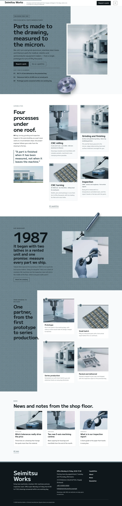

# Seimitsu Works

Seimitsu Works — a theme for a precision metal parts manufacturer (CNC milling, turning, grinding and inspection), laid out as an asymmetric masonry under a formal white top header (company name, tagline, a Request a quote button and a menu button); the menu opens as a full-screen ai-nezumi blue-grey overlay with large numbered entries at every width. Ai-nezumi blue grey (#6C848D) is the main colour, textured with a fine white grid: the hero text field, the story band, the drawing-to-delivery heading block and every page head are blue-grey fields in steel-ink type. The hero puts the text on the left and a white-framed high-key photograph of the machining hall on the right, with a cut-out machined flange (transparent WebP) breaking over the frame corner, the field seam and the hero bottom edge; a cut-out turned shaft breaks over the story band and every page head. The four capabilities run as a two-column masonry of cards with photographs of different heights beside a sticky intro, and the four production steps as a staggered grid. Every picture is a realistic high-key photograph (85mm f/2.8, softbox fill, near-white background). M PLUS 1 for display, Saira for reading, Noto Sans TC for Traditional Chinese headings. Sample content in English, Traditional Chinese, Japanese, French and German; vertical labels only in Chinese and Japanese. WCAG AA colours; no entrance animations.

- Design plan row b5-5: asymmetric-masonry, text-left-art-right hero, overlay nav, real-photography, high-key, ai-nezumi #6C848D, M PLUS 1 + Saira.
- Sample content languages: en, zh-TW, ja, fr, de.
- Contrast: ink #0F171C on ai-nezumi #6C848D 4.59:1 (all text on the hero field, story band, step heading block, page heads, overlay menu and number badges; white on the field is 3.95:1 so it is never used for text there); ink on paper #F7F9FA 17.2:1 and on white 18.1:1; deep slate #38505A on paper 8.1:1 (pull quote, links); quiet #4A5960 on paper 6.9:1 and on mist #E4EBED 6.0:1 (facts, secondary text); pale #DCE6E9 on ink 14.3:1 and white on ink 18.1:1 (footer, dark buttons).
- Break-frame: the cut-out flange (transparent WebP) breaks over the hero photo frame, the field seam and the hero bottom edge; the cut-out shaft breaks over the story band and page heads.

<!-- screenshots:start -->
## Screenshots

<table>
<tr>
<td valign="top"></td>
<td valign="top"></td>
</tr>
</table>

- Services: [desktop](screenshots/services-desktop.webp) · [mobile](screenshots/services-mobile.webp)
- About: [desktop](screenshots/about-desktop.webp) · [mobile](screenshots/about-mobile.webp)
- News: [desktop](screenshots/news-desktop.webp) · [mobile](screenshots/news-mobile.webp)
- Article: [desktop](screenshots/article-desktop.webp) · [mobile](screenshots/article-mobile.webp)
- Category: [desktop](screenshots/category-desktop.webp) · [mobile](screenshots/category-mobile.webp)
- Tag: [desktop](screenshots/tag-desktop.webp) · [mobile](screenshots/tag-mobile.webp)
- Newsletter: [desktop](screenshots/newsletter-desktop.webp) · [mobile](screenshots/newsletter-mobile.webp)
- Contact: [desktop](screenshots/contact-desktop.webp) · [mobile](screenshots/contact-mobile.webp)
- Search: [desktop](screenshots/search-desktop.webp) · [mobile](screenshots/search-mobile.webp)
- Other languages (home page): [zh-TW](screenshots/zh-TW/home-desktop.webp) · [ja](screenshots/ja/home-desktop.webp) · [fr](screenshots/fr/home-desktop.webp) · [de](screenshots/de/home-desktop.webp)
<!-- screenshots:end -->
