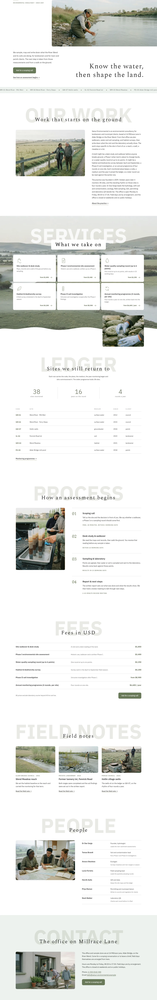

# Seisui Environmental

Block theme for an environmental consultancy serving landowners and municipal clients (fictional practice in Alder Bridge, on the River Wend).

- Home page plus eleven inner pages (About, Services, Water & Soil Assessment, Monitoring Programmes, Habitat & Biodiversity, Field Notes, Fees, How We Begin, People, For Municipalities & Landowners, Contact); the header menu links to real pages.
- Signature: ghost-word headings on every page, a parallax photo band behind a 3×2 card grid, a first screen with the photograph cropped by the right edge.
- Fonts: Spectral and IBM Plex Sans (OFL), loaded through theme.json fontFace so editor and front end match.
- Scroll effects: bundled sp-scroll (reveal, stagger, count, marquee, parallax); respects prefers-reduced-motion.
- Photography: film-grain documentary photographs, bundled in assets/images.
- Sample content: inc/demo-import.php imports the pages and menu from demo-content.json (English; other languages follow).

<!-- screenshots:start -->
## Screenshots

<table>
<tr>
<td valign="top"></td>
<td valign="top"></td>
</tr>
</table>

- About: [desktop](screenshots/about-desktop.webp) · [mobile](screenshots/about-mobile.webp)
- News: [desktop](screenshots/news-desktop.webp) · [mobile](screenshots/news-mobile.webp)
- Article: [desktop](screenshots/article-desktop.webp) · [mobile](screenshots/article-mobile.webp)
- Category: [desktop](screenshots/category-desktop.webp) · [mobile](screenshots/category-mobile.webp)
- Tag: [desktop](screenshots/tag-desktop.webp) · [mobile](screenshots/tag-mobile.webp)
- Newsletter: [desktop](screenshots/newsletter-desktop.webp) · [mobile](screenshots/newsletter-mobile.webp)
- Contact: [desktop](screenshots/contact-desktop.webp) · [mobile](screenshots/contact-mobile.webp)
- Services: [desktop](screenshots/services-desktop.webp) · [mobile](screenshots/services-mobile.webp)
- Water soil assessment: [desktop](screenshots/water-soil-assessment-desktop.webp) · [mobile](screenshots/water-soil-assessment-mobile.webp)
- Monitoring programmes: [desktop](screenshots/monitoring-programmes-desktop.webp) · [mobile](screenshots/monitoring-programmes-mobile.webp)
- Habitat biodiversity: [desktop](screenshots/habitat-biodiversity-desktop.webp) · [mobile](screenshots/habitat-biodiversity-mobile.webp)
- Projects: [desktop](screenshots/projects-desktop.webp) · [mobile](screenshots/projects-mobile.webp)
- Fees: [desktop](screenshots/fees-desktop.webp) · [mobile](screenshots/fees-mobile.webp)
- How we begin: [desktop](screenshots/how-we-begin-desktop.webp) · [mobile](screenshots/how-we-begin-mobile.webp)
- People: [desktop](screenshots/people-desktop.webp) · [mobile](screenshots/people-mobile.webp)
- For municipalities landowners: [desktop](screenshots/for-municipalities-landowners-desktop.webp) · [mobile](screenshots/for-municipalities-landowners-mobile.webp)
- Other languages (home page): [zh-TW](screenshots/zh-TW/home-desktop.webp) · [ja](screenshots/ja/home-desktop.webp) · [fr](screenshots/fr/home-desktop.webp) · [de](screenshots/de/home-desktop.webp)
<!-- screenshots:end -->
