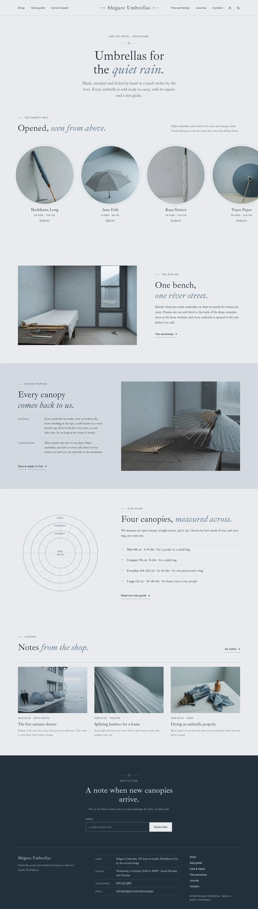
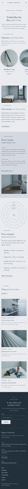

# Shigure Umbrellas

A quiet block theme for a **small umbrella atelier** and its online shop. A ShipPress **store** theme: WooCommerce templates styled to match, eight sample umbrellas in three categories, and a shop that still works without WooCommerce.

The demo shop is fictional: Haruki Onda makes and mends umbrellas by hand at Shigure Umbrellas, 3-8 Ame-no-machi, a quiet riverside shopping street in Hoshikawa City. *Shigure* is a passing autumn shower.

## Concept: ferrule and ribs

- **Palette.** Rain mist `#E9ECEF` pages, slate `#D3D9DF` panels, ink `#23303B` text (11.4:1 mist, 9.5:1 slate) and one muted steel accent `#5E7489` (4.1:1 / 3.4:1, so only for large italics, marks, rings and hairlines). Added for AA: deep steel `#3F5263` for links, labels and rib counts (6.8:1 mist, 5.7:1 slate), quiet slate `#4E5A66` for secondary text (6.0:1 / 5.0:1), a decorative steel hairline `#B4C0CB` and pale mist `#F5F7F8` cards. The footer band is the ink with mist text (11.4:1) and muted labels `#B4C0CB` (7.3:1).
- **Type.** Ibarra Real Nova for reading and display (italic accents, lining-figure prices); Golos Text for the menu, labels, rib counts and table figures (tabular).
- **Ferrule + ribs.** A tiny concentric tip (ring and dot between hairlines) marks section openings and the footer; the wordmark sits between two tip marks; canopy cells carry faint radial rib lines and a steel ring; the size guide is drawn as concentric canopy rings. All CSS.

## Header, footer, layout (ROADMAP codes)

- **H2 centred logo, split navigation.** The Ibarra Real Nova wordmark sits centred between two CSS ferrule tip marks; the core navigation splits three links left and three right (account and mini cart join the right cluster when WooCommerce is active) on a pale mist bar with one cool steel hairline. Below 1180px a Menu button opens the overlay; phones keep Menu, wordmark and cart on one line.
- **F4 newsletter-led footer.** A centred rain letter ("A note when new canopies arrive.") with the email field on a deep slate band; below a hairline, the name, the synced shop details and slim links. Stacks on phones.
- **L4 horizontal scroll.** One quiet opening line ("Umbrellas for the quiet rain."), then the canopy rail: a slow scroll-snap track of large round canopies, each with the rib count and width in small type, name and price. Keyboard (focus + arrow keys) and touch scrollable, no autoplay. Then the atelier note, the synced repair promise, the size-guide teaser and the latest journal.

## One source for shared details

| What | Source | Shown on |
| --- | --- | --- |
| Shop address, hours, telephone, email | `inc/info/shop.html` (synced pattern) | Footer, The workshop, Care & repair, Contact |
| Repair terms: covered, turnaround, prices, bring it in | `inc/info/repair.html` (synced pattern) | Home (short), Care & repair (full), Contact, every product page (short) |
| Rib-count line | each product's `Ribs` and `Size (cm)` attributes | Canopy rail, shop cells, product page |

## Pages and templates

Demo pages: Home, Shop, Size guide (measurements table, how to choose), Care & repair (the synced terms, everyday care, bring it in), The workshop (the maker, at the bench, visit), Journal (posts page), Newsletter and Contact. Six sample posts in three categories (Rain notes, Making, Care) with seven tags.

Templates: front page, page, wide page, single post, journal, archive, category, tag, search, 404, plus WooCommerce shop, product category and tag archives, product, cart, checkout, my account, order confirmation and product search.

## WooCommerce

Optional. With it active, `inc/woo-import.php` adds three product categories, seven tags and eight umbrellas with photographs, prices and attributes (ribs, size, shaft, canopy, weight); run twice it creates nothing new. Without it the canopy rail and the Shop page show static canopies that link to Contact, and orders go by email.

## Licence

GPL-2.0-or-later. Fonts OFL-1.1 (see `assets/fonts/`): Ibarra Real Nova and Golos Text subset to Latin (no Reserved Font Name). Photographs AI-generated for this theme, released under GPL-2.0-or-later / CC0.

<!-- screenshots:start -->
## Screenshots

<table>
<tr>
<td valign="top"></td>
<td valign="top"></td>
</tr>
</table>

- Shop: [desktop](screenshots/shop-desktop.webp) · [mobile](screenshots/shop-mobile.webp)
- Product: [desktop](screenshots/product-desktop.webp) · [mobile](screenshots/product-mobile.webp)
- About: [desktop](screenshots/about-desktop.webp) · [mobile](screenshots/about-mobile.webp)
- Care repair: [desktop](screenshots/care-repair-desktop.webp) · [mobile](screenshots/care-repair-mobile.webp)
- Size guide: [desktop](screenshots/size-guide-desktop.webp) · [mobile](screenshots/size-guide-mobile.webp)
- Contact: [desktop](screenshots/contact-desktop.webp) · [mobile](screenshots/contact-mobile.webp)
- News: [desktop](screenshots/news-desktop.webp) · [mobile](screenshots/news-mobile.webp)
- Article: [desktop](screenshots/article-desktop.webp) · [mobile](screenshots/article-mobile.webp)
- Category: [desktop](screenshots/category-desktop.webp) · [mobile](screenshots/category-mobile.webp)
- Tag: [desktop](screenshots/tag-desktop.webp) · [mobile](screenshots/tag-mobile.webp)
- Newsletter: [desktop](screenshots/newsletter-desktop.webp) · [mobile](screenshots/newsletter-mobile.webp)
- Search: [desktop](screenshots/search-desktop.webp) · [mobile](screenshots/search-mobile.webp)
<!-- screenshots:end -->
