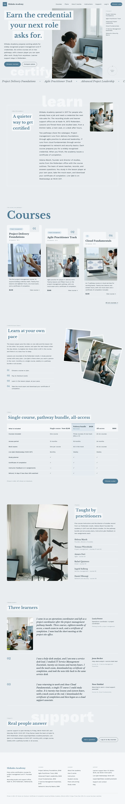

# Shikaku Academy

WordPress block theme for an online certification academy (project management and IT). The English home page and the English inner pages (courses, course page, lesson player, plans and pricing, how it works, instructors, student stories, about, support, FAQ, My courses, journal with one article) are finished and checked (block editor validation, 390 px / 1280 px overflow, motion). Five languages and the Tutor LMS / WooCommerce styles follow in the next stage.

- Palette: ground #E9EDF0, surface #F6F7F8, ink #12222D, muted #6E7F8A, accent hanada #4E7A93, tint #DCE7EE.
- Type: Libre Baskerville (display), Work Sans (text).
- Signatures: T1 paper-strip headline beside a photo on the fold; T2 numbered-tab course ladder; T3 fan of three rotated photo cards.
- Scroll: sp-scroll (assets/sp-scroll.css, .js): sp-reveal--up + sp-stagger, sp-reveal--wipe on section titles, sp-marquee, sp-parallax.
- Copy lives in inc/i18n/<lang>.php; patterns in patterns/; design notes in brand/design-spec.md.

- Home hero: strips reveal top to bottom (CSS clip-path, 220 ms stagger) and the Scroll Next ring turns slowly; both are final-state under no-JS, `?sp-static`, reduced motion and in the editor.
- Menu links point to /courses/, /plans/, /how-it-works/, /instructors/, /support/, /about/, /faq/, /my-courses/ (all built; the course page is /project-delivery-foundations/, the lesson player sample /lesson-player/).

<!-- screenshots:start -->
## Screenshots

<table>
<tr>
<td valign="top"></td>
<td valign="top"></td>
</tr>
</table>

- Courses: [desktop](screenshots/courses-desktop.webp) · [mobile](screenshots/courses-mobile.webp)
- Project delivery foundations: [desktop](screenshots/project-delivery-foundations-desktop.webp) · [mobile](screenshots/project-delivery-foundations-mobile.webp)
- Lesson player: [desktop](screenshots/lesson-player-desktop.webp) · [mobile](screenshots/lesson-player-mobile.webp)
- Plans: [desktop](screenshots/plans-desktop.webp) · [mobile](screenshots/plans-mobile.webp)
- How it works: [desktop](screenshots/how-it-works-desktop.webp) · [mobile](screenshots/how-it-works-mobile.webp)
- Instructors: [desktop](screenshots/instructors-desktop.webp) · [mobile](screenshots/instructors-mobile.webp)
- Student stories: [desktop](screenshots/student-stories-desktop.webp) · [mobile](screenshots/student-stories-mobile.webp)
- About: [desktop](screenshots/about-desktop.webp) · [mobile](screenshots/about-mobile.webp)
- Support: [desktop](screenshots/support-desktop.webp) · [mobile](screenshots/support-mobile.webp)
- Faq: [desktop](screenshots/faq-desktop.webp) · [mobile](screenshots/faq-mobile.webp)
- My courses: [desktop](screenshots/my-courses-desktop.webp) · [mobile](screenshots/my-courses-mobile.webp)
- Journal: [desktop](screenshots/journal-desktop.webp) · [mobile](screenshots/journal-mobile.webp)
- News: [desktop](screenshots/news-desktop.webp) · [mobile](screenshots/news-mobile.webp)
- Article: [desktop](screenshots/article-desktop.webp) · [mobile](screenshots/article-mobile.webp)
- Category: [desktop](screenshots/category-desktop.webp) · [mobile](screenshots/category-mobile.webp)
- Tag: [desktop](screenshots/tag-desktop.webp) · [mobile](screenshots/tag-mobile.webp)
- Newsletter: [desktop](screenshots/newsletter-desktop.webp) · [mobile](screenshots/newsletter-mobile.webp)
- Contact: [desktop](screenshots/contact-desktop.webp) · [mobile](screenshots/contact-mobile.webp)
- Other languages (home page): [zh-TW](screenshots/zh-TW/home-desktop.webp) · [ja](screenshots/ja/home-desktop.webp) · [fr](screenshots/fr/home-desktop.webp) · [de](screenshots/de/home-desktop.webp)
<!-- screenshots:end -->
