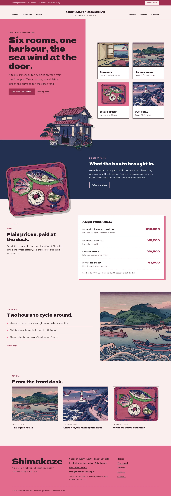
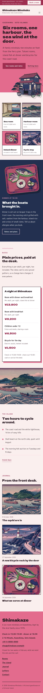

# Shimakaze Minshuku

A bright, woodblock-print hospitality theme for a six-room island guesthouse. Kobai plum pink (#E16B8C) fills the hero, every page head and the footer, with woodblock indigo bands, blush paper and plum ink text; Dela Gothic One for display over M PLUS 1p. The art is ukiyo-e woodblock raster illustration (the inn, the harbour, a tatami room, a dinner tray, the coast road), with the inn and the dinner tray as transparent cut-outs that break out of their frames. A full top header: a deep plum strip with a Book a room button, then the menu split into two halves either side of the centred inn name. The home page is a split screen: the plum field with the title and the cut-out inn crossing the split line beside a grid of rooms and plans with prices, then dinner on an indigo band, the synced rates card, the island and the journal. The rates card and the inn details are synced patterns edited in one place. WCAG AA colours; no entrance animations.

- Design plan row: b3-11 (split-screen archetype, product-grid hero, split nav, cut-out break-frame images, woodblock illustration, kobai #E16B8C, Dela Gothic One + M PLUS 1p).
- Break-frame: the cut-out inn crosses the split line and the lower edge of the home hero; the cut-out dinner tray overhangs the indigo band's lower edge over a plum disc; on The family page the inn steps out of the plum field.
- Synced: room rates (home, Rooms & rates) and inn details (footer, Contact).

## Templates
front-page, home, index, page, page-wide, single, archive, category, tag, search, 404.

## Patterns
home-hero, home-dinner, home-rates, home-island, home-journal, rooms-head, rooms-main, island-head, island-main, about-head, about-main, newsletter-head, newsletter-signup, contact-head, contact-main, prices, details-card, not-found.

## Screenshots

<!-- screenshots:start -->
## Screenshots

<table>
<tr>
<td valign="top"></td>
<td valign="top"></td>
</tr>
</table>

- Rooms: [desktop](screenshots/rooms-desktop.webp) · [mobile](screenshots/rooms-mobile.webp)
- Island: [desktop](screenshots/island-desktop.webp) · [mobile](screenshots/island-mobile.webp)
- About: [desktop](screenshots/about-desktop.webp) · [mobile](screenshots/about-mobile.webp)
- News: [desktop](screenshots/news-desktop.webp) · [mobile](screenshots/news-mobile.webp)
- Article: [desktop](screenshots/article-desktop.webp) · [mobile](screenshots/article-mobile.webp)
- Category: [desktop](screenshots/category-desktop.webp) · [mobile](screenshots/category-mobile.webp)
- Tag: [desktop](screenshots/tag-desktop.webp) · [mobile](screenshots/tag-mobile.webp)
- Newsletter: [desktop](screenshots/newsletter-desktop.webp) · [mobile](screenshots/newsletter-mobile.webp)
- Contact: [desktop](screenshots/contact-desktop.webp) · [mobile](screenshots/contact-mobile.webp)
- Search: [desktop](screenshots/search-desktop.webp) · [mobile](screenshots/search-mobile.webp)
<!-- screenshots:end -->
