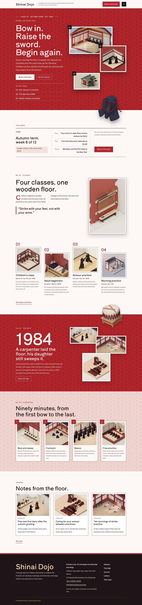

# Shinai Dojo

Shinai Dojo — a neighbourhood kendo dojo theme set like a magazine. A formal top header carries the dojo name and tagline, a Book a trial class button and a menu button that opens a full-screen madder red overlay with large numbered entries. Akane (#B7282E), the deep madder red of traditional Japanese dyeing, is the main colour: the cover, the dojo band and every page head are madder fields with a faint asanoha hemp-leaf pattern texture multiplied in, set in plaster white with hinoki-gold labels. The cover is a stacked collage: the issue line, title, lead, buttons and the contents of this issue on the left, three numbered 2.5D isometric plates of the dojo stacked and offset on the right, and a cut-out kendo helmet (transparent WebP) breaking out of the stack and over the cover bottom edge; a cut-out dojo drum breaks over the top edge of the dojo band and the bottom edge of every page head. The home page reads as three features: the classes as a magazine spread with a drop cap and a pull quote, the dojo story with the founding year in giant type, and a practice in four plates on pale madder with the light pattern; a synced practice board and the fees are kept in one place each. Every picture is a 2.5D isometric illustration. Shippori Antique for display, Libre Franklin for reading, Noto Sans TC for Traditional Chinese headings. Sample content in English, Traditional Chinese, Japanese, French and German; vertical labels only in Chinese and Japanese. WCAG AA colours; no entrance animations.

- Design plan row b4-11: editorial-magazine, stacked-collage hero, overlay nav, pattern-texture (2.5d-isometric), akane #B7282E, Shippori Antique + Libre Franklin.
- Sample content languages: en, zh-TW, ja, fr, de.
- Contrast: plaster #FBF7F4 on akane #B7282E 5.9:1 (all text on the cover, the dojo band, every page head and the overlay menu; white on akane 6.3:1); hinoki gold #F8DDB0 on akane 4.8:1 (eyebrows, issue line, contents label, menu numbers); the asanoha texture only darkens the field, so these ratios are the minimum; sumi #1E1416 on plaster 16.9:1 and on pale madder #F5E1DF 14.3:1; deep madder #8E1F25 on plaster 8.3:1 and on pale madder 7.1:1 (links, labels, class facts); ash rose #5A4A4C on plaster 7.8:1 and on pale madder 6.6:1 (secondary text); plaster on sumi 16.9:1 and hinoki gold on sumi 13.7:1 (footer, plate numbers); plaster on akane buttons 5.9:1; akane on plaster 5.9:1 (drop caps, class numbers); sumi on akane only 2.9:1, never used for text.
- Break-frame: the cut-out kendo helmet (transparent WebP) breaks out of the stacked plates and over the cover bottom edge; the cut-out dojo drum breaks over the top edge of the dojo band and the bottom edge of every page head.

<!-- screenshots:start -->
## Screenshots

<table>
<tr>
<td valign="top"></td>
<td valign="top"></td>
</tr>
</table>

- Classes: [desktop](screenshots/classes-desktop.webp) · [mobile](screenshots/classes-mobile.webp)
- About: [desktop](screenshots/about-desktop.webp) · [mobile](screenshots/about-mobile.webp)
- News: [desktop](screenshots/news-desktop.webp) · [mobile](screenshots/news-mobile.webp)
- Article: [desktop](screenshots/article-desktop.webp) · [mobile](screenshots/article-mobile.webp)
- Category: [desktop](screenshots/category-desktop.webp) · [mobile](screenshots/category-mobile.webp)
- Tag: [desktop](screenshots/tag-desktop.webp) · [mobile](screenshots/tag-mobile.webp)
- Newsletter: [desktop](screenshots/newsletter-desktop.webp) · [mobile](screenshots/newsletter-mobile.webp)
- Contact: [desktop](screenshots/contact-desktop.webp) · [mobile](screenshots/contact-mobile.webp)
- Search: [desktop](screenshots/search-desktop.webp) · [mobile](screenshots/search-mobile.webp)
- Other languages (home page): [zh-TW](screenshots/zh-TW/home-desktop.webp) · [ja](screenshots/ja/home-desktop.webp) · [fr](screenshots/fr/home-desktop.webp) · [de](screenshots/de/home-desktop.webp)
<!-- screenshots:end -->
