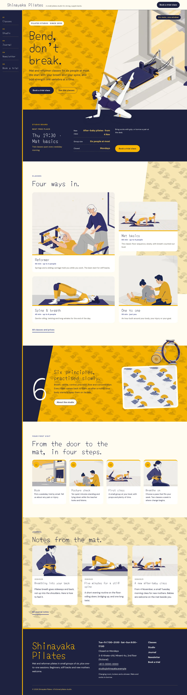
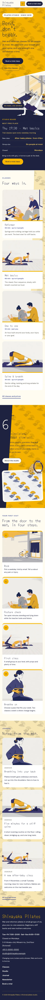

# Shinayaka Pilates

Shinayaka Pilates — a pilates studio theme with a formal header (studio name, menu and a Book a trial class button) whose menu runs down a fixed indigo side rail on wide screens (stacked vertical words in Chinese and Japanese). Yamabuki golden yellow (#F8B500) is the main colour: the hero field, every page head and the method band are yamabuki fields with a fan-and-wave pattern texture multiplied in, set with indigo type. The hero is split on a diagonal: the yamabuki field beside a flat illustration of the studio, with a cut-out figure stretching across the seam and over the hero edge; a cut-out ring and mat break over the method band, and the figure stretches over every page head. Classes sit in an asymmetric masonry. Every picture is a 2D flat illustration. Yomogi for display, DM Sans for reading, Noto Sans TC for Traditional Chinese headings. Sample content in English, Traditional Chinese, Japanese, French and German; vertical labels only in Chinese and Japanese. WCAG AA colours; no entrance animations.

- Design plan row b3-26: asymmetric-masonry, diagonal-split hero, side-rail nav, pattern-texture, 2d-flat, yamabuki #F8B500, Yomogi + DM Sans.
- Sample content languages: en, zh-TW, ja, fr, de.
- Contrast: indigo ink #1E2240 on yamabuki #F8B500 8.5:1 (all text on the hero field, page heads and method band); ink on warm white #FFFCF3 15.1:1; ai indigo #34408F on warm white 9.0:1 and on white 9.2:1 (links, labels, class facts); ai indigo on yamabuki 5.1:1; warm grey #5A5546 on warm white 7.3:1 (secondary text); ink on pale yamabuki #FDEBB8 13.1:1 (prices, details cards); light yamabuki #FCD25A on ink 10.7:1 (rail numbers, board values); yamabuki on ink 8.5:1 (footer name, board button; ink on yamabuki buttons 8.5:1); white on ink 15.5:1; bengara #A63A16 on warm white 6.3:1 and on white 6.5:1 (small class facts labels); white on yamabuki only 1.8:1, never used for text.
- Break-frame: the cut-out figure (transparent WebP) stretches across the hero's diagonal seam between the yamabuki field and the studio illustration and over the hero bottom edge into the studio board; the cut-out ring and mat break over the method band's top edge; the figure stretches over the diagonal edge of every page head.

## Templates and patterns

Every template is the header (with the side-rail menu on wide screens), the page column and the footer. Page bodies come from patterns (home-hero with the diagonal split and the cut-out figure, home-board with the synced studio board, home-works as an asymmetric masonry of classes, home-serial with the method band and the cut-out ring, home-process with the first-visit steps, home-journal) and template patterns (tpl-*) so their words follow the content language.

<!-- screenshots:start -->
## Screenshots

<table>
<tr>
<td valign="top"></td>
<td valign="top"></td>
</tr>
</table>

- Classes: [desktop](screenshots/classes-desktop.webp) · [mobile](screenshots/classes-mobile.webp)
- About: [desktop](screenshots/about-desktop.webp) · [mobile](screenshots/about-mobile.webp)
- News: [desktop](screenshots/news-desktop.webp) · [mobile](screenshots/news-mobile.webp)
- Article: [desktop](screenshots/article-desktop.webp) · [mobile](screenshots/article-mobile.webp)
- Category: [desktop](screenshots/category-desktop.webp) · [mobile](screenshots/category-mobile.webp)
- Tag: [desktop](screenshots/tag-desktop.webp) · [mobile](screenshots/tag-mobile.webp)
- Newsletter: [desktop](screenshots/newsletter-desktop.webp) · [mobile](screenshots/newsletter-mobile.webp)
- Contact: [desktop](screenshots/contact-desktop.webp) · [mobile](screenshots/contact-mobile.webp)
- Search: [desktop](screenshots/search-desktop.webp) · [mobile](screenshots/search-mobile.webp)
- Other languages (home page): [zh-TW](screenshots/zh-TW/home-desktop.webp) · [ja](screenshots/ja/home-desktop.webp) · [fr](screenshots/fr/home-desktop.webp) · [de](screenshots/de/home-desktop.webp)
<!-- screenshots:end -->
