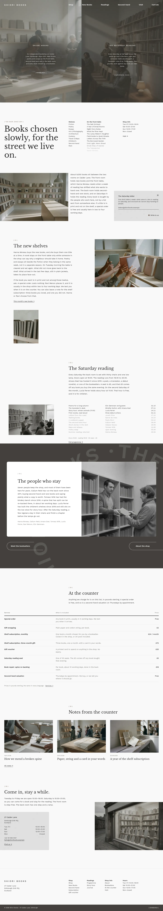

# Shiori Books

Shiori Books is a block theme for an independent neighbourhood bookshop, set up for a shop that sells new, second-hand and rare books and holds a Saturday reading. It styles a WooCommerce catalogue and still works as a reading site when WooCommerce is not active. The front page is a day-and-evening entrance, a shelf index, a reading programme, the people of the shop, a price list and a visit panel.

## Structure
- `patterns/front-*.php`: the eight home sections (entrance, shop, new shelves, readings, people, counter, journal, visit); `footer-main.php`: the footer.
- `templates/`: front page and plain templates. The demo import also creates the ten pages the menu and footer link to (Shop, New Books, Readings, Second-hand, Subscription, At the counter, Booksellers, About, Visit, Cart) as plain long-form pages.
- `inc/i18n/<lang>.php`: the theme strings; `demo-content.json`: sample content.
- Scroll effects: `assets/sp-scroll.css`, `assets/sp-scroll.js` (sp-parallax on the entrance and the people field, sp-reveal and sp-stagger on the index and journal, sp-reveal--wipe on the card).
- Photos: `assets/images/` (AI-generated, GPL-2.0-or-later / CC0). See `readme.txt`.

Design notes: `brand.md`, `brand/design-spec.md`, `brand/reference.md`.

License: GPL-2.0-or-later.

<!-- screenshots:start -->
## Screenshots

<table>
<tr>
<td valign="top"></td>
<td valign="top"></td>
</tr>
</table>

- Shop: [desktop](screenshots/shop-desktop.webp) · [mobile](screenshots/shop-mobile.webp)
- New books: [desktop](screenshots/new-books-desktop.webp) · [mobile](screenshots/new-books-mobile.webp)
- Readings: [desktop](screenshots/readings-desktop.webp) · [mobile](screenshots/readings-mobile.webp)
- Second hand: [desktop](screenshots/second-hand-desktop.webp) · [mobile](screenshots/second-hand-mobile.webp)
- Subscription: [desktop](screenshots/subscription-desktop.webp) · [mobile](screenshots/subscription-mobile.webp)
- Services: [desktop](screenshots/services-desktop.webp) · [mobile](screenshots/services-mobile.webp)
- Booksellers: [desktop](screenshots/booksellers-desktop.webp) · [mobile](screenshots/booksellers-mobile.webp)
- About: [desktop](screenshots/about-desktop.webp) · [mobile](screenshots/about-mobile.webp)
- Visit: [desktop](screenshots/visit-desktop.webp) · [mobile](screenshots/visit-mobile.webp)
- Cart: [desktop](screenshots/cart-desktop.webp) · [mobile](screenshots/cart-mobile.webp)
- Journal: [desktop](screenshots/journal-desktop.webp) · [mobile](screenshots/journal-mobile.webp)
- News: [desktop](screenshots/news-desktop.webp) · [mobile](screenshots/news-mobile.webp)
- Article: [desktop](screenshots/article-desktop.webp) · [mobile](screenshots/article-mobile.webp)
- Category: [desktop](screenshots/category-desktop.webp) · [mobile](screenshots/category-mobile.webp)
- Tag: [desktop](screenshots/tag-desktop.webp) · [mobile](screenshots/tag-mobile.webp)
- Newsletter: [desktop](screenshots/newsletter-desktop.webp) · [mobile](screenshots/newsletter-mobile.webp)
- Contact: [desktop](screenshots/contact-desktop.webp) · [mobile](screenshots/contact-mobile.webp)
- Other languages (home page): [zh-TW](screenshots/zh-TW/home-desktop.webp) · [ja](screenshots/ja/home-desktop.webp) · [fr](screenshots/fr/home-desktop.webp) · [de](screenshots/de/home-desktop.webp)
<!-- screenshots:end -->
