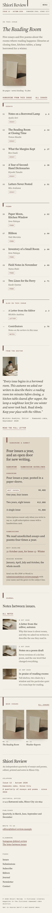

# Shiori Review

A quiet, typographic media theme for an **independent literary quarterly** of essays and poems.

*Shiori* means bookmark. The demo magazine is a fictional quarterly edited in an upstairs room on Kawasemi-zaka (fictional Hinoe City) by editor Michiko Asahina, poetry editor Sora Nakaya and contributing editor Kiyoshi Tanabe. It is a media theme, not a shop: no WooCommerce templates or products.

## Concept: bookmark ribbon + folio

- **Palette.** Oat paper `#F3EFE7` ground, warm stone `#E0D8C9` panels, sumi ink `#1F1D1A` text (14.7:1 on oat, 11.9:1 on stone). Deep red-brown `#5A2E26` for links and small accents (9.9:1 / 8.0:1); muted ink `#5E574D` for secondary text (6.2:1 / 5.0:1); paper `#FAF8F3` for detail cards. Faded red pencil `#6A3E35` (7.8:1 on oat) draws the ribbons, hairline underlines, chip borders and drop caps.
- **Type.** Source Serif 4 (variable, optical sizes: the huge wordmark uses the display cut) with Azeret Mono for the dateline, folios, numbers and labels. Both OFL-1.1 without a Reserved Font Name, subset to Latin WOFF2 (84 + 85 + 16 KB).
- **Motif.** Narrow faded-red bookmark ribbons with a V notch hang from the rules above each section (CSS only), one longer ribbon hangs from the page top beside the wordmark, and every contents row ends in a page-like folio (`p. 62`) in mono. Oat-paper whitespace, no illustrations, no entrance animations.

## Header, footer, layout (ROADMAP codes)

- **H5 magazine masthead**: a huge centred Source Serif 4 wordmark, a ruled dateline row (Issue 12 · Autumn 2026 / Kawasemi-zaka, Hinoe City / A quarterly of essays and poems · since 2014, from the synced magazine details), then a ruled menu row (Issues, Editors, Journal, Submit, Subscribe, Contact; core Navigation, keyboard accessible). At 390 px: wordmark and Menu on one line, the dateline below, an oat overlay menu.
- **F8 photo-strip footer**: five issue covers (No. 12 to No. 08) in a calm row linking to Issues (a snap-scrolling row on phones), then the colophon: wordmark, the synced magazine details, page links and a set-in line.
- **L3 editorial masthead + index**: the issue title and cover in a 4/12 aside beside the numbered contents (Essays, Poems, Also in this issue: number, title, author, Essay/Poem chip, folio), a note from the editor, a stone subscribe-and-submit panel from the synced rates, and the latest journal notes as rows, all on one 4/12 + 8/12 reading axis. Works without JavaScript.

## One source for shared details

- **Magazine details** synced pattern (`inc/info/details.html`): masthead dateline, footer colophon, Contact, Subscribe.
- **Subscription and submissions** synced pattern (`inc/info/rates.html`): Subscribe, Submissions (submissions first) and the home page (short), with the editable "Most chosen" badge.
- The demo import (`inc/demo-import.php`) is idempotent and never overwrites user content.

## Pages and templates

Home (contents); Issues (current issue large, four back issues with covers and stock notes); Submissions (synced guidelines, how we read); Subscribe (synced rates and the office details); Editors (three portraits, about the review); Journal (posts page); Newsletter; Contact; article (drop cap, tags, earlier/later), category, tag, search and 404 templates. Six journal posts in three categories (Letters, On the desk, On reading) with six tags.

## Licence

GPL-2.0-or-later. Fonts OFL-1.1 (see `assets/fonts/`). Photographs AI-generated for this theme, released under GPL-2.0-or-later / CC0. The magazine, people, district, city, address and rates are fictional.

<!-- screenshots:start -->
## Screenshots

<table>
<tr>
<td valign="top"></td>
<td valign="top"></td>
</tr>
</table>

- Issues: [desktop](screenshots/issues-desktop.webp) · [mobile](screenshots/issues-mobile.webp)
- Submissions: [desktop](screenshots/submissions-desktop.webp) · [mobile](screenshots/submissions-mobile.webp)
- Subscribe: [desktop](screenshots/subscribe-desktop.webp) · [mobile](screenshots/subscribe-mobile.webp)
- About: [desktop](screenshots/about-desktop.webp) · [mobile](screenshots/about-mobile.webp)
- Contact: [desktop](screenshots/contact-desktop.webp) · [mobile](screenshots/contact-mobile.webp)
- News: [desktop](screenshots/news-desktop.webp) · [mobile](screenshots/news-mobile.webp)
- Article: [desktop](screenshots/article-desktop.webp) · [mobile](screenshots/article-mobile.webp)
- Category: [desktop](screenshots/category-desktop.webp) · [mobile](screenshots/category-mobile.webp)
- Tag: [desktop](screenshots/tag-desktop.webp) · [mobile](screenshots/tag-mobile.webp)
- Newsletter: [desktop](screenshots/newsletter-desktop.webp) · [mobile](screenshots/newsletter-mobile.webp)
- Search: [desktop](screenshots/search-desktop.webp) · [mobile](screenshots/search-mobile.webp)
<!-- screenshots:end -->
