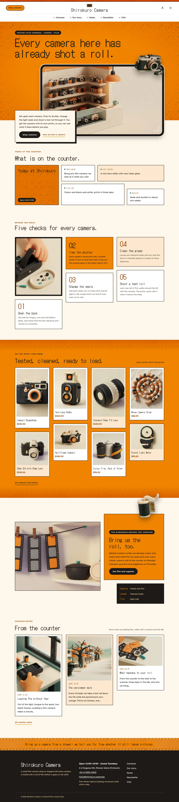
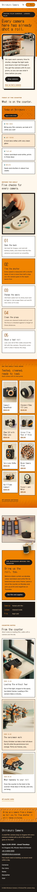

# Shirokuro Camera

Shirokuro Camera — a WooCommerce store theme for a small film camera shop on a hillside street, laid out as an asymmetric masonry. A formal centred top header carries the Shop cameras button on the left, the shop name in the middle, account and cart on the right and the main menu centred on its own row below, under a strip of clay sprocket holes; below 1100 px a Menu button opens it as a full-screen mikan overlay. Mikan orange (#F08300) is the main colour: the hero field, the counter board lead tile, the camera shelf band, the darkroom card, every page head and the footer strip are mikan fields with camera-black text, and raster clay textures (film sprocket holes and a halftone of clay dots) run through them. The hero shows the clay shop interior through a black viewfinder window with rounded corners and frame marks; a cream card with the lead overlaps the window and a cut-out clay camera (transparent WebP) breaks out over the window frame and the hero's bottom edge. The counter board, the five checks, the camera shelf, the darkroom collage and the counter notes are all uneven masonry tiles and columns, and a cut-out film roll breaks out of the darkroom card. Every picture is a soft 3D clay illustration. DotGothic16 for display, Lexend Deca for reading. Sample content and products in English, Traditional Chinese, Japanese, French and German; vertical lines only in Chinese and Japanese. Works without WooCommerce. WCAG AA colours; no entrance animations.

- Design plan row b4-15: asymmetric-masonry, framed-window hero, centered nav, pattern-texture, 3d-clay, mikan #F08300, DotGothic16 + Lexend Deca.
- Sample content languages: en, zh-TW, ja, fr, de.
- Contrast: camera black #1E1A16 on mikan #F08300 6.5:1 (all text on the hero field, the board lead tile, the shelf band, the darkroom card, the second check tile, the second promise tile, every page head, the mikan overlay menu and the footer strip; the clay textures are masked away from the text or lightened); ink on warm paper #FFF7EC 16.3:1, on white 17.3:1 and on pale mikan #FDE8CF 14.5:1; deep mikan #8F3D00 on paper 7.0:1, on white 7.4:1 and on pale mikan 6.2:1 (links, prices, labels, menu numbers; white on deep 7.4:1); warm grey #5F5247 on paper 7.1:1, on white 7.5:1 and on pale mikan 6.3:1 (secondary text); white on camera-black buttons 17.3:1; mikan on ink 6.5:1 and pale mikan #FFD9A8 on ink 13.0:1 (the black tile, chips, footer); lens teal #1D6B66 on paper 5.9:1 (small square marks only); white on mikan only 2.6:1, never used for text.
- Break-frame: the cut-out clay camera (transparent WebP) breaks out over the top-right frame of the hero viewfinder window and above the window; the cream lead card overlaps the window and the hero bottom edge; the cut-out film roll breaks out of the top edge of the mikan darkroom card; the camera also breaks over the bottom edge of every page head.

## Templates and patterns

Every template is the centred header (the Shop cameras button, the shop name in the middle, account and cart; the main menu centred on its own row from 1100 px, a full-screen mikan overlay below that), the page column and the footer. Page bodies come from patterns: home-hero (the clay shop through a black viewfinder window on the mikan field, the lead card overlapping it, the cut-out camera breaking out), home-board (synced counter board as masonry tiles), home-waters (five checks in masonry columns beside the tall repair picture), home-shelf (cameras on a mikan band in masonry columns; WooCommerce products, pictures without it), home-break (darkroom collage of three tiles with the cut-out film roll), home-journal (counter notes as masonry cards), and the page heads and bodies of Cameras, Our story, Newsletter and Visit. WooCommerce templates (shop, product, cart, checkout, account, order confirmation, product search) use tpl-* patterns for their text.

<!-- screenshots:start -->
## Screenshots

<table>
<tr>
<td valign="top"></td>
<td valign="top"></td>
</tr>
</table>

- Shop: [desktop](screenshots/shop-desktop.webp) · [mobile](screenshots/shop-mobile.webp)
- Product: [desktop](screenshots/product-desktop.webp) · [mobile](screenshots/product-mobile.webp)
- About: [desktop](screenshots/about-desktop.webp) · [mobile](screenshots/about-mobile.webp)
- Contact: [desktop](screenshots/contact-desktop.webp) · [mobile](screenshots/contact-mobile.webp)
- News: [desktop](screenshots/news-desktop.webp) · [mobile](screenshots/news-mobile.webp)
- Article: [desktop](screenshots/article-desktop.webp) · [mobile](screenshots/article-mobile.webp)
- Category: [desktop](screenshots/category-desktop.webp) · [mobile](screenshots/category-mobile.webp)
- Tag: [desktop](screenshots/tag-desktop.webp) · [mobile](screenshots/tag-mobile.webp)
- Newsletter: [desktop](screenshots/newsletter-desktop.webp) · [mobile](screenshots/newsletter-mobile.webp)
- Search: [desktop](screenshots/search-desktop.webp) · [mobile](screenshots/search-mobile.webp)
- Other languages (home page): [zh-TW](screenshots/zh-TW/home-desktop.webp) · [ja](screenshots/ja/home-desktop.webp) · [fr](screenshots/fr/home-desktop.webp) · [de](screenshots/de/home-desktop.webp)
<!-- screenshots:end -->
