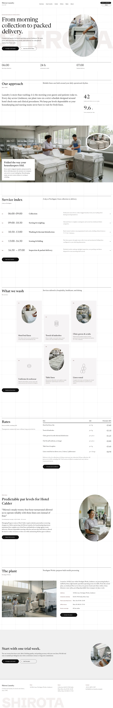

# Shirota Laundry

A WordPress block theme for a commercial laundry serving hotels and clinics in Lindmoor (founded 1987). The business is fictional; people, places and prices are written down in [`brand.md`](brand.md). Stage 1 ships the English home page; inner pages are placeholders.

## Concept: from morning collection to packed delivery

- **Palette.** White ground, ink `#111111`, card grey `#F6F4F4`, hairlines `#E5E1E1`; a dusty rose accent `#8A6A68` only on dots, eyebrows and numbers.
- **Type.** Newsreader (headings and body) and Schibsted Grotesk (UI, wordmark); Noto Serif TC / JP for CJK. OFL-1.1.
- **Signature.** A tall oval photo window over a ghost "SHIROTA" wordmark, a fixed 8-column hairline weave with 5px crosses, ruled section heads and a staggered card mosaic.
- **Motion.** `sp-scroll` (parallax, reveal, stagger, count); respects `prefers-reduced-motion`, content visible without JavaScript.

## Front page

Hero with three equal columns, approach statement and counts, full-bleed packing band, service index, card mosaic, rate table, client story, plant facts, closing call to action.

<!-- screenshots:start -->
## Screenshots

<table>
<tr>
<td valign="top"></td>
<td valign="top"></td>
</tr>
</table>

- Services: [desktop](screenshots/services-desktop.webp) · [mobile](screenshots/services-mobile.webp)
- How it works: [desktop](screenshots/how-it-works-desktop.webp) · [mobile](screenshots/how-it-works-mobile.webp)
- Hotels: [desktop](screenshots/hotels-desktop.webp) · [mobile](screenshots/hotels-mobile.webp)
- Clinics: [desktop](screenshots/clinics-desktop.webp) · [mobile](screenshots/clinics-mobile.webp)
- Linen rental: [desktop](screenshots/linen-rental-desktop.webp) · [mobile](screenshots/linen-rental-mobile.webp)
- Rates: [desktop](screenshots/rates-desktop.webp) · [mobile](screenshots/rates-mobile.webp)
- Quality: [desktop](screenshots/quality-desktop.webp) · [mobile](screenshots/quality-mobile.webp)
- About: [desktop](screenshots/about-desktop.webp) · [mobile](screenshots/about-mobile.webp)
- Stories: [desktop](screenshots/stories-desktop.webp) · [mobile](screenshots/stories-mobile.webp)
- Contact: [desktop](screenshots/contact-desktop.webp) · [mobile](screenshots/contact-mobile.webp)
- News: [desktop](screenshots/news-desktop.webp) · [mobile](screenshots/news-mobile.webp)
- Article: [desktop](screenshots/article-desktop.webp) · [mobile](screenshots/article-mobile.webp)
- Category: [desktop](screenshots/category-desktop.webp) · [mobile](screenshots/category-mobile.webp)
- Tag: [desktop](screenshots/tag-desktop.webp) · [mobile](screenshots/tag-mobile.webp)
- Newsletter: [desktop](screenshots/newsletter-desktop.webp) · [mobile](screenshots/newsletter-mobile.webp)
- Other languages (home page): [zh-TW](screenshots/zh-TW/home-desktop.webp) · [ja](screenshots/ja/home-desktop.webp) · [fr](screenshots/fr/home-desktop.webp) · [de](screenshots/de/home-desktop.webp)
<!-- screenshots:end -->
