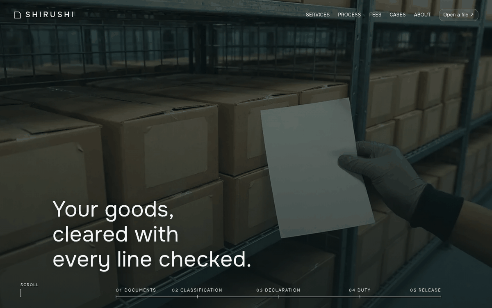

# Shirushi Customs

Shirushi Customs is a quiet WordPress block theme for a small customs broker that clears imported goods for small manufacturers. The home page opens on a dark documentary photograph of cartons on racks with a gloved hand holding a packing list; the three-line statement starts low and rides up over the pinned photograph while a thin timeline line of five ticks (Documents, Classification, Declaration, Duty, Release) stays along the bottom, and cool paper takes over. It continues with a heading bottom-aligned to a tall photograph that runs to the right edge, an uneven two-column masonry of four declaration types, a strip of five dossier cards where photograph and text are one unit (with a progress line and two round arrows), a blurred copy of the quay photograph with a sharp window and an outline map, a ruled list of six documents, a seven-row fee table, notes as hairline rows and a notice panel. Onest for headings, Source Sans 3 for reading. Works without WooCommerce. WCAG AA colours.

## Structure
- `patterns/front-*.php`: the nine home sections (stage, desk, declarations, handover, quay, prepare, fees, notes, notice); `head-bar.php` and `foot-main.php` are the header and footer.
- `templates/`: front page, posts index, archive, single, page, wide page, search and 404.
- `inc/i18n/<lang>.php`: the theme strings; `demo-content.json`: sample content (home page, notes, six posts, menu).
- `assets/sp-scroll.css`, `assets/sp-scroll.js`: the shared scroll effects (reveal up, stagger, mask, parallax); `assets/strip.js`: the two arrows under the dossier strip.
- Photos: `assets/images/` (AI-generated, GPL-2.0-or-later / CC0). See `readme.txt` for the list.

Design notes: `brand.md`, `brand/design-spec.md`, `brand/reference.md`.

License: GPL-2.0-or-later.

## Pages
Home, Declarations (`/services/`), Process, What you prepare, Fees, Case files, About and Open a file (`/contact/`) use the "Inner page (dark head)" template: a dark photograph band with the title, a lead and the five-tick timeline line (the tick of the stage the page is about is lit), then the page sections. Notes is the posts page. Other languages follow in a later release.

## Screenshots

