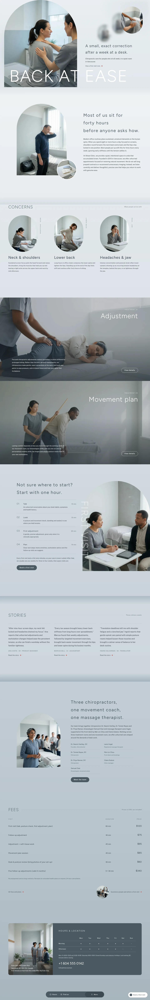

# Shisei Clinic

Chiropractic clinic block theme (type health). Left arch photograph with a white BACK AT EASE wordmark, oval photo with two blurred echoes, fixed slate pill bar, drifting slate ground. Figtree + Public Sans. Design notes: brand/design-spec.md, brand/reference.md. Sample content: demo-content.json (en); inner pages and one article are included; zh-TW, ja, fr and de follow.

Patterns: front-kv, front-concept, front-concerns, front-care, front-first-visit, front-stories, front-clinicians, front-fees, front-visit, header-main, footer-main, pill-bar, notes-head, archive-head, single-head, search-head, lost-head, notes-intro.

## Status (stage 2 fix)
- Home (en) verified: no horizontal overflow at 390px and 1280px, blocks valid in the editor, fonts match editor and front end.
- Sections use a soft veil (45% white) with 80px faded edges; a faint slate glow sits behind the first screen; ghost ovals are blurred at 10px.
- Menu, header and footer links point to the inner pages (conditions, treatments, first-visit, fees, clinicians, stories, notes, questions, contact); all of them exist in the English sample content (nine pages, the Notes index and one article); zh-TW, ja, fr and de are added in the next stage.
- Every inner page opens with the arch page head (sp-parallax on the arch photo); Treatments uses two full-bleed parallax panels; the price list is full width at 782px and above and stacks on phones.

<!-- screenshots:start -->
## Screenshots

<table>
<tr>
<td valign="top"></td>
<td valign="top"></td>
</tr>
</table>

- About: [desktop](screenshots/about-desktop.webp) · [mobile](screenshots/about-mobile.webp)
- Conditions: [desktop](screenshots/conditions-desktop.webp) · [mobile](screenshots/conditions-mobile.webp)
- Treatments: [desktop](screenshots/treatments-desktop.webp) · [mobile](screenshots/treatments-mobile.webp)
- First visit: [desktop](screenshots/first-visit-desktop.webp) · [mobile](screenshots/first-visit-mobile.webp)
- Fees: [desktop](screenshots/fees-desktop.webp) · [mobile](screenshots/fees-mobile.webp)
- Clinicians: [desktop](screenshots/clinicians-desktop.webp) · [mobile](screenshots/clinicians-mobile.webp)
- Stories: [desktop](screenshots/stories-desktop.webp) · [mobile](screenshots/stories-mobile.webp)
- Notes: [desktop](screenshots/notes-desktop.webp) · [mobile](screenshots/notes-mobile.webp)
- Questions: [desktop](screenshots/questions-desktop.webp) · [mobile](screenshots/questions-mobile.webp)
- Contact: [desktop](screenshots/contact-desktop.webp) · [mobile](screenshots/contact-mobile.webp)
- News: [desktop](screenshots/news-desktop.webp) · [mobile](screenshots/news-mobile.webp)
- Article: [desktop](screenshots/article-desktop.webp) · [mobile](screenshots/article-mobile.webp)
- Category: [desktop](screenshots/category-desktop.webp) · [mobile](screenshots/category-mobile.webp)
- Tag: [desktop](screenshots/tag-desktop.webp) · [mobile](screenshots/tag-mobile.webp)
- Newsletter: [desktop](screenshots/newsletter-desktop.webp) · [mobile](screenshots/newsletter-mobile.webp)
- Search: [desktop](screenshots/search-desktop.webp) · [mobile](screenshots/search-mobile.webp)
- 404: [desktop](screenshots/404-desktop.webp) · [mobile](screenshots/404-mobile.webp)
- Other languages (home page): [zh-TW](screenshots/zh-TW/home-desktop.webp) · [ja](screenshots/ja/home-desktop.webp) · [fr](screenshots/fr/home-desktop.webp) · [de](screenshots/de/home-desktop.webp)
<!-- screenshots:end -->
