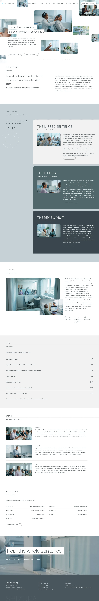

# Shizuka Hearing

A WordPress block theme for a calm audiology clinic serving adults who strain to follow conversation in noise. Fictional practice, founded 2014, 18 Harbour Lane, Northgate; fees in euros.

## Design
- Hero: nine rounded photo tiles scattered around a two-line statement in white highlight strips (four tiles bleed off the viewport edges, parallax layer).
- Journey: three stacked sticky cards (the missed sentence, the fitting, the review visit) on a blue-gray band with a sticky title column.
- Every section opens with an eyebrow, a hairline to the right edge and a sub-label.
- Palette: white, #F2F2F2, #C5D1D5 band, #49565E ink, #51676B and #3A464D cards, #0086BF accent only on the logo dot and focus.
- Fonts: Manrope and Public Sans; Noto Sans TC / JP for Chinese and Japanese. All bundled, OFL.

## Notes
- Business theme: WooCommerce compatible, not required.
- Scroll effects use the bundled sp-scroll assets and respect prefers-reduced-motion.
- Status: home page (en) polished; inner pages and zh-TW, ja, fr, de are still to do.

<!-- screenshots:start -->
## Screenshots

<table>
<tr>
<td valign="top"></td>
<td valign="top"></td>
</tr>
</table>

- About: [desktop](screenshots/about-desktop.webp) · [mobile](screenshots/about-mobile.webp)
- Hearing check: [desktop](screenshots/hearing-check-desktop.webp) · [mobile](screenshots/hearing-check-mobile.webp)
- Fitting method: [desktop](screenshots/fitting-method-desktop.webp) · [mobile](screenshots/fitting-method-mobile.webp)
- Tinnitus care: [desktop](screenshots/tinnitus-care-desktop.webp) · [mobile](screenshots/tinnitus-care-mobile.webp)
- Aftercare: [desktop](screenshots/aftercare-desktop.webp) · [mobile](screenshots/aftercare-mobile.webp)
- Fees: [desktop](screenshots/fees-desktop.webp) · [mobile](screenshots/fees-mobile.webp)
- Audiologists: [desktop](screenshots/audiologists-desktop.webp) · [mobile](screenshots/audiologists-mobile.webp)
- Stories: [desktop](screenshots/stories-desktop.webp) · [mobile](screenshots/stories-mobile.webp)
- Faq: [desktop](screenshots/faq-desktop.webp) · [mobile](screenshots/faq-mobile.webp)
- Contact: [desktop](screenshots/contact-desktop.webp) · [mobile](screenshots/contact-mobile.webp)
- News: [desktop](screenshots/news-desktop.webp) · [mobile](screenshots/news-mobile.webp)
- Article: [desktop](screenshots/article-desktop.webp) · [mobile](screenshots/article-mobile.webp)
- Category: [desktop](screenshots/category-desktop.webp) · [mobile](screenshots/category-mobile.webp)
- Tag: [desktop](screenshots/tag-desktop.webp) · [mobile](screenshots/tag-mobile.webp)
- Newsletter: [desktop](screenshots/newsletter-desktop.webp) · [mobile](screenshots/newsletter-mobile.webp)
- Other languages (home page): [zh-TW](screenshots/zh-TW/home-desktop.webp) · [ja](screenshots/ja/home-desktop.webp) · [fr](screenshots/fr/home-desktop.webp) · [de](screenshots/de/home-desktop.webp)
<!-- screenshots:end -->
