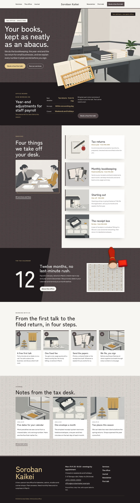
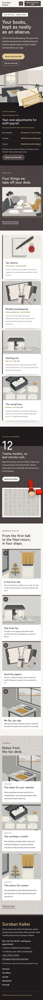

# Soroban Kaikei

Soroban Kaikei — a small-business tax accountant theme with a formal top header whose menu is split either side of the centred office name, with a Book a free first talk button. Keshizumi charcoal (#524748) is the main colour: the hero field, every page head, the services column, the calendar band and the overlay menu are charcoal fields with a 2D flat abacus-bead and ledger-line pattern multiplied in, set in white and light ochre. The hero is a diagonal split: the charcoal field cut on a slant beside the office illustration, with a cut-out abacus on a ledger lying across the seam and breaking over the hero edge. Sticky media: the services column with the adviser picture stays in view while four service cards scroll, and each Services picture stays beside its notes. A cut-out seal stamp breaks over the calendar band. Every picture is a 2D flat illustration. Zen Kaku Gothic New for display, Plus Jakarta Sans for reading, Noto Sans TC for Traditional Chinese headings. Sample content in English, Traditional Chinese, Japanese, French and German; vertical labels only in Chinese and Japanese. WCAG AA colours; no entrance animations.

- Design plan row b3-30: sticky-media, diagonal-split hero, split nav, pattern-texture, 2d-flat, keshizumi #524748, Zen Kaku Gothic New + Plus Jakarta Sans.
- Sample content languages: en, zh-TW, ja, fr, de.
- Contrast: white #FFFFFF on keshizumi charcoal #524748 8.9:1 (hero field, page heads, the services column, the calendar band and the overlay menu; the abacus pattern multiplied in only darkens the field); paper #F7F5F2 on keshizumi 8.2:1; light ochre #E3C88E on keshizumi 5.5:1 (eyebrows, labels and the hero button, ink text on it 10.6:1); sumi ink #1F1A1B on paper 15.8:1; deep charcoal #3F3637 on paper 10.8:1 (links); keshizumi on paper 8.2:1 and on pale stone #E8E3DE 7.0:1; warm grey #5E5657 on paper 6.6:1 (secondary text); deep ochre #7A5A1E on paper 5.8:1 and on white 6.4:1 (small service facts); light ochre on ink 10.6:1 (board, footer name); white on ink 17.2:1; ink on keshizumi only 1.9:1, never used for text.
- Break-frame: the cut-out abacus and ledger (transparent WebP) lie across the hero diagonal seam between the charcoal field and the office illustration and break over the hero bottom edge into the office board; the cut-out seal stamp breaks over the top edge of the calendar band; the abacus sits across the diagonal seam of every page head.

## Templates and patterns

Every template is the split-menu header, the page column and the footer. Page bodies come from patterns (home-hero with the diagonal split and the cut-out abacus, home-board with the synced office board, home-works with the sticky picture column and four service cards, home-serial with the tax calendar band and the cut-out seal, home-process, home-journal, and a diagonal page head per page). The office board, details and fees are synced patterns.

<!-- screenshots:start -->
## Screenshots

<table>
<tr>
<td valign="top"></td>
<td valign="top"></td>
</tr>
</table>

- Services: [desktop](screenshots/services-desktop.webp) · [mobile](screenshots/services-mobile.webp)
- About: [desktop](screenshots/about-desktop.webp) · [mobile](screenshots/about-mobile.webp)
- News: [desktop](screenshots/news-desktop.webp) · [mobile](screenshots/news-mobile.webp)
- Article: [desktop](screenshots/article-desktop.webp) · [mobile](screenshots/article-mobile.webp)
- Category: [desktop](screenshots/category-desktop.webp) · [mobile](screenshots/category-mobile.webp)
- Tag: [desktop](screenshots/tag-desktop.webp) · [mobile](screenshots/tag-mobile.webp)
- Newsletter: [desktop](screenshots/newsletter-desktop.webp) · [mobile](screenshots/newsletter-mobile.webp)
- Contact: [desktop](screenshots/contact-desktop.webp) · [mobile](screenshots/contact-mobile.webp)
- Search: [desktop](screenshots/search-desktop.webp) · [mobile](screenshots/search-mobile.webp)
- Other languages (home page): [zh-TW](screenshots/zh-TW/home-desktop.webp) · [ja](screenshots/ja/home-desktop.webp) · [fr](screenshots/fr/home-desktop.webp) · [de](screenshots/de/home-desktop.webp)
<!-- screenshots:end -->
