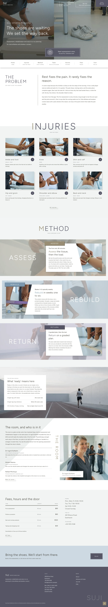

# Suji Clinic

A quiet block theme for a sports medicine clinic that treats club athletes and amateur runners: a twin photo hero (taping | race shoes) with a hairline headline and a framed notice card, a divided navigation strip, an injury grid with offset lines, three diagonal-cut method bands (Assess, Rebuild, Return), a parallax proof band, the people in the room, a plain fee table and visit details.

## Structure
- `patterns/front-*.php`: the home sections (hero, problem, injuries, method, proof, room, visit, close); `patterns/head-bar.php` and `patterns/foot-main.php` build the header and footer.
- `parts/`: header, navigation strip and footer; `templates/`: block templates.
- `demo-content.json`: sample content (en). The main menu links to real pages (Injuries, Method, Team, Stories, Fees, Visit).
- Photos: `assets/images/` (AI-generated, GPL-2.0-or-later / CC0).
- Scroll effects: `assets/sp-scroll.css`, `assets/sp-scroll.js`.

Figtree and Public Sans are bundled as variable fonts (Latin subset).

Design notes: `brand.md`, `brand/design-spec.md`, `brand/reference.md`.

License: GPL-2.0-or-later.

<!-- screenshots:start -->
## Screenshots

<table>
<tr>
<td valign="top"></td>
<td valign="top"></td>
</tr>
</table>
<!-- screenshots:end -->
