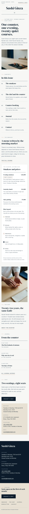

# Sushi Ginza

A crisp, precise and quietly elegant WordPress **block theme** for an **eight-seat omakase sushi counter**. Paper ground (#F7F7F5), **deep navy** type and bands (#0C1B2A), a pale **hinoki** panel (#E9E1D3), slate meta text (#56677A) and one **muted salmon** (#C8664A) used only as a tiny accent: label hairlines, plate rings, the footer rule. **DM Serif Display** headings over **Inter**.

All sample copy is English and every name is fictional: the counter, Chef Haruki Senda, the suppliers (Kanemasa Fish, Hoshino Farm, Akaishi Vinegar, Morikawa Brewery), the address, telephone and prices.

## Who it is for

- **Industry:** sushi-bar: omakase counters, kappo bars, small set-menu restaurants.
- **Site type:** food-drink. No WooCommerce.

## Layout codes

- **Header H5 — magazine masthead:** a dateline row (place on the left, "Reserve a seat" on the right), the counter's name set large and centred, the menu beneath between hairlines. Unlike Oto Radio's left-set retro wordmark it is centred, navy on paper and newspaper-quiet.
- **Footer F10 — split two-tone panel:** navy panel (wordmark, seatings and address) beside a hinoki booking panel (CTA, links, legal). Paper/navy/hinoki rather than Ginrin Cycle's graphite/steel drawing sheet.
- **Home L3 — editorial masthead + index list:** cover line and wide photograph, then a numbered contents index ("In this issue"), the course card, the chef, the journal as a dated index and the seatings.

## Pages

Home, The chef (about), Omakase (five movements with the plate legend, prices), Booking (seatings, request by email, policies, prices), Journal (6 posts, 3 categories, 6 tags) with article, category and tag archives, Newsletter, Contact, Search and 404.

## Edited in one place

- **Seatings, address, telephone and email:** synced pattern, shown in the footer and on the home, Booking and Contact pages.
- **Courses, prices, the "Chef's choice" badge and the plate legend:** synced pattern, shown on the home, Omakase and Booking pages.

Both are created by `inc/shop-info.php` on activation (never twice). Demo import: shared `inc/demo-import.php` driven by `demo-content.json`; idempotent.

## Plate legend

The roadmap asked for a "conveyor-plate colour legend". This is a refined counter, not kaiten, so it became a quiet **plate legend**: five small ringed plates drawn in CSS (hinoki, white with a fine ring, salmon ring, indigo, grey stoneware) keyed to the five movements of the omakase.

## Deviations from the roadmap

- Accent toned down from #E8572F to muted salmon #C8664A, used only for hairlines and plate rings (never as a fill or body text); hinoki #E9E1D3 and slate #56677A added.
- Style tags crisp + precise + elegant.
- Conveyor-plate legend reinterpreted as the seasonal plate legend above.

## Credits

Fonts: DM Serif Display and Inter (SIL OFL 1.1, from google/fonts). Photographs: AI-generated for this theme, GPL-2.0-or-later / CC0 (see readme.txt).

<!-- screenshots:start -->
## Screenshots

<table>
<tr>
<td valign="top"></td>
<td valign="top"></td>
</tr>
</table>

- About: [desktop](screenshots/about-desktop.webp) · [mobile](screenshots/about-mobile.webp)
- Omakase: [desktop](screenshots/omakase-desktop.webp) · [mobile](screenshots/omakase-mobile.webp)
- Booking: [desktop](screenshots/booking-desktop.webp) · [mobile](screenshots/booking-mobile.webp)
- News: [desktop](screenshots/news-desktop.webp) · [mobile](screenshots/news-mobile.webp)
- Article: [desktop](screenshots/article-desktop.webp) · [mobile](screenshots/article-mobile.webp)
- Category: [desktop](screenshots/category-desktop.webp) · [mobile](screenshots/category-mobile.webp)
- Tag: [desktop](screenshots/tag-desktop.webp) · [mobile](screenshots/tag-mobile.webp)
- Newsletter: [desktop](screenshots/newsletter-desktop.webp) · [mobile](screenshots/newsletter-mobile.webp)
- Contact: [desktop](screenshots/contact-desktop.webp) · [mobile](screenshots/contact-mobile.webp)
- Search: [desktop](screenshots/search-desktop.webp) · [mobile](screenshots/search-mobile.webp)
<!-- screenshots:end -->
