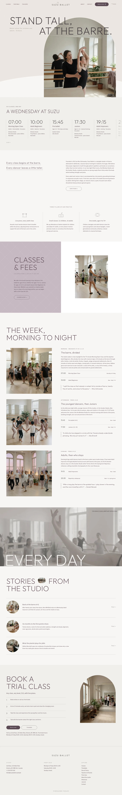

# Suzu Ballet

A calm block theme for a **ballet school for children and adults**: one daylight studio, two rooms, live piano in every adult and Juniors class.

The demo school is fictional (Victoria, BC, founded 2012 by Mira Ostrowska). The whole brand is in [`brand.md`](brand.md); every page's copy comes from it. Type: education. The English home page and nine inner pages (classes, timetable, fees, teachers, trial, about, showcase, journal, contact) are in; zh-TW, ja, fr, de follow.

## Concept: a daylight studio seen through an arched window

- **Arch window.** The hero photograph is clipped to a tall semicircle-topped arch (59 % of the width, top at 205 px at 1440, bleeding off the first screen). A thin Outfit 200 caps headline crosses its shoulders; the arch photograph drifts slower than the page (`sp-parallax`, 8 %). A harlequin diamond lattice (white 35 %) fades in from the two top corners.
- **Mauve lattice split.** A full-bleed 50/50 section: `#C6B9C1` panel with the lattice and a 90 px caps title, one inset 3:4 portrait on white (mask reveal).
- **Greige band.** A full-bleed desaturated photograph with a giant caps word sitting on its bottom edge, parallax 10 %.
- **Day schedule.** A Wednesday time-card strip that scrolls sideways inside its own row, then three morning / afternoon / evening rows, each with its own sticky 4:5 photograph beside a ruled list of the classes.
- **Palette.** Base `#F8F7F5`, hero tint `#EDE6E0`, soft band `#F0EFEB`, panel `#C6B9C1`, primary `#5C4A55`, text `#5B4652`, deep `#393035`. No accent.
- **Type.** Outfit (headings) over Source Sans 3 (text); Noto Sans TC / JP for Chinese and Japanese.

## Front page

1. `front-hero` arch window · 2. `front-day-strip` · 3. `front-intro` · 4. `front-reasons` · 5. `front-classes` (50/50 split) · 6. `front-day` (sticky day schedule) · 7. `front-band` · 8. `front-stories` (round thumbnails, one inline photo chip) · 9. `front-trial` (arch-topped photo).

## Scroll effects

`assets/sp-scroll.css` and `.js` (ShipPress sp-scroll): `sp-parallax` on the hero arch and the band, `sp-reveal--up` (+ `sp-stagger`) on text columns, `sp-reveal--mask` on the portraits. Off with prefers-reduced-motion, without JavaScript and in the editor.

## Helpers

`inc/blocks.php` prints the repeated block markup (`sb_open`, `sb_p`, `sb_h`, `sb_img`, `sb_pill`, `sb_outline`); strings live in `inc/i18n/<lang>.php` (en only so far)

## Inner pages

Each inner page (template `page-wide`) opens with a small arch-window header (T1), ruled text sections, a mauve lattice panel on classes / teachers / about / showcase (T2), a slim parallax band on about / journal / showcase (T3) and a trial-class close. Fees and contact use the same ruled rows as the day schedule..

<!-- screenshots:start -->
## Screenshots

<table>
<tr>
<td valign="top"></td>
<td valign="top"></td>
</tr>
</table>

- Classes: [desktop](screenshots/classes-desktop.webp) · [mobile](screenshots/classes-mobile.webp)
- Timetable: [desktop](screenshots/timetable-desktop.webp) · [mobile](screenshots/timetable-mobile.webp)
- Fees: [desktop](screenshots/fees-desktop.webp) · [mobile](screenshots/fees-mobile.webp)
- Teachers: [desktop](screenshots/teachers-desktop.webp) · [mobile](screenshots/teachers-mobile.webp)
- Trial: [desktop](screenshots/trial-desktop.webp) · [mobile](screenshots/trial-mobile.webp)
- About: [desktop](screenshots/about-desktop.webp) · [mobile](screenshots/about-mobile.webp)
- Showcase: [desktop](screenshots/showcase-desktop.webp) · [mobile](screenshots/showcase-mobile.webp)
- Journal: [desktop](screenshots/journal-desktop.webp) · [mobile](screenshots/journal-mobile.webp)
- Contact: [desktop](screenshots/contact-desktop.webp) · [mobile](screenshots/contact-mobile.webp)
- News: [desktop](screenshots/news-desktop.webp) · [mobile](screenshots/news-mobile.webp)
- Article: [desktop](screenshots/article-desktop.webp) · [mobile](screenshots/article-mobile.webp)
- Category: [desktop](screenshots/category-desktop.webp) · [mobile](screenshots/category-mobile.webp)
- Tag: [desktop](screenshots/tag-desktop.webp) · [mobile](screenshots/tag-mobile.webp)
- Newsletter: [desktop](screenshots/newsletter-desktop.webp) · [mobile](screenshots/newsletter-mobile.webp)
- Other languages (home page): [zh-TW](screenshots/zh-TW/home-desktop.webp) · [ja](screenshots/ja/home-desktop.webp) · [fr](screenshots/fr/home-desktop.webp) · [de](screenshots/de/home-desktop.webp)
<!-- screenshots:end -->
