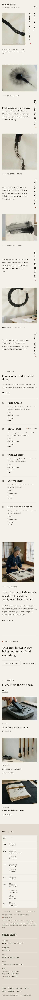

# Suzuri Shodo

A quiet, vertical-type education theme for a **small calligraphy (shodo) school**.

*Suzuri* is the inkstone. The demo school is a fictional calligraphy school in an old timber house with a moss-garden veranda in Kiriyama, taught by Haruko Mineyama since 1996 with her assistant Tomo Iwase: adult evening and weekend classes in five levels, a Saturday class for young learners, a monthly open studio and a free trial lesson. It is an education theme, not a shop: no WooCommerce templates or products.

## Concept: vertical type and long pauses

- **Palette.** Washi `#F4F0E8` ground, felt grey `#E2DCD0` for the footer sheet, sumi ink `#1E1C1A` text (14.9:1 on washi, 12.4:1 on felt), stone `#5E5852` secondary text (6.2:1 / 5.1:1). Seal red `#9A4A3A` (5.4:1 / 4.5:1) is used only for small marks: the active menu numeral, the free trial slot, today's marker in the timetable, the "Most chosen" dot and the small round stopping dot after vertical titles. Four ink tones (heavy `#3D3935`, mid `#6E6862`, pale `#A39C94`, dry `#CDC6BB`) appear only in marks.
- **Type.** Sawarabi Mincho (display, vertical titles) over Zen Kaku Gothic Antique (text, menu, timetable). Both OFL-1.1 without a Reserved Font Name, subset to Latin WOFF2 (~35 KB total, from 3.6 MB and 2.3 MB per weight).
- **Motifs.** Faint fold lines like a folded practice sheet (hanshi) structure the class levels and the timetable; a "five tones of ink" strip (dark, heavy, mid, pale, dry) marks every section and keys the timetable legend. Vertical titles use `writing-mode: vertical-rl` with sideways Latin and are real headings. No ensō motif, no seal logo, no entrance animations.

## Header, footer, layout (ROADMAP codes)

- **H12 split header**: the wordmark top-left in Sawarabi Mincho with a one-line descriptor ("Calligraphy school · Kiriyama"). On the home page the menu (core Navigation, editable) is a numbered list with hairline leaders in the hero's lower-right corner; on inner pages the same numbered list sits compactly top-right. On phones: wordmark + a quiet "Menu" button opening the core overlay with the numbered list.
- **F11 hours and calendar table**: the weekly class timetable as a ruled grid (Monday to Sunday, morning / afternoon / evening, level tones, the free trial slot with a seal-red dot, a legend) drawn as a folded sheet on the felt-grey panel, beside the school details. Today is marked server-side from the site's WordPress timezone (render_block filter, `aria-current="date"`). At 390 px the grid becomes a stacked day list.
- **L5 vertical type**: the hero brush-stroke photograph as a wide pale sheet with "One stroke, then a long pause." set vertically; four chapters (ink, brush, paper, the stroke), each one photograph, a vertical chapter title and a short paragraph on alternating sides with long pauses; the five class levels as tall vertical columns read right to left like hanging scrolls (one baseline via CSS subgrid); a note from the teacher; the trial-lesson line; three journal notes.

## One source for shared details

- **School details** (address, telephone, email, office hours, term dates): footer, Timetable, Contact.
- **Weekly class timetable**: footer, Timetable, Classes.
- **Class levels with hours and fees**: Home, Classes (with the editable "Most chosen" badge).
- Created once by `inc/shared-info.php` from `inc/info/*.html`; the demo import (`inc/demo-import.php`) is idempotent and never overwrites user content. A page that shows the timetable or details does not repeat them in its footer.

## Pages and templates

Home; Classes (levels, each level in detail, young learners, open studio, free trial lesson, the week); Timetable (the synced week, terms and office, holidays, how to book a trial); Materials (the seven-piece starter kit with prices, what each tool does and care notes; what to bring to the first class); About (the teacher, the room, the veranda); Journal (posts page); Newsletter; Contact (labelled trial-lesson enquiry that composes an email, no backend); article, category, tag, search and 404 templates. Six journal posts in three categories (Practice, Materials, School notes) with six tags.

## Licence

GPL-2.0-or-later. Fonts OFL-1.1 (see `assets/fonts/`). Photographs AI-generated for this theme, released under GPL-2.0-or-later / CC0. The school, teacher, assistant, town, address, phone numbers and prices are fictional.

<!-- screenshots:start -->
## Screenshots

<table>
<tr>
<td valign="top"></td>
<td valign="top"></td>
</tr>
</table>

- Classes: [desktop](screenshots/classes-desktop.webp) · [mobile](screenshots/classes-mobile.webp)
- Timetable: [desktop](screenshots/timetable-desktop.webp) · [mobile](screenshots/timetable-mobile.webp)
- Materials: [desktop](screenshots/materials-desktop.webp) · [mobile](screenshots/materials-mobile.webp)
- About: [desktop](screenshots/about-desktop.webp) · [mobile](screenshots/about-mobile.webp)
- Contact: [desktop](screenshots/contact-desktop.webp) · [mobile](screenshots/contact-mobile.webp)
- News: [desktop](screenshots/news-desktop.webp) · [mobile](screenshots/news-mobile.webp)
- Article: [desktop](screenshots/article-desktop.webp) · [mobile](screenshots/article-mobile.webp)
- Category: [desktop](screenshots/category-desktop.webp) · [mobile](screenshots/category-mobile.webp)
- Tag: [desktop](screenshots/tag-desktop.webp) · [mobile](screenshots/tag-mobile.webp)
- Newsletter: [desktop](screenshots/newsletter-desktop.webp) · [mobile](screenshots/newsletter-mobile.webp)
- Search: [desktop](screenshots/search-desktop.webp) · [mobile](screenshots/search-mobile.webp)
<!-- screenshots:end -->
