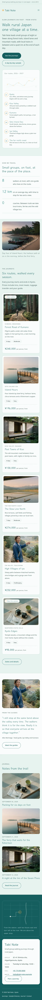

# Tabi Note

A calm, refined WordPress **block theme** for **small walking-tour and slow-travel agencies**. *Tabi* means journey; the note is the notebook every guide carries. The sample agency, **Tabi Note**, is a fictional Kyoto office running small-group walking journeys through rural Japan (forest pilgrim paths, Inland Sea islands, mountain villages and local trains), with three fictional guides (Aiko Morinaga, Kenta Shirase, Hana Oyama) and fictional inns. Address, phone, email and prices are placeholders.

## Design

- **Palette:** mist mint `#E6F2EF` ground, paper `#FAFCFB` cards, ink `#16302F` text, teal `#1C7C7D` for large headings and the route line, deep teal `#155E5F` for links, buttons and the footer band, sea line `#B7D3CD` hairlines, quiet `#476462` small text. Amber `#F2A541` is used **only** for tiny marks (stamp rings, route dots, list bullets), never for fills or text.
- **Type:** Klee One (handwritten-feel, used sparingly: headings, wordmark, notes, stamp numerals) over Noto Sans. Both OFL, Latin subsets bundled; no CDN.
- **Signature:** a quiet *stamped route map*: a dashed hand-drawn-feeling route line across faint contour lines with a small circular amber stamp at each stop, on a paper card; the six stops sit below as editable text. Stamp circles recur for the itinerary days, the guides and the 404.
- **Header H9 (two-tier):** a thin note strip ("since 2014" note + a small "autumn departures" link) above the Klee One wordmark with its stamp dot and the menu. Unlike Sumai Realty's H9 (office details in a dark strip, CTA button), it is a single quiet mist band with no button.
- **Footer F6 (map + address card):** a deep-teal band with a small line-drawn street map (walking route from the station to an amber stamp) beside a paper card holding the synced office details.
- **Layout L10 (map first):** the home page opens on the route map, then how we travel, a wide harbour photograph, the six journeys (synced), a guide's words and the journal.

## Pages (created by the demo import)

Home, About (story, guides, promises), Journeys (six journeys with region, days, difficulty, price and editable badges; what is included; questions), Sample itinerary (Forest Road of Kumano, six days with stamps, distances and inns), Journal (6 posts, 3 categories, 6 tags), Letters from the trail (newsletter), Plan a journey (enquiry form + office). Templates for article, category, tag, archive, search and 404.

## Edited in one place

- **Office details** (address, hours, phone, email): synced pattern `Tabi Note: office address, hours, phone and email`, in the footer and on the Contact page.
- **Journeys and prices** (including the "Most walked" / "New this autumn" badges): synced pattern `Tabi Note: journeys with days, difficulty and prices`, on the home page and the Journeys page.

## Roadmap notes and deviations

Batch 1 #17. Header H9, footer F6, layout L10 (combination unused; neighbours Kaori Cosme H10/F3/L1 and Sushi Ginza H5/F10/L3 differ). Planned style tags "adventurous, handwritten" mapped to the accepted `handmade` + `serene`, kept calm and elegant at the user's request; colour tags `teal` + `light`. Teal `#1C7C7D` is 4.3:1 on mist, so it is used for large headings and lines only; small text and links use deep teal `#155E5F`. A newsletter page was added (required by the catalogue). New industry tag `travel-agency`; new page tags `tours`, `itinerary`.

## Credits

Fonts: Klee One (Fontworks, OFL-1.1), Noto Sans (Noto Project, OFL-1.1). Photographs: AI-generated for this theme, GPL-2.0-or-later / CC0. See readme.txt.

<!-- screenshots:start -->
## Screenshots

<table>
<tr>
<td valign="top"></td>
<td valign="top"></td>
</tr>
</table>

- About: [desktop](screenshots/about-desktop.webp) · [mobile](screenshots/about-mobile.webp)
- Tours: [desktop](screenshots/tours-desktop.webp) · [mobile](screenshots/tours-mobile.webp)
- Itinerary: [desktop](screenshots/itinerary-desktop.webp) · [mobile](screenshots/itinerary-mobile.webp)
- News: [desktop](screenshots/news-desktop.webp) · [mobile](screenshots/news-mobile.webp)
- Article: [desktop](screenshots/article-desktop.webp) · [mobile](screenshots/article-mobile.webp)
- Category: [desktop](screenshots/category-desktop.webp) · [mobile](screenshots/category-mobile.webp)
- Tag: [desktop](screenshots/tag-desktop.webp) · [mobile](screenshots/tag-mobile.webp)
- Newsletter: [desktop](screenshots/newsletter-desktop.webp) · [mobile](screenshots/newsletter-mobile.webp)
- Contact: [desktop](screenshots/contact-desktop.webp) · [mobile](screenshots/contact-mobile.webp)
- Search: [desktop](screenshots/search-desktop.webp) · [mobile](screenshots/search-mobile.webp)
<!-- screenshots:end -->
