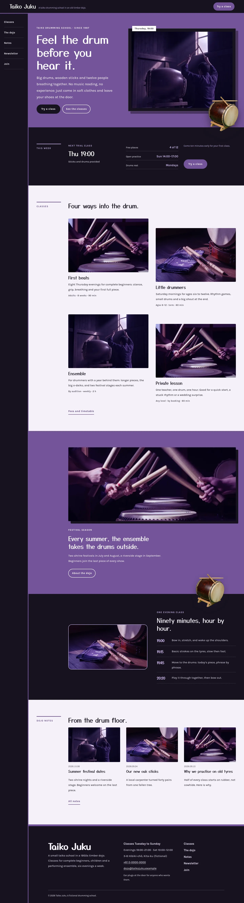

# Taiko Juku

Taiko Juku — a taiko drumming school theme that scrolls like a vertical scroll: a sumi header with the school name and a Try a class button, whose menu runs down a fixed side rail on wide screens (top to bottom in Chinese and Japanese). Edo purple (#745399) is the main colour: the hero, every page head and the festival band are purple fields with white type. The hero is a framed window: a low-key photograph of a drummer in a dark timber dojo inside a deep sumi frame, with a cut-out drum breaking out of the window and over the hero edge; a second cut-out drum breaks over the class band. Every picture is a low-key photograph (50mm f/1.4, hard window light, dark ground, graded toward Edo purple). Yusei Magic for display, Karla for reading. Sample content in English, Traditional Chinese, Japanese, French and German; vertical section labels only in Chinese and Japanese. WCAG AA colours; no entrance animations.

- Design plan row b3-22: tategaki-vertical-scroll, framed-window hero, side-rail nav, real-photography, low-key, Edo purple (edo-murasaki) #745399, Yusei Magic + Karla.
- Sample content languages: en, zh-TW, ja, fr, de.
- Contrast: white #FFFFFF on Edo purple #745399 6.1:1 (all text on the hero, page heads and festival band); paper #F5F1F8 on Edo purple 5.5:1; sumi #17121F on paper #F5F1F8 16.5:1; deep purple #5B3F7E on paper 7.7:1 (links, labels); ash violet #544B5E on paper 7.4:1 (secondary text); lilac #C9B3E6 on sumi 9.7:1 (labels, times on the header, rail, board and class band); paper on sumi 16.5:1; white on sumi buttons 18.4:1; sumi on Edo purple only 3.0:1, never used for text.

## Templates and patterns

Every template is the header (with the side-rail menu on wide screens), the page column and the footer. Page bodies come from patterns (home-hero with the framed window and cut-out drum, home-week with the synced dojo board, home-stays, home-meadow, home-night, home-journal, rooms-*, about-*, letter-*, contact-*); template headings come from tpl-* patterns so they follow the content language.

<!-- screenshots:start -->
## Screenshots

<table>
<tr>
<td valign="top"></td>
<td valign="top"></td>
</tr>
</table>

- Classes: [desktop](screenshots/classes-desktop.webp) · [mobile](screenshots/classes-mobile.webp)
- About: [desktop](screenshots/about-desktop.webp) · [mobile](screenshots/about-mobile.webp)
- News: [desktop](screenshots/news-desktop.webp) · [mobile](screenshots/news-mobile.webp)
- Article: [desktop](screenshots/article-desktop.webp) · [mobile](screenshots/article-mobile.webp)
- Category: [desktop](screenshots/category-desktop.webp) · [mobile](screenshots/category-mobile.webp)
- Tag: [desktop](screenshots/tag-desktop.webp) · [mobile](screenshots/tag-mobile.webp)
- Newsletter: [desktop](screenshots/newsletter-desktop.webp) · [mobile](screenshots/newsletter-mobile.webp)
- Contact: [desktop](screenshots/contact-desktop.webp) · [mobile](screenshots/contact-mobile.webp)
- Search: [desktop](screenshots/search-desktop.webp) · [mobile](screenshots/search-mobile.webp)
- Other languages (home page): [zh-TW](screenshots/zh-TW/home-desktop.webp) · [ja](screenshots/ja/home-desktop.webp) · [fr](screenshots/fr/home-desktop.webp) · [de](screenshots/de/home-desktop.webp)
<!-- screenshots:end -->
