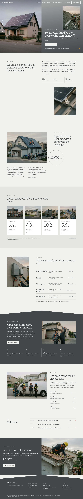

# Taiyo Solar Works

A quiet block theme (type business) for a regional solar installation company, in five languages (English, Traditional Chinese, Japanese, French, German). It works without WooCommerce or any plugin; the free roof assessment is a plain HTML form.

## Signature
- Split first screen: a roof photograph on the left half, a graphite gradient panel on the right with an inset portrait and a vertical "install / 07" label. The same split opens every inner page.
- Two overlapping 1 px hairline circles carrying case figures (system size, estimated yearly output).
- White numeral cards (system size in kW) on a darker grey band, with [0n] section labels; a shallow roof-pitch edge on the dark band and the footer.

## Pages
Home, Installations, Kenning case study, Residential Solar, Battery Storage and EV Charging, Commercial Roofs, How It Works, Maintenance and Warranty, Pricing and Financing, Free Roof Assessment, About, Contact, Journal (six posts).

## Patterns
- `footer-main`
- `front-assessment`
- `front-close`
- `front-crew`
- `front-featured-case`
- `front-installations`
- `front-notes`
- `front-roofwork`
- `front-services`
- `front-split`
- `header-main`
- `page-about`
- `page-battery-storage-ev-charging`
- `page-commercial-roofs`
- `page-contact`
- `page-free-roof-assessment`
- `page-how-it-works`
- `page-installations`
- `page-kenning-case`
- `page-maintenance-warranty`
- `page-pricing-financing`
- `page-residential-solar`
- `tpl-404`
- `tpl-archive`
- `tpl-category`
- `tpl-index`
- `tpl-tag`

## Fonts
Merriweather and Source Sans 3 (SIL OFL 1.1, licences in assets/fonts).

## Images (AI-generated for this theme, no text or logos; assets/images/)
- assets/images/p1.webp
- assets/images/p10.webp
- assets/images/p11.webp
- assets/images/p12.webp
- assets/images/p13.webp
- assets/images/p14.webp
- assets/images/p15.webp
- assets/images/p16.webp
- assets/images/p17.webp
- assets/images/p18.webp
- assets/images/p2.webp
- assets/images/p3.webp
- assets/images/p4.webp
- assets/images/p5.webp
- assets/images/p6.webp
- assets/images/p7.webp
- assets/images/p8.webp
- assets/images/p9.webp

<!-- screenshots:start -->
## Screenshots

<table>
<tr>
<td valign="top"></td>
<td valign="top"></td>
</tr>
</table>

- News: [desktop](screenshots/news-desktop.webp) · [mobile](screenshots/news-mobile.webp)
- Article: [desktop](screenshots/article-desktop.webp) · [mobile](screenshots/article-mobile.webp)
- Category: [desktop](screenshots/category-desktop.webp) · [mobile](screenshots/category-mobile.webp)
- Installations: [desktop](screenshots/installations-desktop.webp) · [mobile](screenshots/installations-mobile.webp)
- Kenning case: [desktop](screenshots/kenning-case-desktop.webp) · [mobile](screenshots/kenning-case-mobile.webp)
- Residential solar: [desktop](screenshots/residential-solar-desktop.webp) · [mobile](screenshots/residential-solar-mobile.webp)
- Battery storage ev charging: [desktop](screenshots/battery-storage-ev-charging-desktop.webp) · [mobile](screenshots/battery-storage-ev-charging-mobile.webp)
- Commercial roofs: [desktop](screenshots/commercial-roofs-desktop.webp) · [mobile](screenshots/commercial-roofs-mobile.webp)
- How it works: [desktop](screenshots/how-it-works-desktop.webp) · [mobile](screenshots/how-it-works-mobile.webp)
- Maintenance warranty: [desktop](screenshots/maintenance-warranty-desktop.webp) · [mobile](screenshots/maintenance-warranty-mobile.webp)
- Pricing financing: [desktop](screenshots/pricing-financing-desktop.webp) · [mobile](screenshots/pricing-financing-mobile.webp)
- Free roof assessment: [desktop](screenshots/free-roof-assessment-desktop.webp) · [mobile](screenshots/free-roof-assessment-mobile.webp)
- About: [desktop](screenshots/about-desktop.webp) · [mobile](screenshots/about-mobile.webp)
- Contact: [desktop](screenshots/contact-desktop.webp) · [mobile](screenshots/contact-mobile.webp)
- Newsletter: [desktop](screenshots/newsletter-desktop.webp) · [mobile](screenshots/newsletter-mobile.webp)
- Tag: [desktop](screenshots/tag-desktop.webp) · [mobile](screenshots/tag-mobile.webp)
- Search: [desktop](screenshots/search-desktop.webp) · [mobile](screenshots/search-mobile.webp)
- Other languages (home page): [zh-TW](screenshots/zh-TW/home-desktop.webp) · [ja](screenshots/ja/home-desktop.webp) · [fr](screenshots/fr/home-desktop.webp) · [de](screenshots/de/home-desktop.webp)
<!-- screenshots:end -->
