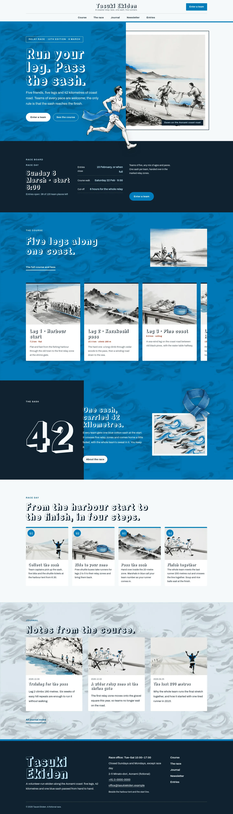
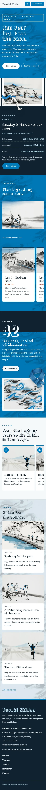

# Tasuki Ekiden

Tasuki Ekiden — a community ekiden relay race theme with a formal top header: the race name centred on the top row, the Enter a team button at its right end and the menu centred on its own row beneath. Konpeki blue (#007BBB) is the main colour: the hero text half, the course strip, the sash band, every page head and the overlay menu are konpeki fields with a sumi-ink wind-and-wave brush pattern multiplied in, set in white. The hero puts the text on the left and a framed sumi-ink painting of a sash handover on the right; a cut-out runner breaks out of the frame across the blue field and over the hero bottom edge. Horizontal strips: the five legs of the course scroll sideways as one strip of cards, race day runs as a four-step strip, and the race board is one long band. A cut-out blue sash breaks over the sash band. Every picture is a sumi-ink brush painting with cerulean washes. Rampart One for display, Archivo for reading, Noto Sans TC for Traditional Chinese headings. Sample content in English, Traditional Chinese, Japanese, French and German; vertical labels only in Chinese and Japanese. WCAG AA colours; no entrance animations.

- Design plan row b4-1: horizontal-strip, text-left-art-right hero, centered nav, full-illustration, sumi-ink, konpeki #007BBB, Rampart One + Archivo.
- Sample content languages: en, zh-TW, ja, fr, de.
- Contrast: white #FFFFFF on konpeki #007BBB 4.6:1 (all text on the hero field, the course band, the sash band, page heads and the menu panel; konpeki is never used as small text on paper); sumi ink #0F2230 on paper #F5F8FA 15.2:1; deep konpeki #00507A on paper 8.1:1 and on white 8.6:1 (links, labels); slate #4A5A66 on paper 6.7:1 (secondary text); ink on pale sky #E2EEF5 13.8:1 (fees and details cards); light sky #BFE3F5 on ink 12.0:1 (board values, footer name, hero label); white on ink 16.3:1; deep vermilion #A33B20 on white 6.6:1 and on paper 6.1:1 (small leg facts); ink on konpeki only 3.5:1, never used for text.
- Break-frame: the cut-out runner (transparent WebP) breaks out of the framed hero painting, across the konpeki field and over the hero bottom edge into the race board; the cut-out blue sash breaks over the sash band's top edge and its framed painting; the runner breaks over the bottom edge of every page head.

## Templates and patterns

Every template is the centred header, the page column and the footer. Page bodies come from patterns (home-hero with the text on the left, the framed painting on the right and the cut-out runner, home-board with the synced race board, home-works with the course legs as a horizontal strip, home-serial with the sash band and the cut-out sash, home-process as a race-day strip, home-journal, and a konpeki page head per page). The race board, race office details and entry fees are synced patterns.

<!-- screenshots:start -->
## Screenshots

<table>
<tr>
<td valign="top"></td>
<td valign="top"></td>
</tr>
</table>

- Services: [desktop](screenshots/services-desktop.webp) · [mobile](screenshots/services-mobile.webp)
- About: [desktop](screenshots/about-desktop.webp) · [mobile](screenshots/about-mobile.webp)
- News: [desktop](screenshots/news-desktop.webp) · [mobile](screenshots/news-mobile.webp)
- Article: [desktop](screenshots/article-desktop.webp) · [mobile](screenshots/article-mobile.webp)
- Category: [desktop](screenshots/category-desktop.webp) · [mobile](screenshots/category-mobile.webp)
- Tag: [desktop](screenshots/tag-desktop.webp) · [mobile](screenshots/tag-mobile.webp)
- Newsletter: [desktop](screenshots/newsletter-desktop.webp) · [mobile](screenshots/newsletter-mobile.webp)
- Contact: [desktop](screenshots/contact-desktop.webp) · [mobile](screenshots/contact-mobile.webp)
- Search: [desktop](screenshots/search-desktop.webp) · [mobile](screenshots/search-mobile.webp)
- Other languages (home page): [zh-TW](screenshots/zh-TW/home-desktop.webp) · [ja](screenshots/ja/home-desktop.webp) · [fr](screenshots/fr/home-desktop.webp) · [de](screenshots/de/home-desktop.webp)
<!-- screenshots:end -->
