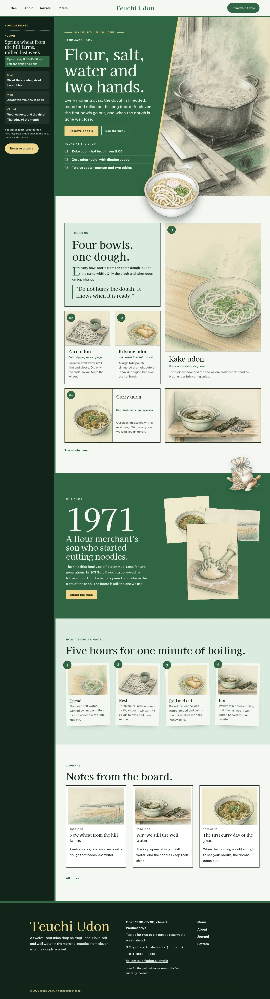
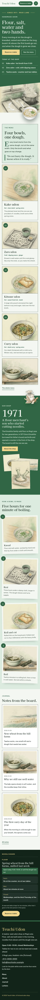

# Teuchi Udon

Teuchi Udon — a handmade udon shop theme laid out like an app: under a formal top header, a pine-ink sidebar holds the synced noodle board (today's flour, hours, seats, wait, closed days and a Reserve a table button) and stays beside the page while it scrolls. The header splits the menu around the centred shop name, with the Reserve a table button at its end. Chitose green (#316745), the deep pine green of traditional Japanese dyeing, is the main colour: the hero, the story band and every page head are chitose green fields set in rice-paper white, with wheat-gold labels. The hero is a diagonal split: the title, lead, buttons and today's bowls on the green field, the pencil sketch of the noodle kitchen cut on a slant beside it, and a cut-out bowl of udon (transparent WebP) sitting on the seam and breaking over the hero bottom edge; a cut-out flour sack breaks over the story band and every page head. Every picture is a full pencil-sketch illustration with a soft green and wheat wash. The menu is a card mosaic of four bowls. Kaisei Decol for display, Be Vietnam Pro for reading, Noto Serif TC for Traditional Chinese headings. Sample content in English, Traditional Chinese, Japanese, French and German; vertical labels only in Chinese and Japanese. WCAG AA colours; no entrance animations.

- Design plan row b4-10: sidebar-app, diagonal-split hero, split nav, full-illustration (pencil-sketch), chitose #316745, Kaisei Decol + Be Vietnam Pro.
- Sample content languages: en, zh-TW, ja, fr, de.
- Contrast: rice paper #F4F7F2 on chitose #316745 6.2:1 (all text on the hero, the story band, every page head and the green overlay menu; white on chitose 6.7:1); wheat #F0D58C on chitose 4.6:1 (eyebrows, issue line, labels on green); ink #12241A on wheat buttons 11.3:1; pine ink #12241A on paper 15.0:1 and on mist #DCEBDF 13.1:1; deep chitose #24503A on paper 8.5:1 and on mist 7.4:1 (links, labels, menu facts); moss grey #4A5A50 on paper 6.8:1 and on mist 5.9:1 (secondary text); paper on pine ink 15.0:1 and wheat on pine ink 11.3:1 (sidebar board, footer); chitose on paper 6.2:1 (shop name, header button); ink on chitose only 2.4:1, never used for text.
- Break-frame: the cut-out udon bowl (transparent WebP) sits on the diagonal seam of the hero and breaks over its bottom edge; the cut-out flour sack breaks over the top edge of the story band and the bottom edge of every page head.

<!-- screenshots:start -->
## Screenshots

<table>
<tr>
<td valign="top"></td>
<td valign="top"></td>
</tr>
</table>

- Menu: [desktop](screenshots/menu-desktop.webp) · [mobile](screenshots/menu-mobile.webp)
- About: [desktop](screenshots/about-desktop.webp) · [mobile](screenshots/about-mobile.webp)
- News: [desktop](screenshots/news-desktop.webp) · [mobile](screenshots/news-mobile.webp)
- Article: [desktop](screenshots/article-desktop.webp) · [mobile](screenshots/article-mobile.webp)
- Category: [desktop](screenshots/category-desktop.webp) · [mobile](screenshots/category-mobile.webp)
- Tag: [desktop](screenshots/tag-desktop.webp) · [mobile](screenshots/tag-mobile.webp)
- Newsletter: [desktop](screenshots/newsletter-desktop.webp) · [mobile](screenshots/newsletter-mobile.webp)
- Contact: [desktop](screenshots/contact-desktop.webp) · [mobile](screenshots/contact-mobile.webp)
- Search: [desktop](screenshots/search-desktop.webp) · [mobile](screenshots/search-mobile.webp)
- Other languages (home page): [zh-TW](screenshots/zh-TW/home-desktop.webp) · [ja](screenshots/ja/home-desktop.webp) · [fr](screenshots/fr/home-desktop.webp) · [de](screenshots/de/home-desktop.webp)
<!-- screenshots:end -->
