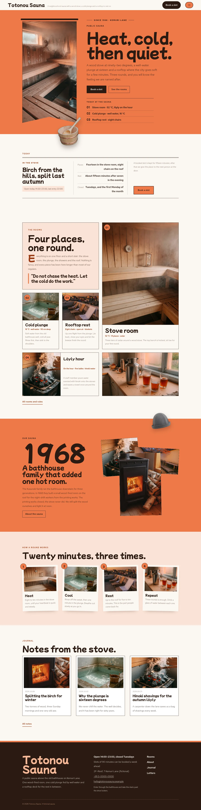

# Totonou Sauna

Totonou Sauna — a neighbourhood public sauna theme built as a card mosaic: the rooms on the home page share one grid of rectangular cards (an intro card, a tall stove-room card, the plunge and roof cards, a wide löyly card and a water photograph). A formal top header: the sauna name and tagline on the left, the Book a slot button and a Menu button on the right; the menu always opens as a full-screen ouni orange overlay with large numbered entries. Ouni orange (#EE7948) is the main colour: the hero, the story band, every page head and the overlay menu are solid orange fields set in dark sauna ink. The hero is a vertical banner: a tall hanging banner photograph of the steam room on a rod, beside the giant title, lead, buttons and today's sauna list; the cut-out wooden sauna bucket (transparent WebP) hangs over the banner edge and breaks below the hero, and a cut-out felt sauna hat breaks over the story band and every page head. Every picture is a documentary-style photograph (35mm wide angle, available light, fine grain) graded toward ouni orange. Mochiy Pop P One for display, Red Hat Text for reading, Noto Sans TC for Traditional Chinese headings. Sample content in English, Traditional Chinese, Japanese, French and German; vertical labels only in Chinese and Japanese. WCAG AA colours; no entrance animations.

- Design plan row b4-9: card-mosaic, vertical-banner hero, overlay nav, real-photography (documentary), ouni #EE7948, Mochiy Pop P One + Red Hat Text.
- Sample content languages: en, zh-TW, ja, fr, de.
- Contrast: ink #2A1A12 on ouni #EE7948 5.95:1 (all text on the hero, the story band, every page head, the overlay menu and the orange buttons); ink on paper #FBF7F2 15.7:1 and on mist #FBE3D6 13.6:1; burnt ouni #9A3A14 on paper 6.6:1 and on mist 5.7:1 (links, labels, eyebrows, room facts); brown grey #6B5248 on paper 6.7:1 and on mist 5.8:1 (secondary text); paper on ink 15.7:1, pale ouni #F6B896 on ink 9.7:1 and ouni on ink 5.95:1 (footer, Book button); white on ouni is only 2.8:1 and ouni on paper 2.6:1, so neither is ever used for text (ouni on paper only for rules, number badges and the header underline).
- Break-frame: the cut-out wooden sauna bucket (transparent WebP) hangs over the edge of the vertical banner photograph and breaks below the hero; the cut-out felt hat breaks over the top edge of the story band and the bottom edge of every page head.

<!-- screenshots:start -->
## Screenshots

<table>
<tr>
<td valign="top"></td>
<td valign="top"></td>
</tr>
</table>

- Projects: [desktop](screenshots/projects-desktop.webp) · [mobile](screenshots/projects-mobile.webp)
- About: [desktop](screenshots/about-desktop.webp) · [mobile](screenshots/about-mobile.webp)
- News: [desktop](screenshots/news-desktop.webp) · [mobile](screenshots/news-mobile.webp)
- Article: [desktop](screenshots/article-desktop.webp) · [mobile](screenshots/article-mobile.webp)
- Category: [desktop](screenshots/category-desktop.webp) · [mobile](screenshots/category-mobile.webp)
- Tag: [desktop](screenshots/tag-desktop.webp) · [mobile](screenshots/tag-mobile.webp)
- Newsletter: [desktop](screenshots/newsletter-desktop.webp) · [mobile](screenshots/newsletter-mobile.webp)
- Contact: [desktop](screenshots/contact-desktop.webp) · [mobile](screenshots/contact-mobile.webp)
- Search: [desktop](screenshots/search-desktop.webp) · [mobile](screenshots/search-mobile.webp)
- Other languages (home page): [zh-TW](screenshots/zh-TW/home-desktop.webp) · [ja](screenshots/ja/home-desktop.webp) · [fr](screenshots/fr/home-desktop.webp) · [de](screenshots/de/home-desktop.webp)
<!-- screenshots:end -->
