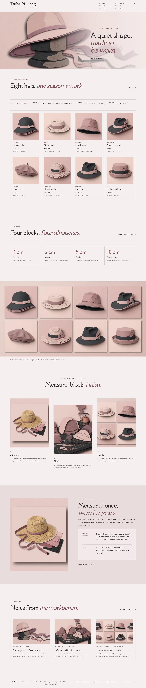

# Tsuba Millinery

An elegant, sculptural block theme for a **small milliner's atelier** and its online shop. A ShipPress **store** theme: WooCommerce templates styled to match, eight sample hats in four shape categories, and a shop that still works without WooCommerce.

The demo atelier is fictional: Tsuba Millinery, 2-11 Kasane-chō, Hoshikawa City, run by milliner Rin Tsubaki.

## Concept: felt, paper and shape

- **Palette.** Felt blush `#F6EFEF`, petal `#E8DCDC`, ink `#2E2628`, one muted mauve `#A27C80` for rules, numerals and large type; deep mauve `#7A5257` for links.
- **Type.** Della Respira (display, prices, menu numerals) and Sen (text, labels, filters).
- **Visual style.** Layered paper-cut illustrations (stacked cut-paper planes with small drop shadows), generated as WebP; product pictures are crops of one collection illustration.
- **Details as product attributes.** Shape, material, brim and sizes; material and brim print under every price.

## Codes

- **H12 header.** The wordmark on the left, a numbered menu list (01–06) set in the corner on the right, mini cart when WooCommerce is active.
- **F3 footer.** One line of shop details: wordmark, atelier address and hours (synced), links, copyright.
- **L14 home layout.** Find your shape: a short paper-cut hero, then a filter-first catalogue (shape, material, head size) with each hat on a plain blush cell.

## One source for shared details

| What | Source | Shown on |
| --- | --- | --- |
| Milliner, atelier address, hours, telephone, email | `inc/info/foundry.html` (synced pattern) | Footer, Atelier, Contact |
| Sizing guide | `inc/info/care.html` (synced pattern) | Fit & sizing, product pages |
| Shapes table | `inc/info/lines.html` (synced pattern) | Made to order, Atelier |
| Material and brim line | each product's `Material` and `Brim` attributes | Product cards and product page |

## Pages and templates

Demo pages: Home, Shop, Fit & sizing, Made to order, Atelier, Journal (posts page), Newsletter and Contact, with sample posts, categories and tags.

Templates: front page, page, wide page, single post, journal, archive, category, tag, search, 404, plus WooCommerce shop, product category and tag archives, product, cart, checkout, my account, order confirmation and product search.

## WooCommerce

Optional. With it active, `inc/woo-import.php` adds four shape categories (Cloche, Boater, Bucket, Wide brim), material tags and eight hats with images, prices and attributes; run twice it creates nothing new. Without it the home catalogue and the Shop page show a static catalogue that links to Contact, and orders go by email.

## Licence

GPL-2.0-or-later. Fonts OFL-1.1 (see `assets/fonts/`): Della Respira (Reserved Font Name, unmodified) and Sen, shipped as unmodified TTF. Images AI-generated for this theme with Grok Build image_gen, layered paper-cut illustration style, released under GPL-2.0-or-later.

<!-- screenshots:start -->
## Screenshots

<table>
<tr>
<td valign="top"></td>
<td valign="top"></td>
</tr>
</table>

- Shop: [desktop](screenshots/shop-desktop.webp) · [mobile](screenshots/shop-mobile.webp)
- Product: [desktop](screenshots/product-desktop.webp) · [mobile](screenshots/product-mobile.webp)
- About: [desktop](screenshots/about-desktop.webp) · [mobile](screenshots/about-mobile.webp)
- Fit sizing: [desktop](screenshots/fit-sizing-desktop.webp) · [mobile](screenshots/fit-sizing-mobile.webp)
- Made to order: [desktop](screenshots/made-to-order-desktop.webp) · [mobile](screenshots/made-to-order-mobile.webp)
- Contact: [desktop](screenshots/contact-desktop.webp) · [mobile](screenshots/contact-mobile.webp)
- News: [desktop](screenshots/news-desktop.webp) · [mobile](screenshots/news-mobile.webp)
- Article: [desktop](screenshots/article-desktop.webp) · [mobile](screenshots/article-mobile.webp)
- Category: [desktop](screenshots/category-desktop.webp) · [mobile](screenshots/category-mobile.webp)
- Tag: [desktop](screenshots/tag-desktop.webp) · [mobile](screenshots/tag-mobile.webp)
- Newsletter: [desktop](screenshots/newsletter-desktop.webp) · [mobile](screenshots/newsletter-mobile.webp)
- Search: [desktop](screenshots/search-desktop.webp) · [mobile](screenshots/search-mobile.webp)
<!-- screenshots:end -->
