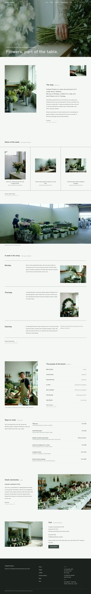

# Tsubaki Flowers

A WordPress block theme for a fictional florist shop (Aldmere, since 2011) that makes flowers for households and small ceremonies. Type: store (WooCommerce-compatible, works without it). Sample content is in English; zh-TW, ja, fr and de follow in stage two. Design notes and the reference mapping are in [`brand/`](brand/).

## Concept
- **Palette.** Cool off-white `#F4F6F3`, green-black ink `#1B221E` hairlines, deep green `#3F4D44` buttons, celadon `#6E7F74` accent.
- **Type.** Hanken Grotesk headings, Onest body; Noto Sans TC/JP for CJK.
- **Signature.** White intro screen fading to a full-bleed film-grain hero with the headline bottom left; a hairline three-column "Stems of the week" grid; an asymmetric shop block with a floating small photo. Scroll: sp-parallax on the hero and market band, masked reveal with stagger.

## Status
Home page (en) is final for stage two: hero text contrast and mobile crop fixed, photos regraded to a deeper green, hairline columns run into the top rule, no horizontal overflow at 390 px, block editor validation clean, the main menu links to the seven inner pages. Inner pages, WooCommerce products and the translations follow.

<!-- screenshots:start -->
## Screenshots

<table>
<tr>
<td valign="top"></td>
<td valign="top"></td>
</tr>
</table>

- Story: [desktop](screenshots/story-desktop.webp) · [mobile](screenshots/story-mobile.webp)
- People: [desktop](screenshots/people-desktop.webp) · [mobile](screenshots/people-mobile.webp)
- Week: [desktop](screenshots/week-desktop.webp) · [mobile](screenshots/week-mobile.webp)
- Flowers prices: [desktop](screenshots/flowers-prices-desktop.webp) · [mobile](screenshots/flowers-prices-mobile.webp)
- Shop: [desktop](screenshots/shop-desktop.webp) · [mobile](screenshots/shop-mobile.webp)
- Visit: [desktop](screenshots/visit-desktop.webp) · [mobile](screenshots/visit-mobile.webp)
- Journal: [desktop](screenshots/journal-desktop.webp) · [mobile](screenshots/journal-mobile.webp)
- About: [desktop](screenshots/about-desktop.webp) · [mobile](screenshots/about-mobile.webp)
- News: [desktop](screenshots/news-desktop.webp) · [mobile](screenshots/news-mobile.webp)
- Article: [desktop](screenshots/article-desktop.webp) · [mobile](screenshots/article-mobile.webp)
- Category: [desktop](screenshots/category-desktop.webp) · [mobile](screenshots/category-mobile.webp)
- Tag: [desktop](screenshots/tag-desktop.webp) · [mobile](screenshots/tag-mobile.webp)
- Newsletter: [desktop](screenshots/newsletter-desktop.webp) · [mobile](screenshots/newsletter-mobile.webp)
- Contact: [desktop](screenshots/contact-desktop.webp) · [mobile](screenshots/contact-mobile.webp)
- Other languages (home page): [zh-TW](screenshots/zh-TW/home-desktop.webp) · [ja](screenshots/ja/home-desktop.webp) · [fr](screenshots/fr/home-desktop.webp) · [de](screenshots/de/home-desktop.webp)
<!-- screenshots:end -->
