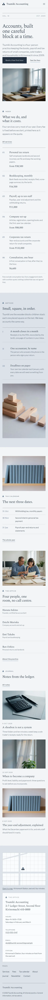

# Tsumiki Accounting

A precise, editorial and minimal block theme for a **small accounting practice**: personal tax returns, bookkeeping, payroll and company set-up.

*Tsumiki* (wooden building blocks). The demo practice is a fictional four-person office on Ledger Street in Kirinomachi, founded by Haruna Sekino with Daichi Morioka, Emi Takabe and Ren Oshiro.

## Concept: accounts, one block at a time

- **Paper, mist, ink navy, slate.** Ground `#F3F4F6`, mist `#DCE1E8` for bands and the footer, ink navy `#22303F` for text (12.2:1). One slate accent `#4B6584` for links, numbers and the block marks (5.5:1 on paper, 4.6:1 on mist); quiet text `#4E5D6E` (6.1:1), cards `#FAFBFC`. Square corners, hairlines, no bright colour.
- **Type.** Spectral (display, Light 300) over Commissioner (text, Light 300). Both OFL-1.1 without a Reserved Font Name, subset to Latin WOFF2. Fees, service numbers and dates use tabular lining figures.
- **Signature: the stacked-block mark.** Three small CSS squares, two side by side with one on top, open every section label, the logo, the separator and the map pin. No SVG illustrations, no entrance animations.

## Header, footer, layout (ROADMAP codes)

- **H12 split header**: wordmark and a one-line descriptor top-left, the menu as a numbered list (01–06, CSS counters) in the top-right corner; a hamburger overlay on phones.
- **F6 map + address card**: a static street plan drawn in CSS (roads, a dashed railway, the block pin, an "Open in a map" link, no embeds or API keys) beside the synced office card and a page list.
- **L3 editorial masthead + index list**: dateline row (volume, tax year and town, established), a large headline, one wide photograph, then the numbered service index with fees.

## One source for shared details

- **Office details** (address, hours, telephone, email, station) are the synced pattern `Tsumiki Accounting: office details`, shown in the footer and on the Contact page.
- **Fee schedule** (the numbered index of six services with fees) is the synced pattern `Tsumiki Accounting: fee schedule`, shown on the home, Services and Fees pages.
- Both are created once by `inc/shared-info.php` from `inc/info/*.html`; pages hold only references. The demo import (`inc/demo-import.php`) is idempotent and never overwrites user content.

## Pages and templates

Home, Services, Fees, Tax calendar, About, Journal (posts page), Newsletter, Contact; article, category, tag, search and 404 templates. Six journal posts in three categories (Bookkeeping, Tax dates, Small business) with six tags.

## Licence

GPL-2.0-or-later. Fonts OFL-1.1 (see `assets/fonts/`). Photographs AI-generated for this theme, released under GPL-2.0-or-later / CC0. All names, the address, phone numbers, dates and fees are fictional; the tax calendar is sample content, not tax advice.

<!-- screenshots:start -->
## Screenshots

<table>
<tr>
<td valign="top"></td>
<td valign="top"></td>
</tr>
</table>

- Services: [desktop](screenshots/services-desktop.webp) · [mobile](screenshots/services-mobile.webp)
- Fees: [desktop](screenshots/fees-desktop.webp) · [mobile](screenshots/fees-mobile.webp)
- Tax calendar: [desktop](screenshots/tax-calendar-desktop.webp) · [mobile](screenshots/tax-calendar-mobile.webp)
- About: [desktop](screenshots/about-desktop.webp) · [mobile](screenshots/about-mobile.webp)
- News: [desktop](screenshots/news-desktop.webp) · [mobile](screenshots/news-mobile.webp)
- Article: [desktop](screenshots/article-desktop.webp) · [mobile](screenshots/article-mobile.webp)
- Category: [desktop](screenshots/category-desktop.webp) · [mobile](screenshots/category-mobile.webp)
- Tag: [desktop](screenshots/tag-desktop.webp) · [mobile](screenshots/tag-mobile.webp)
- Newsletter: [desktop](screenshots/newsletter-desktop.webp) · [mobile](screenshots/newsletter-mobile.webp)
- Contact: [desktop](screenshots/contact-desktop.webp) · [mobile](screenshots/contact-mobile.webp)
- Search: [desktop](screenshots/search-desktop.webp) · [mobile](screenshots/search-mobile.webp)
<!-- screenshots:end -->
