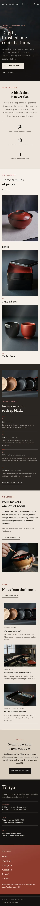

# Tsuya Lacquer

A luxe, restrained block theme for a **small urushi lacquerware workshop** and its online shop. A ShipPress **store** theme: WooCommerce templates styled to match, eight sample products in three categories, and a shop page that still works without WooCommerce.

*Tsuya* (sheen). The demo workshop is a fictional old merchant's house in the river town of Kasumi-machi, shared by four makers: Ren Ashikaga, Mio Sakuragi, Taku Hoshino and Nao Ebisawa.

## Concept: depth, one coat at a time

- **Lacquer black, brown-black, warm ivory, one cinnabar.** Text and dark bands `#141211`, deep brown-black panels `#2A2523`, ivory ground `#EDE6DC` with pale ivory `#F5F0E8` and sand `#D8CEC0` panels, so dark and light sections alternate. One muted cinnabar `#8E3B2E` (6.6:1 on ivory) for links, labels and the footer panel; on black it is only 2.2:1, so marks there use a lighter cinnabar `#C98371` (6.0:1).
- **Type.** Castoro (display: headings, the overlay menu, the footer wordmark, figures, prices) and Epilogue (text, labels, buttons). Both OFL-1.1 from google/fonts, Latin WOFF2 subsets bundled, no CDN.
- **Signature: gloss and layers.** Product photographs carry a soft, still diagonal highlight like polished urushi (it drifts a few percent on hover; still under `prefers-reduced-motion`). Every product shows its **layers of lacquer** count under the price, read from the product's `Layers of lacquer` attribute (one source, edited in the product editor). The Craft page explains the six stages and up to thirty-six coats.
- No entrance animations, no hand-drawn illustrations.

## Header, footer, layout (ROADMAP codes)

- **H4 hamburger only + full-screen overlay.** Wordmark left, one "Menu" button (two hairlines) right, at every width; the core navigation overlay (focus trap, Escape to close) opens in lacquer black with a faint gloss, its items set large in Castoro with cinnabar numbers 01–06 on hairline rows. On the home page the header lies over the photograph in ivory. Without JavaScript the menu shows as a plain list.
- **F10 split two-tone panel.** Edge to edge: lacquer black (7/12) with the TSUYA wordmark, a line and the synced workshop details; muted cinnabar (5/12) with the menu in Castoro and the re-coat note. A thin legal line below.
- **L1 full-bleed photo hero.** A glossy black bowl fills the first screen, the words on its dark side. H4 + F10 + L1 is not used by any other theme.

## One source for shared details

| Synced pattern | Source | Shown on |
|---|---|---|
| Workshop address, hours, email | `inc/info/house.html` | footer (every page), contact |
| The shelf: eight pieces, layer counts, prices, the editable "Most gifted" badge | `inc/info/shelf.html` | shop (without WooCommerce) |

Each is a synced pattern (`wp_block`) created on activation by `inc/shared-info.php`, tagged `_tsuya_lacquer_info` and never created twice. With WooCommerce, the layer count comes from each product's attribute (`functions.php`, `render_block_woocommerce/product-price`).

## Pages and templates

Demo pages: Home, Shop, The Craft (the coats, the curing cabinet, why the count matters), Care guide (four habits, what to avoid), Workshop, Journal (posts page), Newsletter and Contact. Six sample posts in three categories (Craft, Woods & urushi, From the workshop) with six tags.

Templates: front-page, page, page-wide, home, index, single, archive, category, tag, search and 404; for WooCommerce archive-product, single-product, page-cart, page-checkout, page-my-account, order-confirmation and product-search-results (search via core/search limited to products), plus a checkout header part.

## WooCommerce

Optional. With it active, `inc/woo-import.php` adds three product categories (Bowls, Trays & boxes, Table pieces), four tags and eight products with photographs, prices and attributes (layers of lacquer, wood, size, care); run twice it creates nothing new. Without it the Shop page shows the synced shelf and orders go by email.

## Licence

GPL-2.0-or-later. Fonts OFL-1.1 (see `assets/fonts/`). Photographs AI-generated for this theme, released under GPL-2.0-or-later / CC0.

<!-- screenshots:start -->
## Screenshots

<table>
<tr>
<td valign="top"></td>
<td valign="top"></td>
</tr>
</table>

- Shop: [desktop](screenshots/shop-desktop.webp) · [mobile](screenshots/shop-mobile.webp)
- Product: [desktop](screenshots/product-desktop.webp) · [mobile](screenshots/product-mobile.webp)
- The craft: [desktop](screenshots/the-craft-desktop.webp) · [mobile](screenshots/the-craft-mobile.webp)
- Care guide: [desktop](screenshots/care-guide-desktop.webp) · [mobile](screenshots/care-guide-mobile.webp)
- About: [desktop](screenshots/about-desktop.webp) · [mobile](screenshots/about-mobile.webp)
- Contact: [desktop](screenshots/contact-desktop.webp) · [mobile](screenshots/contact-mobile.webp)
- News: [desktop](screenshots/news-desktop.webp) · [mobile](screenshots/news-mobile.webp)
- Article: [desktop](screenshots/article-desktop.webp) · [mobile](screenshots/article-mobile.webp)
- Category: [desktop](screenshots/category-desktop.webp) · [mobile](screenshots/category-mobile.webp)
- Tag: [desktop](screenshots/tag-desktop.webp) · [mobile](screenshots/tag-mobile.webp)
- Newsletter: [desktop](screenshots/newsletter-desktop.webp) · [mobile](screenshots/newsletter-mobile.webp)
- Search: [desktop](screenshots/search-desktop.webp) · [mobile](screenshots/search-mobile.webp)
<!-- screenshots:end -->
