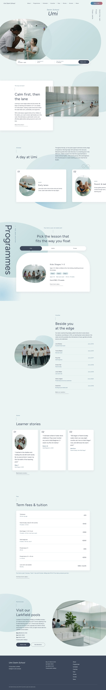

# Umi Swim School

Block theme (business, works without WooCommerce) for a swimming school for children and adult beginners.

## Home
- Hero: pool-edge documentary photo in a water-shaped blob, overlapped by a translucent water blob; info pill bar.
- Concept card with parallax photo, a horizontal day-schedule strip of oval-photo cards (06:30 to 19:30), programme pill tabs (Kids / Adults / Private) with a vertical title, coaches, stories, fees and access.

## Notes
- Fonts: Figtree and Inter Tight, loaded via theme.json; Noto Sans TC/JP fallback for CJK.
- Scroll effects: assets/sp-scroll.css/js (sp-reveal, sp-stagger, sp-parallax); they respect prefers-reduced-motion and are static in the editor and without JS. Tabs and strip buttons: assets/tabs.js.
- Photos: assets/images (16 webp, documentary, pale aqua).
- Status: home page (English) only; inner pages and other languages are added in later steps.

<!-- screenshots:start -->
## Screenshots

<table>
<tr>
<td valign="top"></td>
<td valign="top"></td>
</tr>
</table>

- About: [desktop](screenshots/about-desktop.webp) · [mobile](screenshots/about-mobile.webp)
- Programmes: [desktop](screenshots/programmes-desktop.webp) · [mobile](screenshots/programmes-mobile.webp)
- Timetable: [desktop](screenshots/timetable-desktop.webp) · [mobile](screenshots/timetable-mobile.webp)
- Coaches: [desktop](screenshots/coaches-desktop.webp) · [mobile](screenshots/coaches-mobile.webp)
- Fees: [desktop](screenshots/fees-desktop.webp) · [mobile](screenshots/fees-mobile.webp)
- First lesson: [desktop](screenshots/first-lesson-desktop.webp) · [mobile](screenshots/first-lesson-mobile.webp)
- Stories: [desktop](screenshots/stories-desktop.webp) · [mobile](screenshots/stories-mobile.webp)
- Pool: [desktop](screenshots/pool-desktop.webp) · [mobile](screenshots/pool-mobile.webp)
- Faq: [desktop](screenshots/faq-desktop.webp) · [mobile](screenshots/faq-mobile.webp)
- Access: [desktop](screenshots/access-desktop.webp) · [mobile](screenshots/access-mobile.webp)
- News: [desktop](screenshots/news-desktop.webp) · [mobile](screenshots/news-mobile.webp)
- Article: [desktop](screenshots/article-desktop.webp) · [mobile](screenshots/article-mobile.webp)
- Category: [desktop](screenshots/category-desktop.webp) · [mobile](screenshots/category-mobile.webp)
- Tag: [desktop](screenshots/tag-desktop.webp) · [mobile](screenshots/tag-mobile.webp)
- Newsletter: [desktop](screenshots/newsletter-desktop.webp) · [mobile](screenshots/newsletter-mobile.webp)
- Contact: [desktop](screenshots/contact-desktop.webp) · [mobile](screenshots/contact-mobile.webp)
- Other languages (home page): [zh-TW](screenshots/zh-TW/home-desktop.webp) · [ja](screenshots/ja/home-desktop.webp) · [fr](screenshots/fr/home-desktop.webp) · [de](screenshots/de/home-desktop.webp)
<!-- screenshots:end -->
