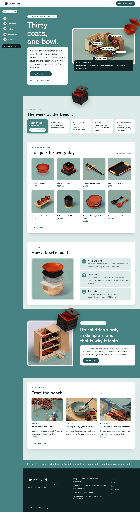
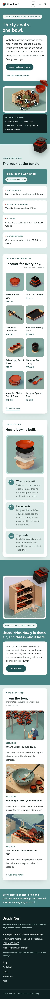

# Urushi Nuri

Urushi Nuri — a WooCommerce store theme for a small urushi lacquerware workshop, laid out like an app with a side rail. A white top header carries the workshop name, the account, the cart and a Shop the lacquerware button; on wide screens the main menu runs down a fixed seiheki side rail under it (numbered; a vertical line in Chinese and Japanese), and below 1100 px it opens as a seiheki panel. Seiheki blue-green (#478384) is the main colour: the hero, the side rail, the drying-room band, every page head and the footer strip are seiheki fields; the pages sit on pale celadon with white app panels. The hero is a scene map: an isometric drawing of the workshop with five numbered pins and a legend; a cut-out vermilion bowl (transparent WebP) breaks out of the map frame and a cut-out jubako breaks over the hero's bottom edge and out of the drying-cabinet frame into the band's top edge. Every picture is a 2.5D isometric illustration. Zen Maru Gothic for display, Manrope for reading. Sample content and products in English, Traditional Chinese, Japanese, French and German; vertical labels only in Chinese and Japanese. Works without WooCommerce. WCAG AA colours; no entrance animations.

- Design plan row b3-28: sidebar-app, scene-map hero, side-rail nav, cutout-break-frame, 2.5d-isometric, seiheki #478384, Zen Maru Gothic + Manrope.
- Sample content languages: en, zh-TW, ja, fr, de.
- Contrast: white #FFFFFF on seiheki #478384 4.3:1, used only for large text (hero and page-head titles at 36 px and up, the hero's vertical line, rail menu items and the overlay menu in 20 px bold and larger, board label 24 px, page-head leads and the footer line in 20 px bold); every smaller label on seiheki sits on a pale chip: deep seiheki #24585A on paper #F3F7F6 7.4:1 (eyebrows, rail label, opening hours, breadcrumbs, rail numbers); body text sits on white panels: ink #0F2222 on white 16.5:1 and on mist #DDEBE8 13.5:1; deep seiheki on white 8.0:1 and on mist 6.5:1 (links, prices, labels, buttons: white on deep 8.0:1); slate #475B5B on white 7.2:1 and on mist 5.9:1 (secondary text); shu vermilion #A6382A on white 6.5:1 (small marks; white on shu 6.5:1 cart badge); white on ink 16.5:1 and pale seiheki #BFE0DB on ink 11.7:1 (footer, map legend, rail hours); ink on seiheki only 3.8:1 and paper on seiheki 4.0:1, never used for small text.
- Break-frame: the cut-out vermilion bowl (transparent WebP) breaks out of the framed workshop map at its top-right corner and over the seiheki hero field; the cut-out jubako breaks over the hero's bottom edge into the workshop board, and a second jubako breaks out of the framed drying-cabinet drawing and over the top edge of the seiheki band; the bowl breaks over the bottom edge of every page head.

## Templates and patterns

Every template is the header (workshop name, account, cart and the Shop the lacquerware button; the menu in the fixed seiheki side rail on wide screens, a menu button below 1100 px), the page column and the footer. Page bodies come from patterns: home-hero (seiheki field, isometric workshop map with five numbered pins and a legend, cut-out bowl and jubako), home-board (synced workshop board as status cards), home-shelf (product grid in a white panel), home-waters (how a bowl is built: exploded bowl and three stage cards), home-break (seiheki band with the cut-out jubako breaking out of the drying cabinet), home-journal, rail (the side rail: label, numbered menu, hours), and the page heads and bodies of Shop, The workshop, Newsletter and Visit. WooCommerce templates: shop and product archives, product search, single product, cart, checkout, my account and order confirmation; their few lines of text come from tpl-t-* patterns in the content language.

<!-- screenshots:start -->
## Screenshots

<table>
<tr>
<td valign="top"></td>
<td valign="top"></td>
</tr>
</table>

- Shop: [desktop](screenshots/shop-desktop.webp) · [mobile](screenshots/shop-mobile.webp)
- Product: [desktop](screenshots/product-desktop.webp) · [mobile](screenshots/product-mobile.webp)
- About: [desktop](screenshots/about-desktop.webp) · [mobile](screenshots/about-mobile.webp)
- Contact: [desktop](screenshots/contact-desktop.webp) · [mobile](screenshots/contact-mobile.webp)
- News: [desktop](screenshots/news-desktop.webp) · [mobile](screenshots/news-mobile.webp)
- Article: [desktop](screenshots/article-desktop.webp) · [mobile](screenshots/article-mobile.webp)
- Category: [desktop](screenshots/category-desktop.webp) · [mobile](screenshots/category-mobile.webp)
- Tag: [desktop](screenshots/tag-desktop.webp) · [mobile](screenshots/tag-mobile.webp)
- Newsletter: [desktop](screenshots/newsletter-desktop.webp) · [mobile](screenshots/newsletter-mobile.webp)
- Search: [desktop](screenshots/search-desktop.webp) · [mobile](screenshots/search-mobile.webp)
- Other languages (home page): [zh-TW](screenshots/zh-TW/home-desktop.webp) · [ja](screenshots/ja/home-desktop.webp) · [fr](screenshots/fr/home-desktop.webp) · [de](screenshots/de/home-desktop.webp)
<!-- screenshots:end -->
