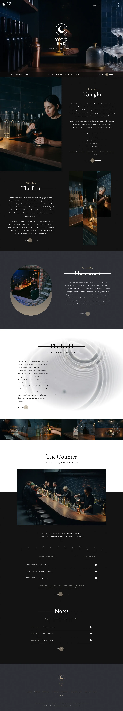
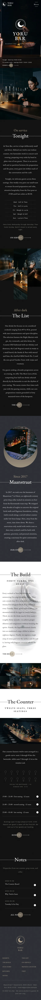

# Yoru Bar

Theme for a reservation-only cocktail bar: near-black ground, lifted ink-blue panel, white and one tan accent, EB Garamond and Work Sans. The home page has a framed full-bleed cover under a transparent overlay header, full-viewport split panels with a struck display word, three tall photo strips, a circle photo with an offset tan disc, a white wash with a bleeding tile strip, a seat arc with seating rows and hairline notes rows. Works without WooCommerce.

## Structure
- `patterns/front-*.php` (home), `head-bar.php`, `foot-main.php`, `plain-moon.php`; `templates/`; `inc/i18n/en.php` (theme strings); `demo-content.json`.
- Scroll effects: `assets/sp-scroll.css|js` (unchanged ShipPress copy).
- Photographs are AI-generated in `assets/images/`.

Status: home page (en) polished for stage 2; menu links resolve to real pages (inner-page copy and the fr, de, zh-TW and ja languages follow).

Design notes: `brand.md`, `brand/design-spec.md`, `brand/reference.md`. License: GPL-2.0-or-later.

<!-- screenshots:start -->
## Screenshots

<table>
<tr>
<td valign="top"></td>
<td valign="top"></td>
</tr>
</table>

- About: [desktop](screenshots/about-desktop.webp) · [mobile](screenshots/about-mobile.webp)
- News: [desktop](screenshots/news-desktop.webp) · [mobile](screenshots/news-mobile.webp)
- Article: [desktop](screenshots/article-desktop.webp) · [mobile](screenshots/article-mobile.webp)
- Category: [desktop](screenshots/category-desktop.webp) · [mobile](screenshots/category-mobile.webp)
- Tag: [desktop](screenshots/tag-desktop.webp) · [mobile](screenshots/tag-mobile.webp)
- Newsletter: [desktop](screenshots/newsletter-desktop.webp) · [mobile](screenshots/newsletter-mobile.webp)
- Contact: [desktop](screenshots/contact-desktop.webp) · [mobile](screenshots/contact-mobile.webp)
- Reserve: [desktop](screenshots/reserve-desktop.webp) · [mobile](screenshots/reserve-mobile.webp)
- The list: [desktop](screenshots/the-list-desktop.webp) · [mobile](screenshots/the-list-mobile.webp)
- The build: [desktop](screenshots/the-build-desktop.webp) · [mobile](screenshots/the-build-mobile.webp)
- On service: [desktop](screenshots/on-service-desktop.webp) · [mobile](screenshots/on-service-mobile.webp)
- Our story: [desktop](screenshots/our-story-desktop.webp) · [mobile](screenshots/our-story-mobile.webp)
- Private counter: [desktop](screenshots/private-counter-desktop.webp) · [mobile](screenshots/private-counter-mobile.webp)
- Kitchen: [desktop](screenshots/kitchen-desktop.webp) · [mobile](screenshots/kitchen-mobile.webp)
- Visit: [desktop](screenshots/visit-desktop.webp) · [mobile](screenshots/visit-mobile.webp)
- Search: [desktop](screenshots/search-desktop.webp) · [mobile](screenshots/search-mobile.webp)
- Other languages (home page): [zh-TW](screenshots/zh-TW/home-desktop.webp) · [ja](screenshots/ja/home-desktop.webp) · [fr](screenshots/fr/home-desktop.webp) · [de](screenshots/de/home-desktop.webp)
<!-- screenshots:end -->
