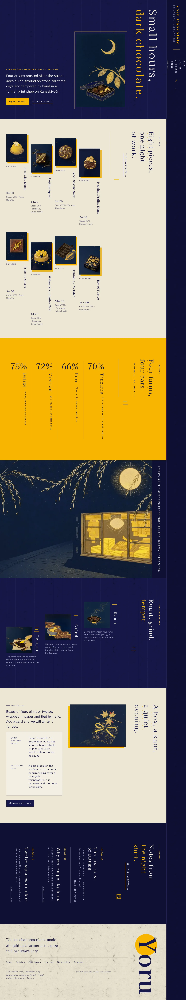
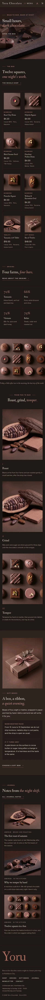

# Yoru Chocolate

A luxe, quiet block theme for a **small bean-to-bar chocolatier** and its online shop. A ShipPress **store** theme: WooCommerce templates styled to match, eight sample products in three categories, and a shop that still works without WooCommerce.

Version 1.0.0.

The demo chocolatier is fictional: Yoru Chocolate, working at night in a former print shop at 3-8 Kanzaki-dōri, Hoshikawa City, founded in 2014 by chocolatier Nao Fujisaki with roaster Ken Arima. Shop hours Wednesday to Sunday, 12:00 – 19:00; closed Monday and Tuesday.

## Concept: night and cacao

- **Palette.** Cocoa `#201816` pages, ganache `#2E2421` panels, cream `#EDE4DA` text and one rose-clay accent `#A36A5A`, kept to rules, numerals and small accents.
- **Type.** Fanwood Text (display, prices, italic accents) and Gantari (text, labels, the origins table).
- **Details as product attributes.** Origin, cacao, pieces or weight and keeping time are attributes of each product; cacao and origin print under every price ("Cacao 70% · Tanzania"), from that one source.

## Header, footer, layout (ROADMAP codes)

- **H3 header.** Fanwood Text wordmark, core navigation, account and mini cart when WooCommerce is active.
- **F1 footer.** The wordmark, the origins table and the shop card (chocolatier, address, hours, telephone, email).
- **L11 home layout.** Bonbons on a dark stone slab; then the idea in one paragraph, a shelf of four bonbons, a grid of twelve, how a bonbon is made, the warm-weather shipping note and the latest journal.

## One source for shared details

| What | Source | Shown on |
| --- | --- | --- |
| Chocolatier, shop address, hours, telephone, email | `inc/info/` shop card (synced pattern) | Footer, Origins, Contact |
| Warm-weather shipping and keeping note | `inc/info/care.html` (synced pattern) | Home, Gift boxes, every product page |
| Origins: Tanzania Kokoa Kamili 70%, Peru Marañón 66%, Vietnam Tiền Giang 72%, Belize Toledo 75% | `inc/info/lines.html` (synced pattern) | Footer, Origins |
| Cacao and origin line | each product's `Cacao` and `Origin` attributes | Product cards and product page |

## Pages and templates

Demo pages: Home, Shop, Origins (the chocolatier and roaster, the four beans, the shop), Gift boxes (the box of twelve, keeping, the shipping season), Journal (posts page), Newsletter and Contact. Six sample posts in three categories (In the kitchen, Beans and roasting, Notes from Kanzaki-dōri) with six tags.

Templates: front page, page, wide page, single post, journal, archive, category, tag, search, 404, plus WooCommerce shop, product category and tag archives, product, cart, checkout, my account, order confirmation and product search.

## WooCommerce

Optional. With it active, `inc/woo-import.php` adds three product categories (Bonbons, Tablets, Gift boxes), five tags (rose, tea, nut, seasonal, gift) and eight products with images, prices and attributes; run twice it creates nothing new. Without it the home shelf and the Shop page show a static shelf that links to Contact, and orders go by email.

## Licence

GPL-2.0-or-later. Fonts OFL-1.1 (see `assets/fonts/`): Fanwood Text and Gantari, shipped as unmodified TTF. Images AI-generated for this theme with Grok Build image_gen, 3D soft render illustration style, released under GPL-2.0-or-later.

<!-- screenshots:start -->
## Screenshots

<table>
<tr>
<td valign="top"></td>
<td valign="top"></td>
</tr>
</table>

- Shop: [desktop](screenshots/shop-desktop.webp) · [mobile](screenshots/shop-mobile.webp)
- Product: [desktop](screenshots/product-desktop.webp) · [mobile](screenshots/product-mobile.webp)
- About: [desktop](screenshots/about-desktop.webp) · [mobile](screenshots/about-mobile.webp)
- Gift boxes: [desktop](screenshots/gift-boxes-desktop.webp) · [mobile](screenshots/gift-boxes-mobile.webp)
- Contact: [desktop](screenshots/contact-desktop.webp) · [mobile](screenshots/contact-mobile.webp)
- News: [desktop](screenshots/news-desktop.webp) · [mobile](screenshots/news-mobile.webp)
- Article: [desktop](screenshots/article-desktop.webp) · [mobile](screenshots/article-mobile.webp)
- Category: [desktop](screenshots/category-desktop.webp) · [mobile](screenshots/category-mobile.webp)
- Tag: [desktop](screenshots/tag-desktop.webp) · [mobile](screenshots/tag-mobile.webp)
- Newsletter: [desktop](screenshots/newsletter-desktop.webp) · [mobile](screenshots/newsletter-mobile.webp)
- Search: [desktop](screenshots/search-desktop.webp) · [mobile](screenshots/search-mobile.webp)
<!-- screenshots:end -->
