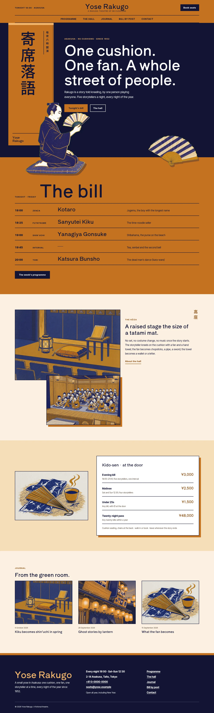
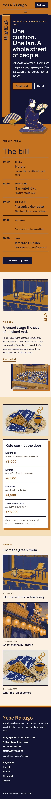

# Yose Rakugo

Yose Rakugo — A rakugo theatre theme set as a typographic poster in kincha golden amber (#C47222), the main colour on the header, the tall vertical banner of the hero, the full-width bill band and every page head, against riso indigo ink (#121433) and programme paper; Shippori Antique B1 display over Inter Tight. The art is risograph raster illustration (two-colour kincha and indigo riso ink with grain and misregistration): a storyteller kneeling on his cushion and an open fan as transparent cut-outs that break out of the banner, the section edges and a card, plus the kōza stage, a laughing audience, the props and the street at dusk. A full top header with the hall name centred, the menu centred beneath it between ink rules, and a Book seats button. Vertical Japanese only on Japanese text; English always runs horizontally. The door prices and the theatre details are synced patterns edited in one place. WCAG AA colours; no entrance animations.

- Design plan row: b3-13 (poster-typographic archetype, vertical-banner hero, centered nav, cut-out break-frame images, risograph illustration, kincha #C47222, Shippori Antique B1 + Inter Tight).
- Header: a full kincha top header with the hall name centred, a Tonight note on the left, the Book seats button on the right and the menu centred beneath between two ink rules.
- Break-frame: the cut-out storyteller kneels across the edge of the tall kincha banner and drops below the hero into the bill band; the cut-out fan breaks over the top edge of the bill band into the hero; on The hall page the fan leaves its kincha card.
- Poster typography: a giant hero line, a giant "The bill" with the night's acts as ruled poster rows, giant page heads.
- Vertical Japanese (banner, page-head labels, spines) is lang="ja"; only CJK text runs vertically, English stays horizontal.
- Synced: door prices (home, Programme) and theatre details (footer, Contact).
- Contrast: riso indigo #121433 on kincha #C47222 4.9:1 (all text on the kincha header, banner, bill band and page heads); white on indigo 17.9:1; lantern glow #F2B66B on indigo 10.0:1; indigo on paper #FBF1E2 16.0:1; burnt kincha #8A4A10 on paper 6.1:1; white on burnt kincha 6.9:1; quiet #5A4636 on paper 7.9:1; white never on kincha (3.6:1).

## Templates
front-page, home, index, page, page-wide, single, archive, category, tag, search, 404.

## Patterns
home-hero, home-bill, home-hall, home-rates, home-journal, programme-head, programme-main, about-head, about-main, newsletter-head, newsletter-signup, contact-head, contact-main, prices, details-card, not-found.

<!-- screenshots:start -->
## Screenshots

<table>
<tr>
<td valign="top"></td>
<td valign="top"></td>
</tr>
</table>

- Programme: [desktop](screenshots/programme-desktop.webp) · [mobile](screenshots/programme-mobile.webp)
- About: [desktop](screenshots/about-desktop.webp) · [mobile](screenshots/about-mobile.webp)
- News: [desktop](screenshots/news-desktop.webp) · [mobile](screenshots/news-mobile.webp)
- Article: [desktop](screenshots/article-desktop.webp) · [mobile](screenshots/article-mobile.webp)
- Category: [desktop](screenshots/category-desktop.webp) · [mobile](screenshots/category-mobile.webp)
- Tag: [desktop](screenshots/tag-desktop.webp) · [mobile](screenshots/tag-mobile.webp)
- Newsletter: [desktop](screenshots/newsletter-desktop.webp) · [mobile](screenshots/newsletter-mobile.webp)
- Contact: [desktop](screenshots/contact-desktop.webp) · [mobile](screenshots/contact-mobile.webp)
- Search: [desktop](screenshots/search-desktop.webp) · [mobile](screenshots/search-mobile.webp)
<!-- screenshots:end -->
