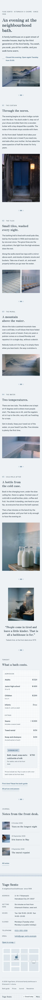

# Yuge Sento

A serene, airy hospitality theme for a **family-run neighbourhood bathhouse** (sento).

*Yuge* is the steam over the water. The demo bathhouse is a fictional public bath in Kitamachi 3-chome, a quiet district of wooden houses in the fictional Hamakaze City, open since 1958 and kept by the third generation of the Arai family: Tadashi at the front desk since 1979, his son Kenta at the boiler. Evenings only, closed on Mondays. It is a hospitality theme, not a shop: no WooCommerce templates or products.

## Concept: an evening at the bath, in one column

- **Palette.** Pale tile `#EEF2F5` ground, misty blue `#C9D6E0` panels, blue ink `#22323F` text (11.7:1 on tile, 8.9:1 on misty). Deep blue `#2E5470` for links, buttons and the open chip (7.1:1 / 5.4:1); quiet slate `#4A5A66` for secondary text (6.3:1 / 4.8:1); foam `#F7F9FB` for the price card and the street plan. Slate blue `#5F7F96` (3.8:1 on tile) appears only in large numerals, rules and marks.
- **Type.** Zen Antique Soft (wordmark, headings, numerals, prices) over Be Vietnam Pro (text, bar, labels). Both OFL-1.1 without a Reserved Font Name, subset to Latin WOFF2 (19 KB display; 21-22 KB per text weight).
- **Motif: bath tile.** A very faint grout-line grid (two repeating linear gradients) on the bottom bar, the price card and the menu; a small three-tile mark as the divider between chapters; a tiled waterline (two rows of small tiles, the lower one a deeper misty blue) above the footer. No steam or tatami motif, no noren header, no hand-drawn illustration, no entrance animations.

## Header, footer, layout (ROADMAP codes)

- **H7 bottom-docked bar**: a slim pale-tile bar fixed to the bottom of the screen with a hairline top border and the faint tile texture: the wordmark at left, the core Navigation (Home, An evening, Bath guide, Prices, Journal, Visit) in the middle, and at right today's hours with an "Open now / Closed · opens 15:00 / Closed today" chip computed on the server from the WordPress timezone. The body gets bottom padding equal to the bar, so it never covers content. Below 960 px: wordmark, chip and a "Menu" button opening a full-screen tile menu read from the bottom up.
- **F6 map + address card**: a quiet street plan (inline SVG: grey-blue blocks, the railway, the station and a dotted walk to the bathhouse marked by a small steaming chimney in slate blue) beside the address card (address, getting here, hours, closed day, telephone, email, "Open in a map"), then a slim colophon. Stacks at 390 px with the card first.
- **L7 single-column long read**: one centred reading column (640 px) with photographs stepping out to 1120 px: the opening (headline, lead, this evening's hours, the bathing hall), five numbered chapters (the curtain, the tiles, the mural, the water, cold milk after), a word from the keeper, tonight's prices and three journal notes.

## One source for shared details

- **Appearance > Bath details** (`inc/bath-info.php`): hours per weekday, closed day, address, station, phone, email; read by the `yuge-sento/bath-info` block in the bar, the home opening line, the footer card, Prices and Visit.
- **Prices** synced pattern (`inc/shared-info.php`, `inc/info/prices.html`): Home, Prices, Bath guide (compact), with the editable "Evening set" badge.
- The demo import (`inc/demo-import.php`) is idempotent and never overwrites user content.

## Pages and templates

Home; An evening (the family, the boiler, the mural and its painter, the garden bench); Bath guide (five customs as a numbered list, what to bring, prices briefly); Prices (price card, the week's hours, passes, bring your own); Journal (posts page); Newsletter; Visit (the week, the address card and a message form that composes an email, no backend); article, category, tag, search and 404 templates. Six journal posts in three categories (Seasonal baths, The house, Neighbourhood) with six tags.

## Licence

GPL-2.0-or-later. Fonts OFL-1.1 (see `assets/fonts/`). Photographs AI-generated for this theme, released under GPL-2.0-or-later / CC0. The bathhouse, family, painter, district, city, address, phone numbers and prices are fictional.

<!-- screenshots:start -->
## Screenshots

<table>
<tr>
<td valign="top"></td>
<td valign="top"></td>
</tr>
</table>

- About: [desktop](screenshots/about-desktop.webp) · [mobile](screenshots/about-mobile.webp)
- Bath guide: [desktop](screenshots/bath-guide-desktop.webp) · [mobile](screenshots/bath-guide-mobile.webp)
- Fees: [desktop](screenshots/fees-desktop.webp) · [mobile](screenshots/fees-mobile.webp)
- Contact: [desktop](screenshots/contact-desktop.webp) · [mobile](screenshots/contact-mobile.webp)
- News: [desktop](screenshots/news-desktop.webp) · [mobile](screenshots/news-mobile.webp)
- Article: [desktop](screenshots/article-desktop.webp) · [mobile](screenshots/article-mobile.webp)
- Category: [desktop](screenshots/category-desktop.webp) · [mobile](screenshots/category-mobile.webp)
- Tag: [desktop](screenshots/tag-desktop.webp) · [mobile](screenshots/tag-mobile.webp)
- Newsletter: [desktop](screenshots/newsletter-desktop.webp) · [mobile](screenshots/newsletter-mobile.webp)
- Search: [desktop](screenshots/search-desktop.webp) · [mobile](screenshots/search-mobile.webp)
<!-- screenshots:end -->
