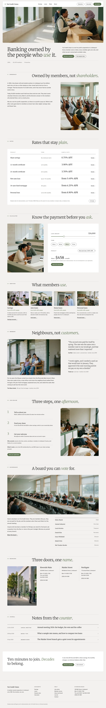

# Yui Credit Union

A WordPress block theme (type business) for a member-owned credit union. Home page (English) reviewed and polished in stage 2; inner pages and languages follow.

- Signature techniques: floating pill header bar, ruled ledger heads, uniform pickup row (see brand.md and brand/design-spec.md).
- Patterns: `patterns/front-*.php` (11 home sections). Demo content: `demo-content.json`, imported on activation by `inc/demo-import.php`.
- Calculator: static default result in the markup, `assets/js/calc.js` makes it live.
- Fonts: Merriweather and Public Sans (OFL, Latin subset woff2 in `assets/fonts`).
- Photographs: `assets/images/*.webp`, 12 photographs generated for this theme (hero is 2000 px wide); no readable text, logos or banknotes.
- Services row links: Savings → `/savings/`, auto, home and personal loans → `/loans/#auto`, `#home`, `#personal`.
- Header navigation targets (`/savings/`, `/loans/`, `/rates/`, `/about/`, `/branches/`, `/calculator/`, `/membership/`) are created with the inner pages.

<!-- screenshots:start -->
## Screenshots

<table>
<tr>
<td valign="top"></td>
<td valign="top"></td>
</tr>
</table>

- Savings: [desktop](screenshots/savings-desktop.webp) · [mobile](screenshots/savings-mobile.webp)
- Loans: [desktop](screenshots/loans-desktop.webp) · [mobile](screenshots/loans-mobile.webp)
- Rates: [desktop](screenshots/rates-desktop.webp) · [mobile](screenshots/rates-mobile.webp)
- Calculator: [desktop](screenshots/calculator-desktop.webp) · [mobile](screenshots/calculator-mobile.webp)
- Membership: [desktop](screenshots/membership-desktop.webp) · [mobile](screenshots/membership-mobile.webp)
- Stories: [desktop](screenshots/stories-desktop.webp) · [mobile](screenshots/stories-mobile.webp)
- About: [desktop](screenshots/about-desktop.webp) · [mobile](screenshots/about-mobile.webp)
- Branches: [desktop](screenshots/branches-desktop.webp) · [mobile](screenshots/branches-mobile.webp)
- Contact: [desktop](screenshots/contact-desktop.webp) · [mobile](screenshots/contact-mobile.webp)
- Journal: [desktop](screenshots/journal-desktop.webp) · [mobile](screenshots/journal-mobile.webp)
- News: [desktop](screenshots/news-desktop.webp) · [mobile](screenshots/news-mobile.webp)
- Article: [desktop](screenshots/article-desktop.webp) · [mobile](screenshots/article-mobile.webp)
- Category: [desktop](screenshots/category-desktop.webp) · [mobile](screenshots/category-mobile.webp)
- Tag: [desktop](screenshots/tag-desktop.webp) · [mobile](screenshots/tag-mobile.webp)
- Newsletter: [desktop](screenshots/newsletter-desktop.webp) · [mobile](screenshots/newsletter-mobile.webp)
- Other languages (home page): [zh-TW](screenshots/zh-TW/home-desktop.webp) · [ja](screenshots/ja/home-desktop.webp) · [fr](screenshots/fr/home-desktop.webp) · [de](screenshots/de/home-desktop.webp)
<!-- screenshots:end -->
