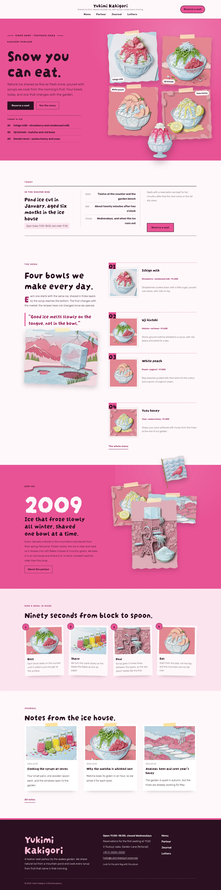

# Yukimi Kakigori

Yukimi Kakigori — a kakigori shaved-ice parlour theme built on sticky media: on wide screens the picture column holds still while the text column scrolls past it (the menu, the four bowl rows, the story band and the parlour page). A formal top header, centred: the parlour name and tagline in the middle of the first row, the menu centred on the second row and the Reserve a seat button at the right end; an overlay menu on phones and tablets. Tsutsuji azalea pink (#E95295) is the main colour: the hero, the story band, every page head and the overlay menu are solid pink fields set in plum-black ink. The hero is a product grid: the title, lead, buttons and today's ice on the left, four paper-cut bowls as a taped, slightly tilted 2 x 2 collage on the right, and a cut-out bowl of strawberry ice (transparent WebP) standing in front of the grid and breaking over the hero bottom edge; a cut-out plover flag breaks over the story band and every page head. Every picture is a layered paper-cut illustration in a torn, taped paper collage. Darumadrop One for display, Rubik for reading, Noto Sans TC for Traditional Chinese headings. Sample content in English, Traditional Chinese, Japanese, French and German; vertical labels only in Chinese and Japanese. WCAG AA colours; no entrance animations.

- Design plan row b4-8: sticky-media, product-grid-hero, centered nav, collage, paper-cut, tsutsuji #E95295, Darumadrop One + Rubik.
- Sample content languages: en, zh-TW, ja, fr, de.
- Contrast: ink #2A1020 on tsutsuji #E95295 5.1:1 (all text on the hero, the story band, every page head, the overlay menu and the pink buttons); ink on paper #FFF8FB 16.8:1 and on mist #FCE4EE 14.6:1; deep azalea #A3245F on paper 6.8:1 and on mist 5.9:1 (links, labels, eyebrows, pull quote); plum grey #6A4A5A on paper 7.3:1 and on mist 6.4:1 (secondary text); paper on ink 16.8:1 and pale azalea #F7B8D2 on ink 10.7:1 (footer); paper on tsutsuji 3.3:1 only for the giant opening year (large text); tsutsuji on paper 3.3:1 only for rules, tape and number badges, never for text.
- Break-frame: the cut-out bowl of strawberry ice (transparent WebP) stands in front of the paper-cut product grid and breaks over the hero bottom edge; the cut-out plover flag breaks over the top edge of the story band and the bottom edge of every page head.

<!-- screenshots:start -->
## Screenshots

<table>
<tr>
<td valign="top"></td>
<td valign="top"></td>
</tr>
</table>

- Projects: [desktop](screenshots/projects-desktop.webp) · [mobile](screenshots/projects-mobile.webp)
- About: [desktop](screenshots/about-desktop.webp) · [mobile](screenshots/about-mobile.webp)
- News: [desktop](screenshots/news-desktop.webp) · [mobile](screenshots/news-mobile.webp)
- Article: [desktop](screenshots/article-desktop.webp) · [mobile](screenshots/article-mobile.webp)
- Category: [desktop](screenshots/category-desktop.webp) · [mobile](screenshots/category-mobile.webp)
- Tag: [desktop](screenshots/tag-desktop.webp) · [mobile](screenshots/tag-mobile.webp)
- Newsletter: [desktop](screenshots/newsletter-desktop.webp) · [mobile](screenshots/newsletter-mobile.webp)
- Contact: [desktop](screenshots/contact-desktop.webp) · [mobile](screenshots/contact-mobile.webp)
- Search: [desktop](screenshots/search-desktop.webp) · [mobile](screenshots/search-mobile.webp)
- Other languages (home page): [zh-TW](screenshots/zh-TW/home-desktop.webp) · [ja](screenshots/ja/home-desktop.webp) · [fr](screenshots/fr/home-desktop.webp) · [de](screenshots/de/home-desktop.webp)
<!-- screenshots:end -->
